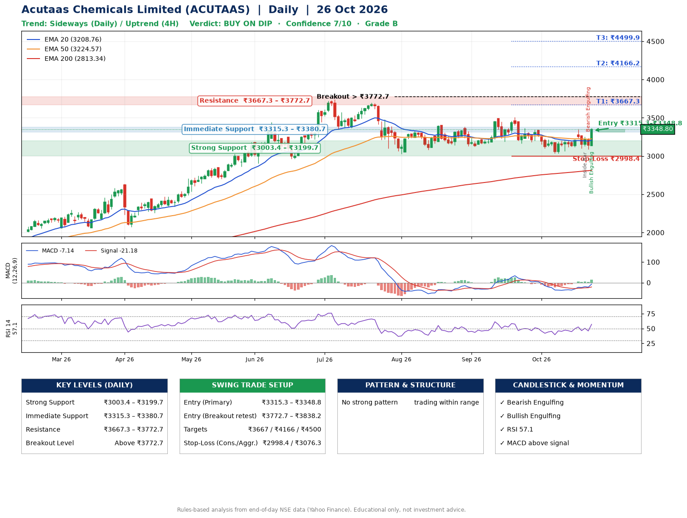

📌 **Acutaas Chemicals Limited (ACUTAAS) – Multi-Timeframe Technical Analysis (Daily + 4H Combined)**
_Data up to 26 Oct 2026 · Close ₹3348.80_

**📍 Daily Timeframe Trend**
- Trend: **Sideways** (mixed swing structure)
- Recent swing highs: ₹3399.8, ₹3384.0, ₹3509.9 · swing lows: ₹3120.0, ₹3167.0, ₹3031.1
- EMAs: EMA20 ₹3208.8, EMA50 ₹3224.6, EMA200 ₹2813.3; mixed / crossing; price above EMA20, EMA50, EMA200
- MACD -7.14 above signal -21.18 (below zero), fresh bullish crossover; histogram rising
- RSI(14) 57.1; no divergence on the last two swings

**📍 4-Hour Timeframe Trend**
- Structure: **Uptrend** (price above rising EMAs)
- Pullback/support area: recent 4H swing lows ₹3120.2, ₹3085.0; EMA20 ₹3204.8
- EMA20/50: bearish stack (EMA20 < EMA50); price above EMA20, EMA50
- MACD 18.25 above signal 0.54 (above zero); histogram rising
- RSI(14) 60.7; no divergence

**📍 Pattern Detection (Both Timeframes)**
- No strong pattern detected. Trading within range.

**📍 Candlestick Patterns (last 3 daily candles)**
- **Inside Bar** – 22 Oct: compression inside the prior range ₹3100.0–₹3269.8
- **Bearish Engulfing** – 23 Oct: sellers fully reversed the prior green candle
- **Bullish Engulfing** – 26 Oct: buyers fully reversed the prior red candle

**📍 Price Action Key Levels (Daily Structure)**

| Zone | Price Level (₹) | Context |
|------|-----------------|---------|
| Strong Support | ₹3003.4 – ₹3199.7 | Cluster of earlier swing lows (demand) |
| Immediate Support | ₹3315.3 – ₹3380.7 | Nearest swing-low / wick area |
| Resistance | ₹3667.3 – ₹3772.7 | Nearest swing-high supply |
| Breakout Level | Above ₹3772.7 | Swing continuation trigger (52-week high ₹3740.0) |

**📍 Swing Trade Setup**

🟢 **Entry Zone**
- Primary: ₹3315.3 – ₹3348.8 (daily support / EMA20 area; enter on a bullish 4H candle)
- Alternate: ₹3772.7 – ₹3838.2 (breakout retest)

🎯 **Profit Targets**
- T1: ₹3667.3
- T2: ₹4166.2
- T3: ₹4499.9

🛑 **Stop-Loss**
- Conservative: below daily swing low (₹2998.4)
- Aggressive: below 4H structure (₹3076.3)
- Risk per share ≈ ₹333.7; reward:risk to T1 ≈ 1.0

**📌 Strategy Notes**
- Higher timeframe: daily trend is sideways; only take longs while price holds above ₹3003.4.
- Entry timing: wait for a bullish 4H candle (engulfing/hammer) inside ₹3315.3 – ₹3348.8 rather than buying mid-range.
- EMA stacking: mixed / crossing; price above EMA20, EMA50, EMA200.
- Breakout rule: a daily close above ₹3772.7 with volume above its 20-day average (≈390,183) opens T2/T3.
- Momentum: RSI 57 – room to run; no divergence on the last two swings.
- Exit discipline: move the stop to entry once T1 is hit; book partial profits at each target.

**STEP 2 — Marked Up Chart**

**✅ Trade Validation Checklist**
- Trend + momentum aligned: No · Price at entry zone: Yes
- Stop defined (₹2998.4) · Reward:risk ≥ 1.5 to T1: No

## 📌 Final Verdict

Recommendation: **🟡 BUY ON DIP**

Confidence: **7/10**

Trade Quality: **B**

Reason:
• No strong edge from trend, momentum or patterns

Next Action:
• Wait for a pullback to ₹3315.3–₹3348.8, or a breakout above ₹3772.7

_Rules-based analysis from end-of-day data. Educational only, not investment advice. Never place orders without your own confirmation._