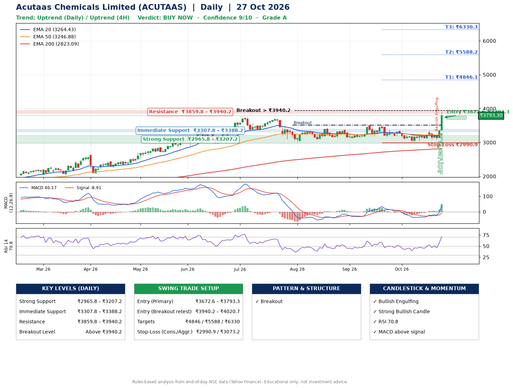

📌 **Acutaas Chemicals Limited (ACUTAAS) – Multi-Timeframe Technical Analysis (Daily + 4H Combined)**
_Data up to 27 Oct 2026 · Close ₹3793.30_

**📍 Daily Timeframe Trend**
- Trend: **Uptrend** (price above rising EMAs)
- Recent swing highs: ₹3399.8, ₹3384.0, ₹3509.9 · swing lows: ₹3120.0, ₹3167.0, ₹3031.1
- EMAs: EMA20 ₹3264.4, EMA50 ₹3246.9, EMA200 ₹2823.1; bullish stack (EMA20 > EMA50 > EMA200); price above EMA20, EMA50, EMA200
- MACD 40.17 above signal -8.91 (above zero); histogram rising
- RSI(14) 70.8; no divergence on the last two swings

**📍 4-Hour Timeframe Trend**
- Structure: **Uptrend** (price above rising EMAs)
- Pullback/support area: recent 4H swing lows ₹3120.2, ₹3085.0; EMA20 ₹3307.4
- EMA20/50: bullish stack (EMA20 > EMA50); price above EMA20, EMA50
- MACD 93.78 above signal 28.48 (above zero); histogram rising
- RSI(14) 76.2; no divergence

**📍 Pattern Detection (Both Timeframes)**
- Daily: **Breakout** – closed above the 60-session high ₹3509.9 on strong volume

**📍 Candlestick Patterns (last 3 daily candles)**
- **Bearish Engulfing** – 23 Oct: sellers fully reversed the prior green candle
- **Bullish Engulfing** – 26 Oct: buyers fully reversed the prior red candle
- **Strong Bullish Candle** – 27 Oct: wide-range green candle, buyers in control

**📍 Price Action Key Levels (Daily Structure)**

| Zone | Price Level (₹) | Context |
|------|-----------------|---------|
| Strong Support | ₹2965.8 – ₹3207.2 | Cluster of earlier swing lows (demand) |
| Immediate Support | ₹3307.8 – ₹3388.2 | Nearest swing-low / wick area |
| Resistance | ₹3859.8 – ₹3940.2 | Nearest swing-high supply |
| Breakout Level | Above ₹3940.2 | Swing continuation trigger (52-week high ₹3900.0) |

**📍 Swing Trade Setup**

🟢 **Entry Zone**
- Primary: ₹3672.6 – ₹3793.3 (daily support / EMA20 area; enter on a bullish 4H candle)
- Alternate: ₹3940.2 – ₹4020.7 (breakout retest)

🎯 **Profit Targets**
- T1: ₹4846.1
- T2: ₹5588.2
- T3: ₹6330.3

🛑 **Stop-Loss**
- Conservative: below daily swing low (₹2990.9)
- Aggressive: below 4H structure (₹3073.2)
- Risk per share ≈ ₹742.1; reward:risk to T1 ≈ 1.5

**📌 Strategy Notes**
- Higher timeframe: daily trend is uptrend; only take longs while price holds above ₹2965.8.
- Entry timing: wait for a bullish 4H candle (engulfing/hammer) inside ₹3672.6 – ₹3793.3 rather than buying mid-range.
- EMA stacking: bullish stack (EMA20 > EMA50 > EMA200); price above EMA20, EMA50, EMA200.
- Breakout rule: a daily close above ₹3940.2 with volume above its 20-day average (≈619,833) opens T2/T3.
- Momentum: RSI 71 – elevated, prefer dips; no divergence on the last two swings.
- Exit discipline: move the stop to entry once T1 is hit; book partial profits at each target.

**STEP 2 — Marked Up Chart**

**✅ Trade Validation Checklist**
- Trend + momentum aligned: Yes · Price at entry zone: Yes
- Stop defined (₹2990.9) · Reward:risk ≥ 1.5 to T1: Yes

## 📌 Final Verdict

Recommendation: **🟢 BUY NOW**

Confidence: **9/10**

Trade Quality: **A**

Reason:
• Daily uptrend (price above rising EMAs)
• EMAs stacked bullishly

Next Action:
• Buy now within the entry zone, with the stop-loss in place

_Rules-based analysis from end-of-day data. Educational only, not investment advice. Never place orders without your own confirmation._