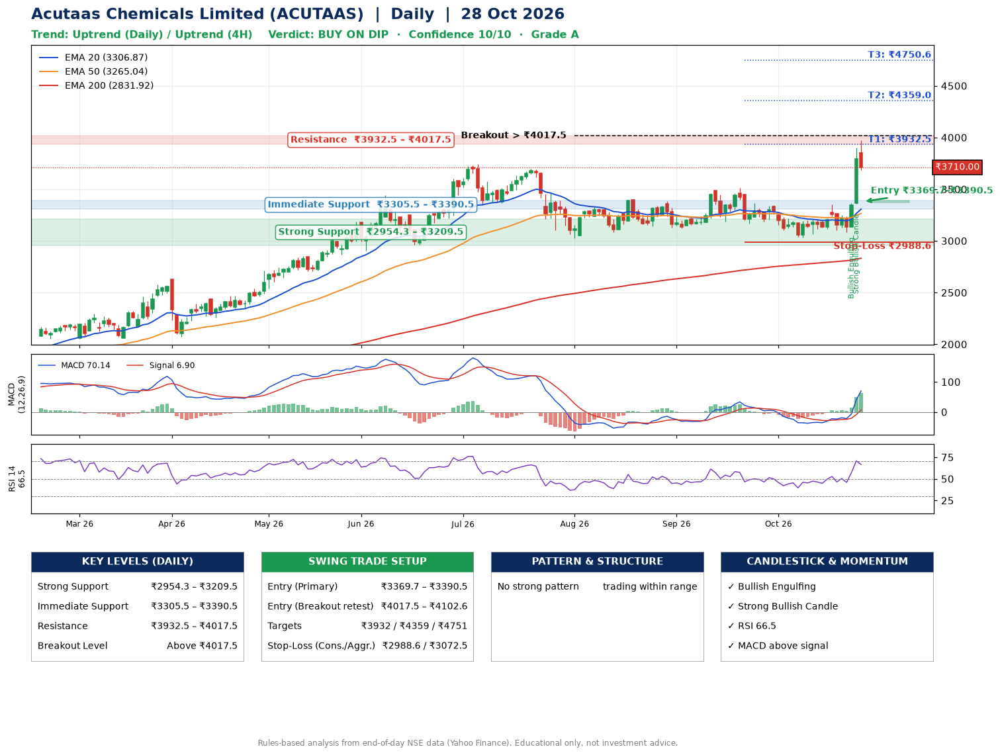

📌 **Acutaas Chemicals Limited (ACUTAAS) – Multi-Timeframe Technical Analysis (Daily + 4H Combined)**
_Data up to 28 Oct 2026 · Close ₹3710.00_

**📍 Daily Timeframe Trend**
- Trend: **Uptrend** (price above rising EMAs)
- Recent swing highs: ₹3399.8, ₹3384.0, ₹3509.9 · swing lows: ₹3120.0, ₹3167.0, ₹3031.1
- EMAs: EMA20 ₹3306.9, EMA50 ₹3265.0, EMA200 ₹2831.9; bullish stack (EMA20 > EMA50 > EMA200); price above EMA20, EMA50, EMA200
- MACD 70.14 above signal 6.90 (above zero); histogram rising
- RSI(14) 66.5; no divergence on the last two swings

**📍 4-Hour Timeframe Trend**
- Structure: **Uptrend** (price above rising EMAs)
- Pullback/support area: recent 4H swing lows ₹3120.2, ₹3085.0; EMA20 ₹3381.9
- EMA20/50: bullish stack (EMA20 > EMA50); price above EMA20, EMA50
- MACD 128.59 above signal 62.31 (above zero); histogram falling
- RSI(14) 70.0; no divergence

**📍 Pattern Detection (Both Timeframes)**
- No strong pattern detected. Trading within range.

**📍 Candlestick Patterns (last 3 daily candles)**
- **Bullish Engulfing** – 26 Oct: buyers fully reversed the prior red candle
- **Strong Bullish Candle** – 27 Oct: wide-range green candle, buyers in control

**📍 Price Action Key Levels (Daily Structure)**

| Zone | Price Level (₹) | Context |
|------|-----------------|---------|
| Strong Support | ₹2954.3 – ₹3209.5 | Cluster of earlier swing lows (demand) |
| Immediate Support | ₹3305.5 – ₹3390.5 | Nearest swing-low / wick area |
| Resistance | ₹3932.5 – ₹4017.5 | Nearest swing-high supply |
| Breakout Level | Above ₹4017.5 | Swing continuation trigger (52-week high ₹3975.0) |

**📍 Swing Trade Setup**

🟢 **Entry Zone**
- Primary: ₹3369.7 – ₹3390.5 (daily support / EMA20 area; enter on a bullish 4H candle)
- Alternate: ₹4017.5 – ₹4102.6 (breakout retest)

🎯 **Profit Targets**
- T1: ₹3932.5
- T2: ₹4359.0
- T3: ₹4750.6

🛑 **Stop-Loss**
- Conservative: below daily swing low (₹2988.6)
- Aggressive: below 4H structure (₹3072.5)
- Risk per share ≈ ₹391.6; reward:risk to T1 ≈ 1.4

**📌 Strategy Notes**
- Higher timeframe: daily trend is uptrend; only take longs while price holds above ₹2954.3.
- Entry timing: wait for a bullish 4H candle (engulfing/hammer) inside ₹3369.7 – ₹3390.5 rather than buying mid-range.
- EMA stacking: bullish stack (EMA20 > EMA50 > EMA200); price above EMA20, EMA50, EMA200.
- Breakout rule: a daily close above ₹4017.5 with volume above its 20-day average (≈723,317) opens T2/T3.
- Momentum: RSI 67 – elevated, prefer dips; no divergence on the last two swings.
- Exit discipline: move the stop to entry once T1 is hit; book partial profits at each target.

**STEP 2 — Marked Up Chart**

**✅ Trade Validation Checklist**
- Trend + momentum aligned: Yes · Price at entry zone: No
- Stop defined (₹2988.6) · Reward:risk ≥ 1.5 to T1: No

## 📌 Final Verdict

Recommendation: **🟡 BUY ON DIP**

Confidence: **10/10**

Trade Quality: **A**

Reason:
• Daily uptrend (price above rising EMAs)
• EMAs stacked bullishly

Next Action:
• Wait for a pullback to ₹3369.7–₹3390.5

_Rules-based analysis from end-of-day data. Educational only, not investment advice. Never place orders without your own confirmation._