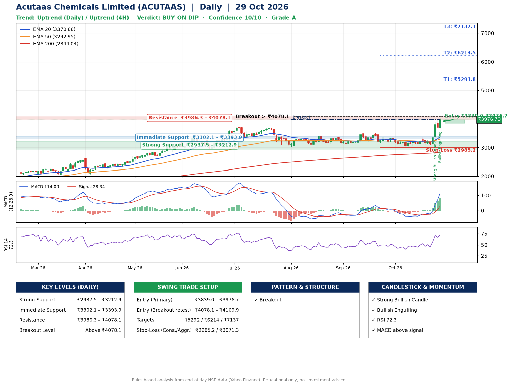

📌 **Acutaas Chemicals Limited (ACUTAAS) – Multi-Timeframe Technical Analysis (Daily + 4H Combined)**
_Data up to 29 Oct 2026 · Close ₹3976.70_

**📍 Daily Timeframe Trend**
- Trend: **Uptrend** (price above rising EMAs)
- Recent swing highs: ₹3399.8, ₹3384.0, ₹3509.9 · swing lows: ₹3120.0, ₹3167.0, ₹3031.1
- EMAs: EMA20 ₹3370.7, EMA50 ₹3292.9, EMA200 ₹2844.0; bullish stack (EMA20 > EMA50 > EMA200); price above EMA20, EMA50, EMA200
- MACD 114.09 above signal 28.34 (above zero); histogram rising
- RSI(14) 72.3; no divergence on the last two swings

**📍 4-Hour Timeframe Trend**
- Structure: **Uptrend** (price above rising EMAs)
- Pullback/support area: recent 4H swing lows ₹3120.2, ₹3085.0; EMA20 ₹3490.7
- EMA20/50: bullish stack (EMA20 > EMA50); price above EMA20, EMA50
- MACD 181.99 above signal 101.87 (above zero); histogram rising
- RSI(14) 76.2; no divergence

**📍 Pattern Detection (Both Timeframes)**
- Daily: **Breakout** – closed above the 60-session high ₹3975.0 on strong volume

**📍 Candlestick Patterns (last 3 daily candles)**
- **Strong Bullish Candle** – 27 Oct: wide-range green candle, buyers in control
- **Bullish Engulfing** – 29 Oct: buyers fully reversed the prior red candle

**📍 Price Action Key Levels (Daily Structure)**

| Zone | Price Level (₹) | Context |
|------|-----------------|---------|
| Strong Support | ₹2937.5 – ₹3212.9 | Cluster of earlier swing lows (demand) |
| Immediate Support | ₹3302.1 – ₹3393.9 | Nearest swing-low / wick area |
| Resistance | ₹3986.3 – ₹4078.1 | Nearest swing-high supply |
| Breakout Level | Above ₹4078.1 | Swing continuation trigger (52-week high ₹4032.2) |

**📍 Swing Trade Setup**

🟢 **Entry Zone**
- Primary: ₹3839.0 – ₹3976.7 (daily support / EMA20 area; enter on a bullish 4H candle)
- Alternate: ₹4078.1 – ₹4169.9 (breakout retest)

🎯 **Profit Targets**
- T1: ₹5291.8
- T2: ₹6214.5
- T3: ₹7137.1

🛑 **Stop-Loss**
- Conservative: below daily swing low (₹2985.2)
- Aggressive: below 4H structure (₹3071.3)
- Risk per share ≈ ₹922.6; reward:risk to T1 ≈ 1.5

**📌 Strategy Notes**
- Higher timeframe: daily trend is uptrend; only take longs while price holds above ₹2937.5.
- Entry timing: wait for a bullish 4H candle (engulfing/hammer) inside ₹3839.0 – ₹3976.7 rather than buying mid-range.
- EMA stacking: bullish stack (EMA20 > EMA50 > EMA200); price above EMA20, EMA50, EMA200.
- Breakout rule: a daily close above ₹4078.1 with volume above its 20-day average (≈820,164) opens T2/T3.
- Momentum: RSI 72 – elevated, prefer dips; no divergence on the last two swings.
- Exit discipline: move the stop to entry once T1 is hit; book partial profits at each target.

**STEP 2 — Marked Up Chart**

**✅ Trade Validation Checklist**
- Trend + momentum aligned: Yes · Price at entry zone: Yes
- Stop defined (₹2985.2) · Reward:risk ≥ 1.5 to T1: No

## 📌 Final Verdict

Recommendation: **🟡 BUY ON DIP**

Confidence: **10/10**

Trade Quality: **A**

Reason:
• Daily uptrend (price above rising EMAs)
• EMAs stacked bullishly

Next Action:
• Wait for a pullback to ₹3839.0–₹3976.7, or a breakout above ₹4078.1

_Rules-based analysis from end-of-day data. Educational only, not investment advice. Never place orders without your own confirmation._