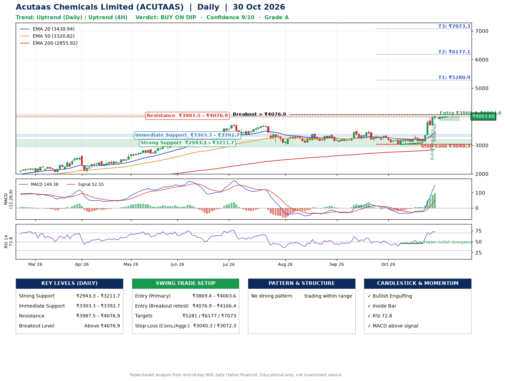

📌 **Acutaas Chemicals Limited (ACUTAAS) – Multi-Timeframe Technical Analysis (Daily + 4H Combined)**
_Data up to 30 Oct 2026 · Close ₹4003.60_

**📍 Daily Timeframe Trend**
- Trend: **Uptrend** (higher highs and higher lows)
- Recent swing highs: ₹3399.8, ₹3384.0, ₹3509.9 · swing lows: ₹3167.0, ₹3031.1, ₹3085.0
- EMAs: EMA20 ₹3430.9, EMA50 ₹3320.8, EMA200 ₹2855.9; bullish stack (EMA20 > EMA50 > EMA200); price above EMA20, EMA50, EMA200
- MACD 149.38 above signal 52.55 (above zero); histogram rising
- RSI(14) 72.8; Hidden bullish divergence

**📍 4-Hour Timeframe Trend**
- Structure: **Uptrend** (price above rising EMAs)
- Pullback/support area: recent 4H swing lows ₹3120.2, ₹3085.0; EMA20 ₹3583.1
- EMA20/50: bullish stack (EMA20 > EMA50); price above EMA20, EMA50
- MACD 210.11 above signal 139.01 (above zero); histogram falling
- RSI(14) 76.8; no divergence

**📍 Pattern Detection (Both Timeframes)**
- No strong pattern detected. Trading within range.

**📍 Candlestick Patterns (last 3 daily candles)**
- **Bullish Engulfing** – 29 Oct: buyers fully reversed the prior red candle
- **Inside Bar** – 30 Oct: compression inside the prior range ₹3673.3–₹4032.2

**📍 Price Action Key Levels (Daily Structure)**

| Zone | Price Level (₹) | Context |
|------|-----------------|---------|
| Strong Support | ₹2943.3 – ₹3211.7 | Cluster of earlier swing lows (demand) |
| Immediate Support | ₹3303.3 – ₹3392.7 | Nearest swing-low / wick area |
| Resistance | ₹3987.5 – ₹4076.9 | Nearest swing-high supply |
| Breakout Level | Above ₹4076.9 | Swing continuation trigger (52-week high ₹4032.2) |

**📍 Swing Trade Setup**

🟢 **Entry Zone**
- Primary: ₹3869.4 – ₹4003.6 (daily support / EMA20 area; enter on a bullish 4H candle)
- Alternate: ₹4076.9 – ₹4166.4 (breakout retest)

🎯 **Profit Targets**
- T1: ₹5280.9
- T2: ₹6177.1
- T3: ₹7073.3

🛑 **Stop-Loss**
- Conservative: below daily swing low (₹3040.3)
- Aggressive: below 4H structure (₹3072.3)
- Risk per share ≈ ₹896.2; reward:risk to T1 ≈ 1.5

**📌 Strategy Notes**
- Higher timeframe: daily trend is uptrend; only take longs while price holds above ₹2943.3.
- Entry timing: wait for a bullish 4H candle (engulfing/hammer) inside ₹3869.4 – ₹4003.6 rather than buying mid-range.
- EMA stacking: bullish stack (EMA20 > EMA50 > EMA200); price above EMA20, EMA50, EMA200.
- Breakout rule: a daily close above ₹4076.9 with volume above its 20-day average (≈860,095) opens T2/T3.
- Momentum: RSI 73 – elevated, prefer dips; Hidden bullish divergence.
- Exit discipline: move the stop to entry once T1 is hit; book partial profits at each target.

**STEP 2 — Marked Up Chart**

**✅ Trade Validation Checklist**
- Trend + momentum aligned: Yes · Price at entry zone: Yes
- Stop defined (₹3040.3) · Reward:risk ≥ 1.5 to T1: Yes

## 📌 Final Verdict

Recommendation: **🟡 BUY ON DIP**

Confidence: **9/10**

Trade Quality: **A**

Reason:
• Daily uptrend (higher highs and higher lows)
• EMAs stacked bullishly

Next Action:
• Wait for a pullback to ₹3869.4–₹4003.6, or a breakout above ₹4076.9

_Rules-based analysis from end-of-day data. Educational only, not investment advice. Never place orders without your own confirmation._