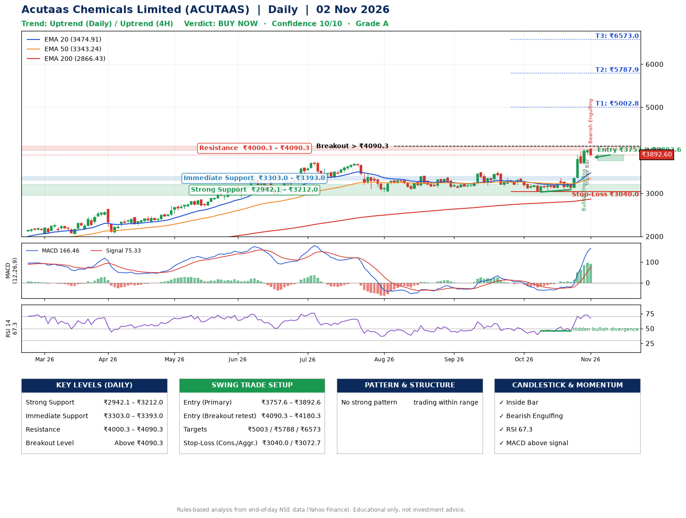

📌 **Acutaas Chemicals Limited (ACUTAAS) – Multi-Timeframe Technical Analysis (Daily + 4H Combined)**
_Data up to 02 Nov 2026 · Close ₹3892.60_

**📍 Daily Timeframe Trend**
- Trend: **Uptrend** (higher highs and higher lows)
- Recent swing highs: ₹3399.8, ₹3384.0, ₹3509.9 · swing lows: ₹3167.0, ₹3031.1, ₹3085.0
- EMAs: EMA20 ₹3474.9, EMA50 ₹3343.2, EMA200 ₹2866.4; bullish stack (EMA20 > EMA50 > EMA200); price above EMA20, EMA50, EMA200
- MACD 166.46 above signal 75.33 (above zero); histogram falling
- RSI(14) 67.3; Hidden bullish divergence

**📍 4-Hour Timeframe Trend**
- Structure: **Uptrend** (price above rising EMAs)
- Pullback/support area: recent 4H swing lows ₹3120.2, ₹3085.0; EMA20 ₹3643.1
- EMA20/50: bullish stack (EMA20 > EMA50); price above EMA20, EMA50
- MACD 206.37 above signal 164.06 (above zero); histogram falling
- RSI(14) 68.4; no divergence

**📍 Pattern Detection (Both Timeframes)**
- No strong pattern detected. Trading within range.

**📍 Candlestick Patterns (last 3 daily candles)**
- **Bullish Engulfing** – 29 Oct: buyers fully reversed the prior red candle
- **Inside Bar** – 30 Oct: compression inside the prior range ₹3673.3–₹4032.2
- **Bearish Engulfing** – 02 Nov: sellers fully reversed the prior green candle

**📍 Price Action Key Levels (Daily Structure)**

| Zone | Price Level (₹) | Context |
|------|-----------------|---------|
| Strong Support | ₹2942.1 – ₹3212.0 | Cluster of earlier swing lows (demand) |
| Immediate Support | ₹3303.0 – ₹3393.0 | Nearest swing-low / wick area |
| Resistance | ₹4000.3 – ₹4090.3 | Nearest swing-high supply |
| Breakout Level | Above ₹4090.3 | Swing continuation trigger (52-week high ₹4045.3) |

**📍 Swing Trade Setup**

🟢 **Entry Zone**
- Primary: ₹3757.6 – ₹3892.6 (daily support / EMA20 area; enter on a bullish 4H candle)
- Alternate: ₹4090.3 – ₹4180.3 (breakout retest)

🎯 **Profit Targets**
- T1: ₹5002.8
- T2: ₹5787.9
- T3: ₹6573.0

🛑 **Stop-Loss**
- Conservative: below daily swing low (₹3040.0)
- Aggressive: below 4H structure (₹3072.7)
- Risk per share ≈ ₹785.1; reward:risk to T1 ≈ 1.5

**📌 Strategy Notes**
- Higher timeframe: daily trend is uptrend; only take longs while price holds above ₹2942.1.
- Entry timing: wait for a bullish 4H candle (engulfing/hammer) inside ₹3757.6 – ₹3892.6 rather than buying mid-range.
- EMA stacking: bullish stack (EMA20 > EMA50 > EMA200); price above EMA20, EMA50, EMA200.
- Breakout rule: a daily close above ₹4090.3 with volume above its 20-day average (≈864,187) opens T2/T3.
- Momentum: RSI 67 – elevated, prefer dips; Hidden bullish divergence.
- Exit discipline: move the stop to entry once T1 is hit; book partial profits at each target.

**STEP 2 — Marked Up Chart**

**✅ Trade Validation Checklist**
- Trend + momentum aligned: Yes · Price at entry zone: Yes
- Stop defined (₹3040.0) · Reward:risk ≥ 1.5 to T1: Yes

## 📌 Final Verdict

Recommendation: **🟢 BUY NOW**

Confidence: **10/10**

Trade Quality: **A**

Reason:
• Daily uptrend (higher highs and higher lows)
• EMAs stacked bullishly

Next Action:
• Buy now within the entry zone, with the stop-loss in place

_Rules-based analysis from end-of-day data. Educational only, not investment advice. Never place orders without your own confirmation._