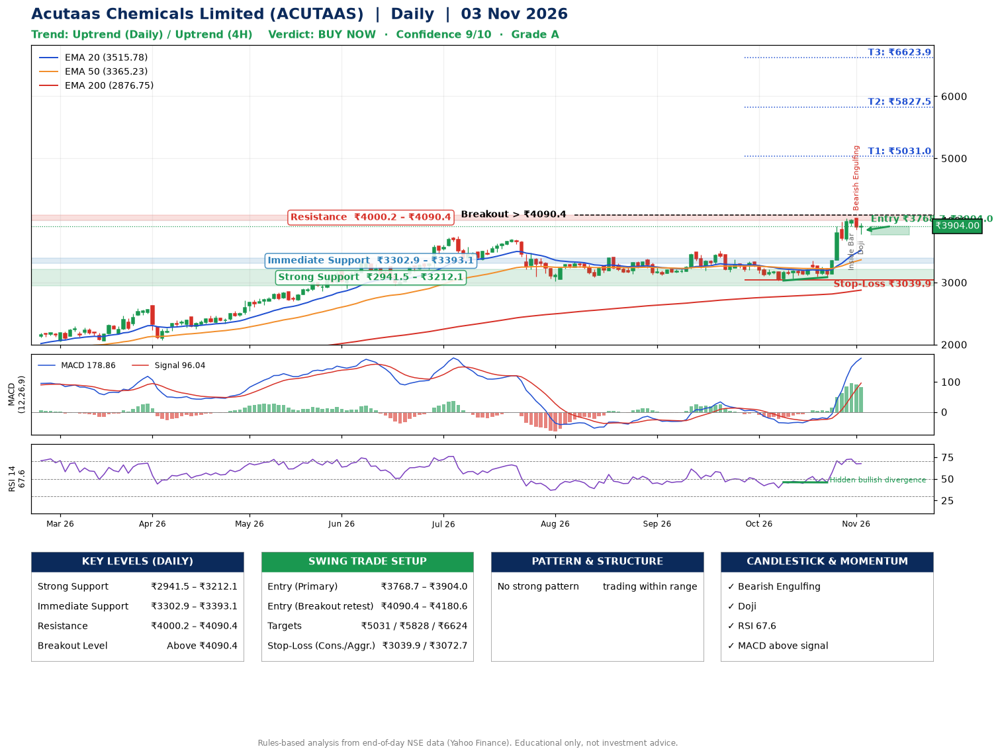

📌 **Acutaas Chemicals Limited (ACUTAAS) – Multi-Timeframe Technical Analysis (Daily + 4H Combined)**
_Data up to 03 Nov 2026 · Close ₹3904.00_

**📍 Daily Timeframe Trend**
- Trend: **Uptrend** (higher highs and higher lows)
- Recent swing highs: ₹3399.8, ₹3384.0, ₹3509.9 · swing lows: ₹3167.0, ₹3031.1, ₹3085.0
- EMAs: EMA20 ₹3515.8, EMA50 ₹3365.2, EMA200 ₹2876.7; bullish stack (EMA20 > EMA50 > EMA200); price above EMA20, EMA50, EMA200
- MACD 178.86 above signal 96.04 (above zero); histogram falling
- RSI(14) 67.6; Hidden bullish divergence

**📍 4-Hour Timeframe Trend**
- Structure: **Uptrend** (price above rising EMAs)
- Pullback/support area: recent 4H swing lows ₹3120.2, ₹3085.0; EMA20 ₹3682.9
- EMA20/50: bullish stack (EMA20 > EMA50); price above EMA20, EMA50
- MACD 189.26 above signal 173.76 (above zero); histogram falling
- RSI(14) 66.7; no divergence

**📍 Pattern Detection (Both Timeframes)**
- No strong pattern detected. Trading within range.

**📍 Candlestick Patterns (last 3 daily candles)**
- **Inside Bar** – 30 Oct: compression inside the prior range ₹3673.3–₹4032.2
- **Bearish Engulfing** – 02 Nov: sellers fully reversed the prior green candle
- **Doji** – 03 Nov: indecision; wait for the next candle to confirm direction

**📍 Price Action Key Levels (Daily Structure)**

| Zone | Price Level (₹) | Context |
|------|-----------------|---------|
| Strong Support | ₹2941.5 – ₹3212.1 | Cluster of earlier swing lows (demand) |
| Immediate Support | ₹3302.9 – ₹3393.1 | Nearest swing-low / wick area |
| Resistance | ₹4000.2 – ₹4090.4 | Nearest swing-high supply |
| Breakout Level | Above ₹4090.4 | Swing continuation trigger (52-week high ₹4045.3) |

**📍 Swing Trade Setup**

🟢 **Entry Zone**
- Primary: ₹3768.7 – ₹3904.0 (daily support / EMA20 area; enter on a bullish 4H candle)
- Alternate: ₹4090.4 – ₹4180.6 (breakout retest)

🎯 **Profit Targets**
- T1: ₹5031.0
- T2: ₹5827.5
- T3: ₹6623.9

🛑 **Stop-Loss**
- Conservative: below daily swing low (₹3039.9)
- Aggressive: below 4H structure (₹3072.7)
- Risk per share ≈ ₹796.4; reward:risk to T1 ≈ 1.5

**📌 Strategy Notes**
- Higher timeframe: daily trend is uptrend; only take longs while price holds above ₹2941.5.
- Entry timing: wait for a bullish 4H candle (engulfing/hammer) inside ₹3768.7 – ₹3904.0 rather than buying mid-range.
- EMA stacking: bullish stack (EMA20 > EMA50 > EMA200); price above EMA20, EMA50, EMA200.
- Breakout rule: a daily close above ₹4090.4 with volume above its 20-day average (≈872,202) opens T2/T3.
- Momentum: RSI 68 – elevated, prefer dips; Hidden bullish divergence.
- Exit discipline: move the stop to entry once T1 is hit; book partial profits at each target.

**STEP 2 — Marked Up Chart**

**✅ Trade Validation Checklist**
- Trend + momentum aligned: Yes · Price at entry zone: Yes
- Stop defined (₹3039.9) · Reward:risk ≥ 1.5 to T1: No

## 📌 Final Verdict

Recommendation: **🟢 BUY NOW**

Confidence: **9/10**

Trade Quality: **A**

Reason:
• Daily uptrend (higher highs and higher lows)
• EMAs stacked bullishly

Next Action:
• Buy now within the entry zone, with the stop-loss in place

_Rules-based analysis from end-of-day data. Educational only, not investment advice. Never place orders without your own confirmation._