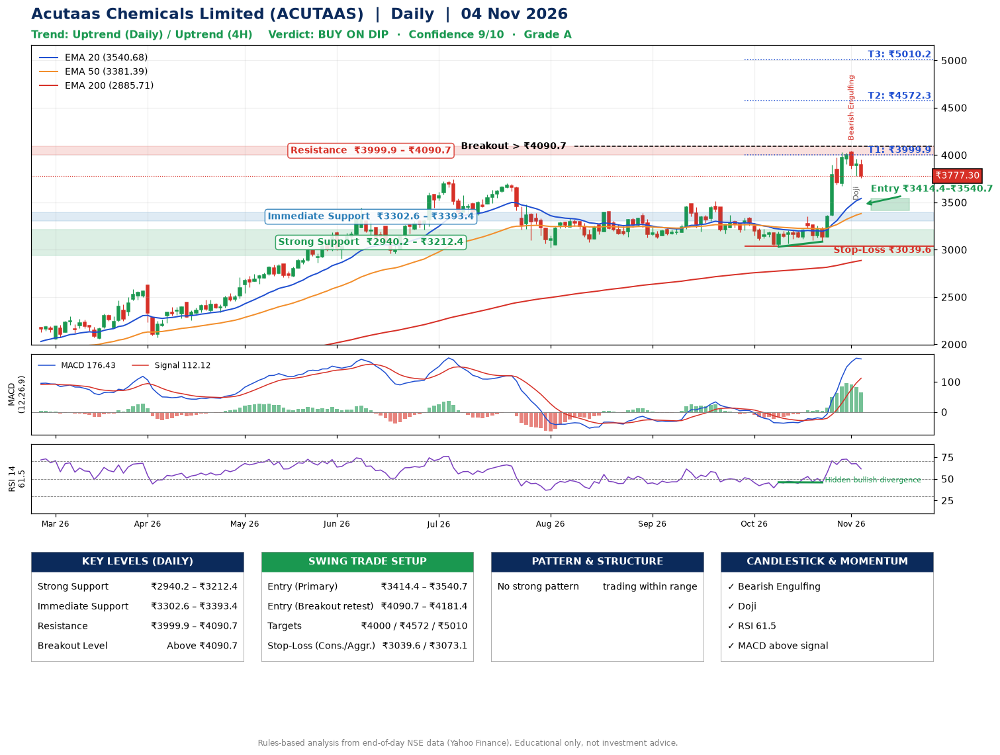

📌 **Acutaas Chemicals Limited (ACUTAAS) – Multi-Timeframe Technical Analysis (Daily + 4H Combined)**
_Data up to 04 Nov 2026 · Close ₹3777.30_

**📍 Daily Timeframe Trend**
- Trend: **Uptrend** (higher highs and higher lows)
- Recent swing highs: ₹3399.8, ₹3384.0, ₹3509.9 · swing lows: ₹3167.0, ₹3031.1, ₹3085.0
- EMAs: EMA20 ₹3540.7, EMA50 ₹3381.4, EMA200 ₹2885.7; bullish stack (EMA20 > EMA50 > EMA200); price above EMA20, EMA50, EMA200
- MACD 176.43 above signal 112.12 (above zero); histogram falling
- RSI(14) 61.5; Hidden bullish divergence

**📍 4-Hour Timeframe Trend**
- Structure: **Uptrend** (price above rising EMAs)
- Pullback/support area: recent 4H swing lows ₹3120.2, ₹3085.0; EMA20 ₹3701.4
- EMA20/50: bullish stack (EMA20 > EMA50); price above EMA20, EMA50
- MACD 159.72 below signal 170.89 (above zero), fresh bearish crossover; histogram falling
- RSI(14) 59.0; no divergence

**📍 Pattern Detection (Both Timeframes)**
- 4H: **Bull Flag** – 28% pole then a tight 7% flag; trigger above ₹4031.9

**📍 Candlestick Patterns (last 3 daily candles)**
- **Bearish Engulfing** – 02 Nov: sellers fully reversed the prior green candle
- **Doji** – 03 Nov: indecision; wait for the next candle to confirm direction

**📍 Price Action Key Levels (Daily Structure)**

| Zone | Price Level (₹) | Context |
|------|-----------------|---------|
| Strong Support | ₹2940.2 – ₹3212.4 | Cluster of earlier swing lows (demand) |
| Immediate Support | ₹3302.6 – ₹3393.4 | Nearest swing-low / wick area |
| Resistance | ₹3999.9 – ₹4090.7 | Nearest swing-high supply |
| Breakout Level | Above ₹4090.7 | Swing continuation trigger (52-week high ₹4045.3) |

**📍 Swing Trade Setup**

🟢 **Entry Zone**
- Primary: ₹3414.4 – ₹3540.7 (daily support / EMA20 area; enter on a bullish 4H candle)
- Alternate: ₹4090.7 – ₹4181.4 (breakout retest)

🎯 **Profit Targets**
- T1: ₹3999.9
- T2: ₹4572.3
- T3: ₹5010.2

🛑 **Stop-Loss**
- Conservative: below daily swing low (₹3039.6)
- Aggressive: below 4H structure (₹3073.1)
- Risk per share ≈ ₹437.9; reward:risk to T1 ≈ 1.2

**📌 Strategy Notes**
- Higher timeframe: daily trend is uptrend; only take longs while price holds above ₹2940.2.
- Entry timing: wait for a bullish 4H candle (engulfing/hammer) inside ₹3414.4 – ₹3540.7 rather than buying mid-range.
- EMA stacking: bullish stack (EMA20 > EMA50 > EMA200); price above EMA20, EMA50, EMA200.
- Breakout rule: a daily close above ₹4090.7 with volume above its 20-day average (≈874,819) opens T2/T3.
- Momentum: RSI 61 – room to run; Hidden bullish divergence.
- Exit discipline: move the stop to entry once T1 is hit; book partial profits at each target.

**STEP 2 — Marked Up Chart**

**✅ Trade Validation Checklist**
- Trend + momentum aligned: Yes · Price at entry zone: No
- Stop defined (₹3039.6) · Reward:risk ≥ 1.5 to T1: No

## 📌 Final Verdict

Recommendation: **🟡 BUY ON DIP**

Confidence: **9/10**

Trade Quality: **A**

Reason:
• Daily uptrend (higher highs and higher lows)
• EMAs stacked bullishly

Next Action:
• Wait for a pullback to ₹3414.4–₹3540.7

_Rules-based analysis from end-of-day data. Educational only, not investment advice. Never place orders without your own confirmation._