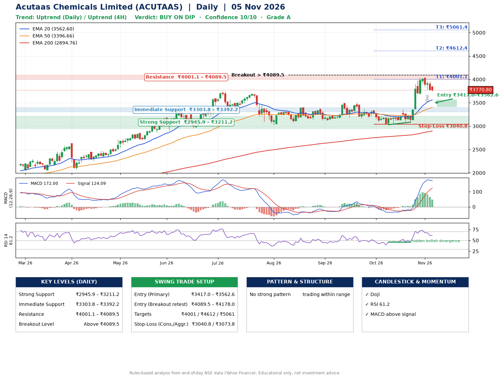

📌 **Acutaas Chemicals Limited (ACUTAAS) – Multi-Timeframe Technical Analysis (Daily + 4H Combined)**
_Data up to 05 Nov 2026 · Close ₹3770.80_

**📍 Daily Timeframe Trend**
- Trend: **Uptrend** (higher highs and higher lows)
- Recent swing highs: ₹3399.8, ₹3384.0, ₹3509.9 · swing lows: ₹3167.0, ₹3031.1, ₹3085.0
- EMAs: EMA20 ₹3562.6, EMA50 ₹3396.7, EMA200 ₹2894.8; bullish stack (EMA20 > EMA50 > EMA200); price above EMA20, EMA50, EMA200
- MACD 172.00 above signal 124.09 (above zero); histogram falling
- RSI(14) 61.2; Hidden bullish divergence

**📍 4-Hour Timeframe Trend**
- Structure: **Uptrend** (price above rising EMAs)
- Pullback/support area: recent 4H swing lows ₹3120.2, ₹3085.0; EMA20 ₹3715.8
- EMA20/50: bullish stack (EMA20 > EMA50); price above EMA20, EMA50
- MACD 134.37 below signal 159.77 (above zero), fresh bearish crossover; histogram falling
- RSI(14) 58.0; no divergence

**📍 Pattern Detection (Both Timeframes)**
- 4H: **Bull Flag** – 20% pole then a tight 7% flag; trigger above ₹4031.9

**📍 Candlestick Patterns (last 3 daily candles)**
- **Doji** – 03 Nov: indecision; wait for the next candle to confirm direction

**📍 Price Action Key Levels (Daily Structure)**

| Zone | Price Level (₹) | Context |
|------|-----------------|---------|
| Strong Support | ₹2945.9 – ₹3211.2 | Cluster of earlier swing lows (demand) |
| Immediate Support | ₹3303.8 – ₹3392.2 | Nearest swing-low / wick area |
| Resistance | ₹4001.1 – ₹4089.5 | Nearest swing-high supply |
| Breakout Level | Above ₹4089.5 | Swing continuation trigger (52-week high ₹4045.3) |

**📍 Swing Trade Setup**

🟢 **Entry Zone**
- Primary: ₹3417.0 – ₹3562.6 (daily support / EMA20 area; enter on a bullish 4H candle)
- Alternate: ₹4089.5 – ₹4178.0 (breakout retest)

🎯 **Profit Targets**
- T1: ₹4001.1
- T2: ₹4612.4
- T3: ₹5061.4

🛑 **Stop-Loss**
- Conservative: below daily swing low (₹3040.8)
- Aggressive: below 4H structure (₹3073.8)
- Risk per share ≈ ₹449.0; reward:risk to T1 ≈ 1.1

**📌 Strategy Notes**
- Higher timeframe: daily trend is uptrend; only take longs while price holds above ₹2945.9.
- Entry timing: wait for a bullish 4H candle (engulfing/hammer) inside ₹3417.0 – ₹3562.6 rather than buying mid-range.
- EMA stacking: bullish stack (EMA20 > EMA50 > EMA200); price above EMA20, EMA50, EMA200.
- Breakout rule: a daily close above ₹4089.5 with volume above its 20-day average (≈885,867) opens T2/T3.
- Momentum: RSI 61 – room to run; Hidden bullish divergence.
- Exit discipline: move the stop to entry once T1 is hit; book partial profits at each target.

**STEP 2 — Marked Up Chart**

**✅ Trade Validation Checklist**
- Trend + momentum aligned: Yes · Price at entry zone: No
- Stop defined (₹3040.8) · Reward:risk ≥ 1.5 to T1: No

## 📌 Final Verdict

Recommendation: **🟡 BUY ON DIP**

Confidence: **10/10**

Trade Quality: **A**

Reason:
• Daily uptrend (higher highs and higher lows)
• EMAs stacked bullishly

Next Action:
• Wait for a pullback to ₹3417.0–₹3562.6

_Rules-based analysis from end-of-day data. Educational only, not investment advice. Never place orders without your own confirmation._