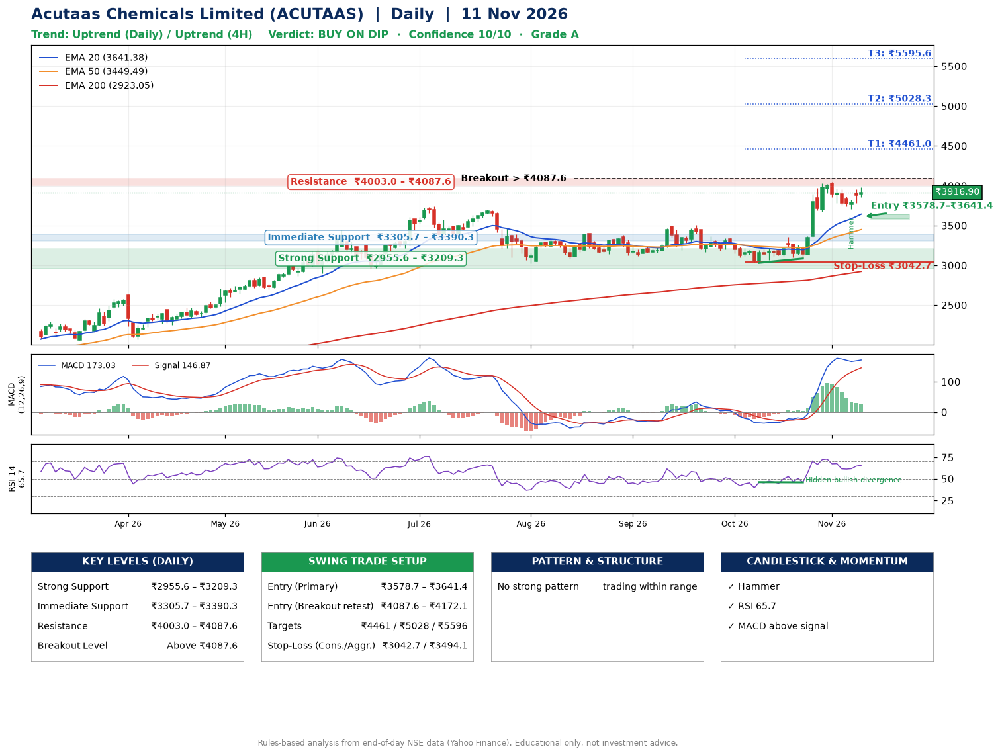

📌 **Acutaas Chemicals Limited (ACUTAAS) – Multi-Timeframe Technical Analysis (Daily + 4H Combined)**
_Data up to 11 Nov 2026 · Close ₹3916.90_

**📍 Daily Timeframe Trend**
- Trend: **Uptrend** (higher highs and higher lows)
- Recent swing highs: ₹3384.0, ₹3509.9, ₹4045.3 · swing lows: ₹3167.0, ₹3031.1, ₹3085.0
- EMAs: EMA20 ₹3641.4, EMA50 ₹3449.5, EMA200 ₹2923.0; bullish stack (EMA20 > EMA50 > EMA200); price above EMA20, EMA50, EMA200
- MACD 173.03 above signal 146.87 (above zero); histogram falling
- RSI(14) 65.7; Hidden bullish divergence

**📍 4-Hour Timeframe Trend**
- Structure: **Uptrend** (higher highs and higher lows)
- Pullback/support area: recent 4H swing lows ₹3085.0, ₹3705.0; EMA20 ₹3787.2
- EMA20/50: bullish stack (EMA20 > EMA50); price above EMA20, EMA50
- MACD 109.62 below signal 125.40 (above zero); histogram rising
- RSI(14) 63.6; no divergence

**📍 Pattern Detection (Both Timeframes)**
- 4H: **Bull Flag** – 20% pole then a tight 7% flag; trigger above ₹3976.2

**📍 Candlestick Patterns (last 3 daily candles)**
- **Hammer** – 06 Nov: long lower wick shows dip-buying near ₹3704.9

**📍 Price Action Key Levels (Daily Structure)**

| Zone | Price Level (₹) | Context |
|------|-----------------|---------|
| Strong Support | ₹2955.6 – ₹3209.3 | Cluster of earlier swing lows (demand) |
| Immediate Support | ₹3305.7 – ₹3390.3 | Nearest swing-low / wick area |
| Resistance | ₹4003.0 – ₹4087.6 | Nearest swing-high supply |
| Breakout Level | Above ₹4087.6 | Swing continuation trigger (52-week high ₹4045.3) |

**📍 Swing Trade Setup**

🟢 **Entry Zone**
- Primary: ₹3578.7 – ₹3641.4 (daily support / EMA20 area; enter on a bullish 4H candle)
- Alternate: ₹4087.6 – ₹4172.1 (breakout retest)

🎯 **Profit Targets**
- T1: ₹4461.0
- T2: ₹5028.3
- T3: ₹5595.6

🛑 **Stop-Loss**
- Conservative: below daily swing low (₹3042.7)
- Aggressive: below 4H structure (₹3494.1)
- Risk per share ≈ ₹567.3; reward:risk to T1 ≈ 1.5

**📌 Strategy Notes**
- Higher timeframe: daily trend is uptrend; only take longs while price holds above ₹2955.6.
- Entry timing: wait for a bullish 4H candle (engulfing/hammer) inside ₹3578.7 – ₹3641.4 rather than buying mid-range.
- EMA stacking: bullish stack (EMA20 > EMA50 > EMA200); price above EMA20, EMA50, EMA200.
- Breakout rule: a daily close above ₹4087.6 with volume above its 20-day average (≈904,798) opens T2/T3.
- Momentum: RSI 66 – elevated, prefer dips; Hidden bullish divergence.
- Exit discipline: move the stop to entry once T1 is hit; book partial profits at each target.

**STEP 2 — Marked Up Chart**

**✅ Trade Validation Checklist**
- Trend + momentum aligned: Yes · Price at entry zone: No
- Stop defined (₹3042.7) · Reward:risk ≥ 1.5 to T1: Yes

## 📌 Final Verdict

Recommendation: **🟡 BUY ON DIP**

Confidence: **10/10**

Trade Quality: **A**

Reason:
• Daily uptrend (higher highs and higher lows)
• EMAs stacked bullishly

Next Action:
• Wait for a pullback to ₹3578.7–₹3641.4

_Rules-based analysis from end-of-day data. Educational only, not investment advice. Never place orders without your own confirmation._