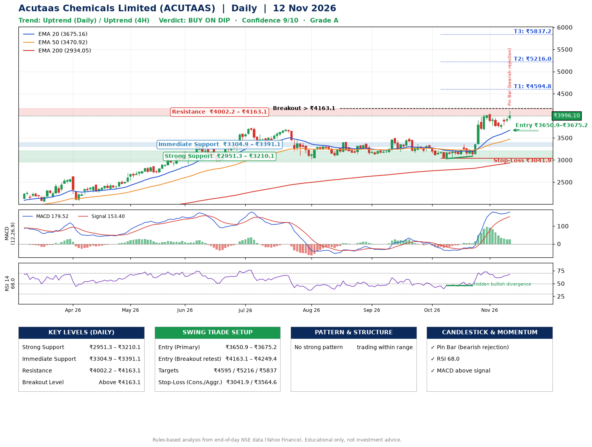

📌 **Acutaas Chemicals Limited (ACUTAAS) – Multi-Timeframe Technical Analysis (Daily + 4H Combined)**
_Data up to 12 Nov 2026 · Close ₹3996.10_

**📍 Daily Timeframe Trend**
- Trend: **Uptrend** (higher highs and higher lows)
- Recent swing highs: ₹3384.0, ₹3509.9, ₹4045.3 · swing lows: ₹3167.0, ₹3031.1, ₹3085.0
- EMAs: EMA20 ₹3675.2, EMA50 ₹3470.9, EMA200 ₹2934.1; bullish stack (EMA20 > EMA50 > EMA200); price above EMA20, EMA50, EMA200
- MACD 179.52 above signal 153.40 (above zero); histogram falling
- RSI(14) 68.0; Hidden bullish divergence

**📍 4-Hour Timeframe Trend**
- Structure: **Uptrend** (higher highs and higher lows)
- Pullback/support area: recent 4H swing lows ₹3085.0, ₹3705.0; EMA20 ₹3832.4
- EMA20/50: bullish stack (EMA20 > EMA50); price above EMA20, EMA50
- MACD 120.21 below signal 123.52 (above zero); histogram rising
- RSI(14) 64.1; no divergence

**📍 Pattern Detection (Both Timeframes)**
- No strong pattern detected. Trading within range.

**📍 Candlestick Patterns (last 3 daily candles)**
- **Pin Bar (bearish rejection)** – 12 Nov: long upper wick shows selling near ₹4120.0

**📍 Price Action Key Levels (Daily Structure)**

| Zone | Price Level (₹) | Context |
|------|-----------------|---------|
| Strong Support | ₹2951.3 – ₹3210.1 | Cluster of earlier swing lows (demand) |
| Immediate Support | ₹3304.9 – ₹3391.1 | Nearest swing-low / wick area |
| Resistance | ₹4002.2 – ₹4163.1 | Nearest swing-high supply |
| Breakout Level | Above ₹4163.1 | Swing continuation trigger (52-week high ₹4120.0) |

**📍 Swing Trade Setup**

🟢 **Entry Zone**
- Primary: ₹3650.9 – ₹3675.2 (daily support / EMA20 area; enter on a bullish 4H candle)
- Alternate: ₹4163.1 – ₹4249.4 (breakout retest)

🎯 **Profit Targets**
- T1: ₹4594.8
- T2: ₹5216.0
- T3: ₹5837.2

🛑 **Stop-Loss**
- Conservative: below daily swing low (₹3041.9)
- Aggressive: below 4H structure (₹3564.6)
- Risk per share ≈ ₹621.2; reward:risk to T1 ≈ 1.5
- Time to T1: about 32 trading days (it rose this much within 60 trading days 55% of the time in the last 2 years)
- Time to T2: about 49 trading days (it rose this much within 60 trading days 19% of the time in the last 2 years)

**📌 Strategy Notes**
- Higher timeframe: daily trend is uptrend; only take longs while price holds above ₹2951.3.
- Entry timing: wait for a bullish 4H candle (engulfing/hammer) inside ₹3650.9 – ₹3675.2 rather than buying mid-range.
- EMA stacking: bullish stack (EMA20 > EMA50 > EMA200); price above EMA20, EMA50, EMA200.
- Breakout rule: a daily close above ₹4163.1 with volume above its 20-day average (≈936,482) opens T2/T3.
- Momentum: RSI 68 – elevated, prefer dips; Hidden bullish divergence.
- Exit discipline: move the stop to entry once T1 is hit; book partial profits at each target.

**STEP 2 — Marked Up Chart**

**✅ Trade Validation Checklist**
- Trend + momentum aligned: Yes · Price at entry zone: No
- Stop defined (₹3041.9) · Reward:risk ≥ 1.5 to T1: No

## 📌 Final Verdict

Recommendation: **🟡 BUY ON DIP**

Confidence: **9/10**

Trade Quality: **A**

Reason:
• Daily uptrend (higher highs and higher lows)
• EMAs stacked bullishly

Next Action:
• Wait for a pullback to ₹3650.9–₹3675.2

_Rules-based analysis from end-of-day data. Educational only, not investment advice. Never place orders without your own confirmation._