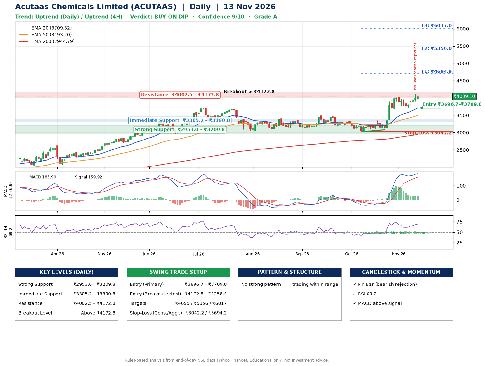

📌 **Acutaas Chemicals Limited (ACUTAAS) – Multi-Timeframe Technical Analysis (Daily + 4H Combined)**
_Data up to 13 Nov 2026 · Close ₹4039.10_

**📍 Daily Timeframe Trend**
- Trend: **Uptrend** (higher highs and higher lows)
- Recent swing highs: ₹3384.0, ₹3509.9, ₹4045.3 · swing lows: ₹3167.0, ₹3031.1, ₹3085.0
- EMAs: EMA20 ₹3709.8, EMA50 ₹3493.2, EMA200 ₹2944.8; bullish stack (EMA20 > EMA50 > EMA200); price above EMA20, EMA50, EMA200
- MACD 185.99 above signal 159.92 (above zero); histogram falling
- RSI(14) 69.2; Hidden bullish divergence

**📍 4-Hour Timeframe Trend**
- Structure: **Uptrend** (higher highs and higher lows)
- Pullback/support area: recent 4H swing lows ₹3085.0, ₹3705.0; EMA20 ₹3869.4
- EMA20/50: bullish stack (EMA20 > EMA50); price above EMA20, EMA50
- MACD 122.28 below signal 122.99 (above zero); histogram rising
- RSI(14) 65.9; no divergence

**📍 Pattern Detection (Both Timeframes)**
- No strong pattern detected. Trading within range.

**📍 Candlestick Patterns (last 3 daily candles)**
- **Pin Bar (bearish rejection)** – 12 Nov: long upper wick shows selling near ₹4120.0

**📍 Price Action Key Levels (Daily Structure)**

| Zone | Price Level (₹) | Context |
|------|-----------------|---------|
| Strong Support | ₹2953.0 – ₹3209.8 | Cluster of earlier swing lows (demand) |
| Immediate Support | ₹3305.2 – ₹3390.8 | Nearest swing-low / wick area |
| Resistance | ₹4002.5 – ₹4172.8 | Nearest swing-high supply |
| Breakout Level | Above ₹4172.8 | Swing continuation trigger (52-week high ₹4130.0) |

**📍 Swing Trade Setup**

🟢 **Entry Zone**
- Primary: ₹3696.7 – ₹3709.8 (daily support / EMA20 area; enter on a bullish 4H candle)
- Alternate: ₹4172.8 – ₹4258.4 (breakout retest)

🎯 **Profit Targets**
- T1: ₹4694.9
- T2: ₹5356.0
- T3: ₹6017.0

🛑 **Stop-Loss**
- Conservative: below daily swing low (₹3042.2)
- Aggressive: below 4H structure (₹3694.2)
- Risk per share ≈ ₹661.1; reward:risk to T1 ≈ 1.5
- Time to T1: about 34 trading days (it rose this much within 60 trading days 53% of the time in the last 2 years)
- Time to T2: about 48 trading days (it rose this much within 60 trading days 16% of the time in the last 2 years)

**📌 Strategy Notes**
- Higher timeframe: daily trend is uptrend; only take longs while price holds above ₹2953.0.
- Entry timing: wait for a bullish 4H candle (engulfing/hammer) inside ₹3696.7 – ₹3709.8 rather than buying mid-range.
- EMA stacking: bullish stack (EMA20 > EMA50 > EMA200); price above EMA20, EMA50, EMA200.
- Breakout rule: a daily close above ₹4172.8 with volume above its 20-day average (≈949,324) opens T2/T3.
- Momentum: RSI 69 – elevated, prefer dips; Hidden bullish divergence.
- Exit discipline: move the stop to entry once T1 is hit; book partial profits at each target.

**STEP 2 — Marked Up Chart**

**✅ Trade Validation Checklist**
- Trend + momentum aligned: Yes · Price at entry zone: No
- Stop defined (₹3042.2) · Reward:risk ≥ 1.5 to T1: Yes

## 📌 Final Verdict

Recommendation: **🟡 BUY ON DIP**

Confidence: **9/10**

Trade Quality: **A**

Reason:
• Daily uptrend (higher highs and higher lows)
• EMAs stacked bullishly

Next Action:
• Wait for a pullback to ₹3696.7–₹3709.8

_Rules-based analysis from end-of-day data. Educational only, not investment advice. Never place orders without your own confirmation._