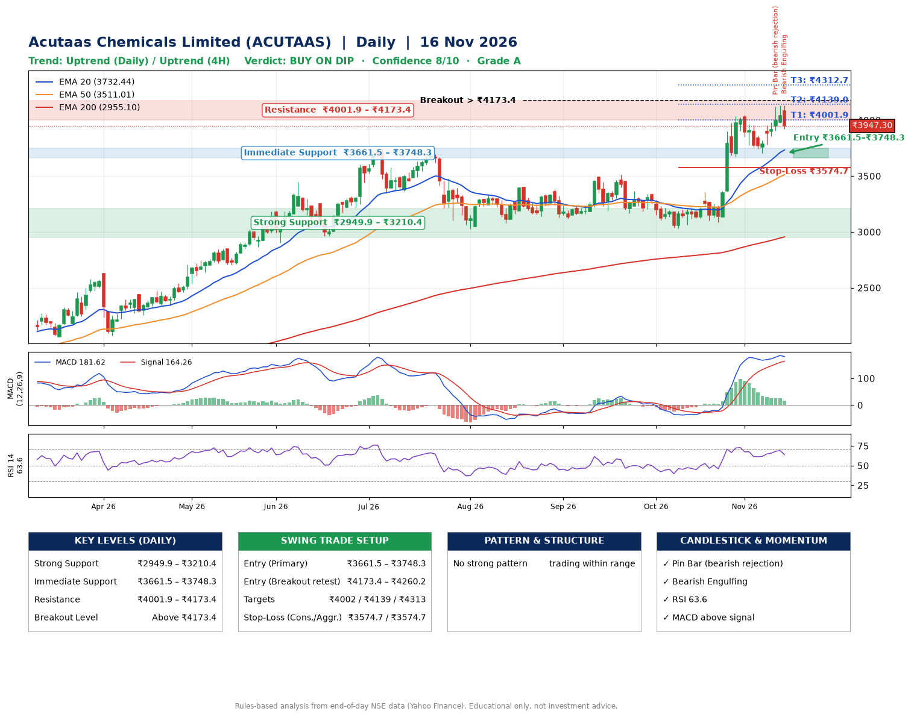

📌 **Acutaas Chemicals Limited (ACUTAAS) – Multi-Timeframe Technical Analysis (Daily + 4H Combined)**
_Data up to 16 Nov 2026 · Close ₹3947.30_

**📍 Daily Timeframe Trend**
- Trend: **Uptrend** (higher highs and higher lows)
- Recent swing highs: ₹3384.0, ₹3509.9, ₹4045.3 · swing lows: ₹3031.1, ₹3085.0, ₹3704.9
- EMAs: EMA20 ₹3732.4, EMA50 ₹3511.0, EMA200 ₹2955.1; bullish stack (EMA20 > EMA50 > EMA200); price above EMA20, EMA50, EMA200
- MACD 181.62 above signal 164.26 (above zero); histogram falling
- RSI(14) 63.6; no divergence on the last two swings

**📍 4-Hour Timeframe Trend**
- Structure: **Uptrend** (higher highs and higher lows)
- Pullback/support area: recent 4H swing lows ₹3085.0, ₹3705.0; EMA20 ₹3900.8
- EMA20/50: bullish stack (EMA20 > EMA50); price above EMA20, EMA50
- MACD 94.41 below signal 112.24 (above zero); histogram falling
- RSI(14) 57.2; Regular bearish divergence

**📍 Pattern Detection (Both Timeframes)**
- 4H: **Double Top** – tops near ₹4031.9/₹4129.7, neckline ₹3705.0, forming
- 4H: **Bull Flag** – 17% pole then a tight 6% flag; trigger above ₹4129.7

**📍 Candlestick Patterns (last 3 daily candles)**
- **Pin Bar (bearish rejection)** – 12 Nov: long upper wick shows selling near ₹4120.0
- **Bearish Engulfing** – 16 Nov: sellers fully reversed the prior green candle

**📍 Price Action Key Levels (Daily Structure)**

| Zone | Price Level (₹) | Context |
|------|-----------------|---------|
| Strong Support | ₹2949.9 – ₹3210.4 | Cluster of earlier swing lows (demand) |
| Immediate Support | ₹3661.5 – ₹3748.3 | Nearest swing-low / wick area |
| Resistance | ₹4001.9 – ₹4173.4 | Nearest swing-high supply |
| Breakout Level | Above ₹4173.4 | Swing continuation trigger (52-week high ₹4130.0) |

**📍 Swing Trade Setup**

🟢 **Entry Zone**
- Primary: ₹3661.5 – ₹3748.3 (daily support / EMA20 area; enter on a bullish 4H candle)
- Alternate: ₹4173.4 – ₹4260.2 (breakout retest)

🎯 **Profit Targets**
- T1: ₹4001.9
- T2: ₹4139.0
- T3: ₹4312.7

🛑 **Stop-Loss**
- Conservative: below daily swing low (₹3574.7)
- Aggressive: below 4H structure (₹3574.7)
- Risk per share ≈ ₹173.7; reward:risk to T1 ≈ 1.7
- Time to T1: about 9 trading days (it rose this much within 60 trading days 88% of the time in the last 2 years)
- Time to T2: about 16 trading days (it rose this much within 60 trading days 83% of the time in the last 2 years)

**📌 Strategy Notes**
- Higher timeframe: daily trend is uptrend; only take longs while price holds above ₹2949.9.
- Entry timing: wait for a bullish 4H candle (engulfing/hammer) inside ₹3661.5 – ₹3748.3 rather than buying mid-range.
- EMA stacking: bullish stack (EMA20 > EMA50 > EMA200); price above EMA20, EMA50, EMA200.
- Breakout rule: a daily close above ₹4173.4 with volume above its 20-day average (≈958,064) opens T2/T3.
- Momentum: RSI 64 – room to run; no divergence on the last two swings.
- Exit discipline: move the stop to entry once T1 is hit; book partial profits at each target.

**STEP 2 — Marked Up Chart**

**✅ Trade Validation Checklist**
- Trend + momentum aligned: Yes · Price at entry zone: No
- Stop defined (₹3574.7) · Reward:risk ≥ 1.5 to T1: Yes

## 📌 Final Verdict

Recommendation: **🟡 BUY ON DIP**

Confidence: **8/10**

Trade Quality: **A**

Reason:
• Daily uptrend (higher highs and higher lows)
• EMAs stacked bullishly

Next Action:
• Wait for a pullback to ₹3661.5–₹3748.3

_Rules-based analysis from end-of-day data. Educational only, not investment advice. Never place orders without your own confirmation._