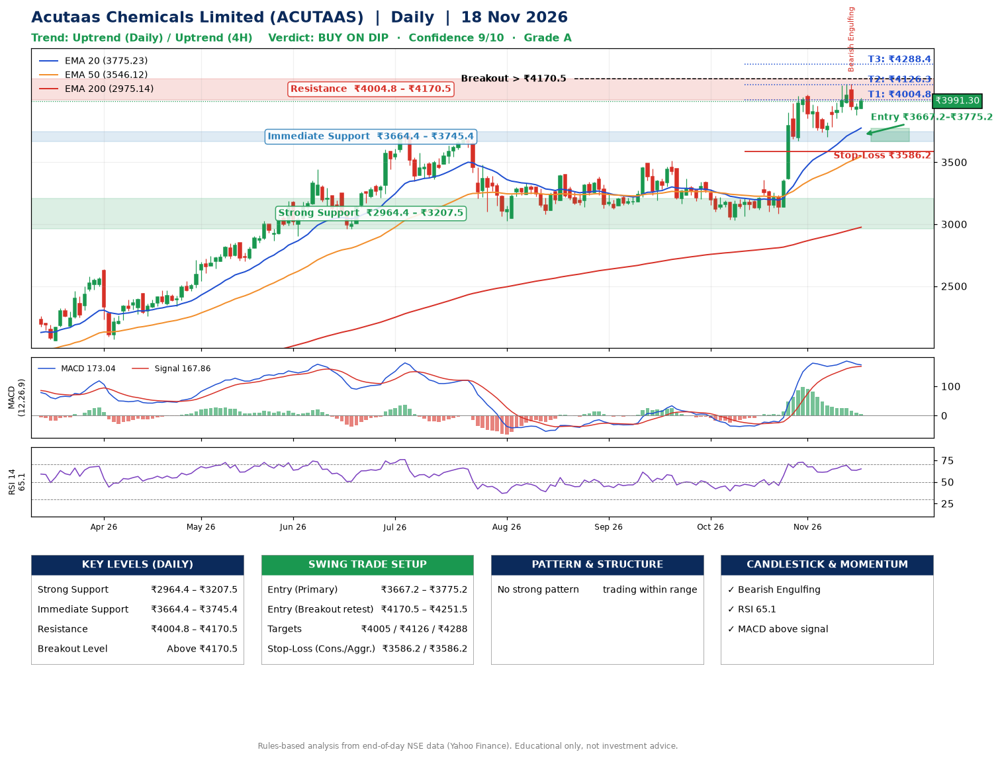

📌 **Acutaas Chemicals Limited (ACUTAAS) – Multi-Timeframe Technical Analysis (Daily + 4H Combined)**
_Data up to 18 Nov 2026 · Close ₹3991.30_

**📍 Daily Timeframe Trend**
- Trend: **Uptrend** (higher highs and higher lows)
- Recent swing highs: ₹3384.0, ₹3509.9, ₹4045.3 · swing lows: ₹3031.1, ₹3085.0, ₹3704.9
- EMAs: EMA20 ₹3775.2, EMA50 ₹3546.1, EMA200 ₹2975.1; bullish stack (EMA20 > EMA50 > EMA200); price above EMA20, EMA50, EMA200
- MACD 173.04 above signal 167.86 (above zero); histogram falling
- RSI(14) 65.1; no divergence on the last two swings

**📍 4-Hour Timeframe Trend**
- Structure: **Uptrend** (higher highs and higher lows)
- Pullback/support area: recent 4H swing lows ₹3705.0, ₹3884.1; EMA20 ₹3917.9
- EMA20/50: bullish stack (EMA20 > EMA50); price above EMA20, EMA50
- MACD 87.26 below signal 103.83 (above zero); histogram rising
- RSI(14) 60.7; Hidden bullish divergence; Regular bearish divergence

**📍 Pattern Detection (Both Timeframes)**
- 4H: **Double Top** – tops near ₹4031.9/₹4129.7, neckline ₹3705.0, forming
- 4H: **Bull Flag** – 19% pole then a tight 6% flag; trigger above ₹4129.7

**📍 Candlestick Patterns (last 3 daily candles)**
- **Bearish Engulfing** – 16 Nov: sellers fully reversed the prior green candle

**📍 Price Action Key Levels (Daily Structure)**

| Zone | Price Level (₹) | Context |
|------|-----------------|---------|
| Strong Support | ₹2964.4 – ₹3207.5 | Cluster of earlier swing lows (demand) |
| Immediate Support | ₹3664.4 – ₹3745.4 | Nearest swing-low / wick area |
| Resistance | ₹4004.8 – ₹4170.5 | Nearest swing-high supply |
| Breakout Level | Above ₹4170.5 | Swing continuation trigger (52-week high ₹4130.0) |

**📍 Swing Trade Setup**

🟢 **Entry Zone**
- Primary: ₹3667.2 – ₹3775.2 (daily support / EMA20 area; enter on a bullish 4H candle)
- Alternate: ₹4170.5 – ₹4251.5 (breakout retest)

🎯 **Profit Targets**
- T1: ₹4004.8
- T2: ₹4126.3
- T3: ₹4288.4

🛑 **Stop-Loss**
- Conservative: below daily swing low (₹3586.2)
- Aggressive: below 4H structure (₹3586.2)
- Risk per share ≈ ₹162.0; reward:risk to T1 ≈ 1.8
- Time to T1: about 9 trading days (it rose this much within 60 trading days 89% of the time in the last 2 years)
- Time to T2: about 15 trading days (it rose this much within 60 trading days 85% of the time in the last 2 years)

**📌 Strategy Notes**
- Higher timeframe: daily trend is uptrend; only take longs while price holds above ₹2964.4.
- Entry timing: wait for a bullish 4H candle (engulfing/hammer) inside ₹3667.2 – ₹3775.2 rather than buying mid-range.
- EMA stacking: bullish stack (EMA20 > EMA50 > EMA200); price above EMA20, EMA50, EMA200.
- Breakout rule: a daily close above ₹4170.5 with volume above its 20-day average (≈930,030) opens T2/T3.
- Momentum: RSI 65 – elevated, prefer dips; no divergence on the last two swings.
- Exit discipline: move the stop to entry once T1 is hit; book partial profits at each target.

**STEP 2 — Marked Up Chart**

**✅ Trade Validation Checklist**
- Trend + momentum aligned: Yes · Price at entry zone: No
- Stop defined (₹3586.2) · Reward:risk ≥ 1.5 to T1: Yes

## 📌 Final Verdict

Recommendation: **🟡 BUY ON DIP**

Confidence: **9/10**

Trade Quality: **A**

Reason:
• Daily uptrend (higher highs and higher lows)
• EMAs stacked bullishly

Next Action:
• Wait for a pullback to ₹3667.2–₹3775.2

_Rules-based analysis from end-of-day data. Educational only, not investment advice. Never place orders without your own confirmation._