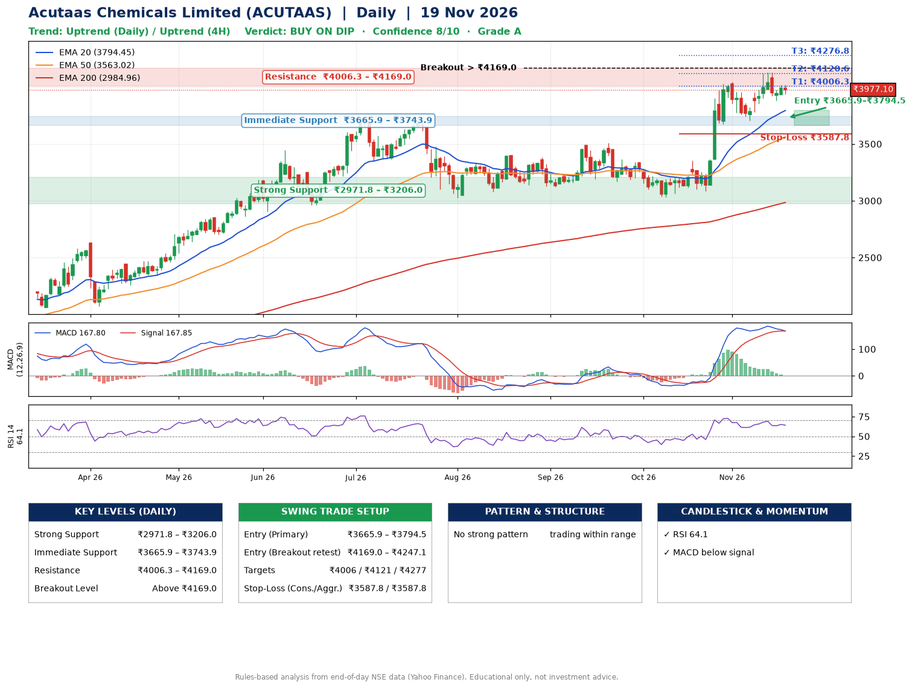

📌 **Acutaas Chemicals Limited (ACUTAAS) – Multi-Timeframe Technical Analysis (Daily + 4H Combined)**
_Data up to 19 Nov 2026 · Close ₹3977.10_

**📍 Daily Timeframe Trend**
- Trend: **Uptrend** (higher highs and higher lows)
- Recent swing highs: ₹3384.0, ₹3509.9, ₹4045.3 · swing lows: ₹3031.1, ₹3085.0, ₹3704.9
- EMAs: EMA20 ₹3794.5, EMA50 ₹3563.0, EMA200 ₹2985.0; bullish stack (EMA20 > EMA50 > EMA200); price above EMA20, EMA50, EMA200
- MACD 167.80 below signal 167.85 (above zero), fresh bearish crossover; histogram falling
- RSI(14) 64.1; no divergence on the last two swings

**📍 4-Hour Timeframe Trend**
- Structure: **Uptrend** (higher highs and higher lows)
- Pullback/support area: recent 4H swing lows ₹3705.0, ₹3884.1; EMA20 ₹3929.2
- EMA20/50: bullish stack (EMA20 > EMA50); price above EMA20, EMA50
- MACD 77.08 below signal 95.11 (above zero); histogram falling
- RSI(14) 58.2; Hidden bullish divergence; Regular bearish divergence

**📍 Pattern Detection (Both Timeframes)**
- 4H: **Double Top** – tops near ₹4031.9/₹4129.7, neckline ₹3705.0, forming

**📍 Candlestick Patterns (last 3 daily candles)**
- No notable candlestick signal in the last 3 sessions.

**📍 Price Action Key Levels (Daily Structure)**

| Zone | Price Level (₹) | Context |
|------|-----------------|---------|
| Strong Support | ₹2971.8 – ₹3206.0 | Cluster of earlier swing lows (demand) |
| Immediate Support | ₹3665.9 – ₹3743.9 | Nearest swing-low / wick area |
| Resistance | ₹4006.3 – ₹4169.0 | Nearest swing-high supply |
| Breakout Level | Above ₹4169.0 | Swing continuation trigger (52-week high ₹4130.0) |

**📍 Swing Trade Setup**

🟢 **Entry Zone**
- Primary: ₹3665.9 – ₹3794.5 (daily support / EMA20 area; enter on a bullish 4H candle)
- Alternate: ₹4169.0 – ₹4247.1 (breakout retest)

🎯 **Profit Targets**
- T1: ₹4006.3
- T2: ₹4120.6
- T3: ₹4276.8

🛑 **Stop-Loss**
- Conservative: below daily swing low (₹3587.8)
- Aggressive: below 4H structure (₹3587.8)
- Risk per share ≈ ₹156.2; reward:risk to T1 ≈ 1.8
- Time to T1: about 8 trading days (it rose this much within 60 trading days 89% of the time in the last 2 years)
- Time to T2: about 14 trading days (it rose this much within 60 trading days 85% of the time in the last 2 years)

**📌 Strategy Notes**
- Higher timeframe: daily trend is uptrend; only take longs while price holds above ₹2971.8.
- Entry timing: wait for a bullish 4H candle (engulfing/hammer) inside ₹3665.9 – ₹3794.5 rather than buying mid-range.
- EMA stacking: bullish stack (EMA20 > EMA50 > EMA200); price above EMA20, EMA50, EMA200.
- Breakout rule: a daily close above ₹4169.0 with volume above its 20-day average (≈929,197) opens T2/T3.
- Momentum: RSI 64 – room to run; no divergence on the last two swings.
- Exit discipline: move the stop to entry once T1 is hit; book partial profits at each target.

**STEP 2 — Marked Up Chart**

**✅ Trade Validation Checklist**
- Trend + momentum aligned: No · Price at entry zone: No
- Stop defined (₹3587.8) · Reward:risk ≥ 1.5 to T1: Yes

## 📌 Final Verdict

Recommendation: **🟡 BUY ON DIP**

Confidence: **8/10**

Trade Quality: **A**

Reason:
• Daily uptrend (higher highs and higher lows)
• EMAs stacked bullishly

Next Action:
• Wait for a pullback to ₹3665.9–₹3794.5

_Rules-based analysis from end-of-day data. Educational only, not investment advice. Never place orders without your own confirmation._