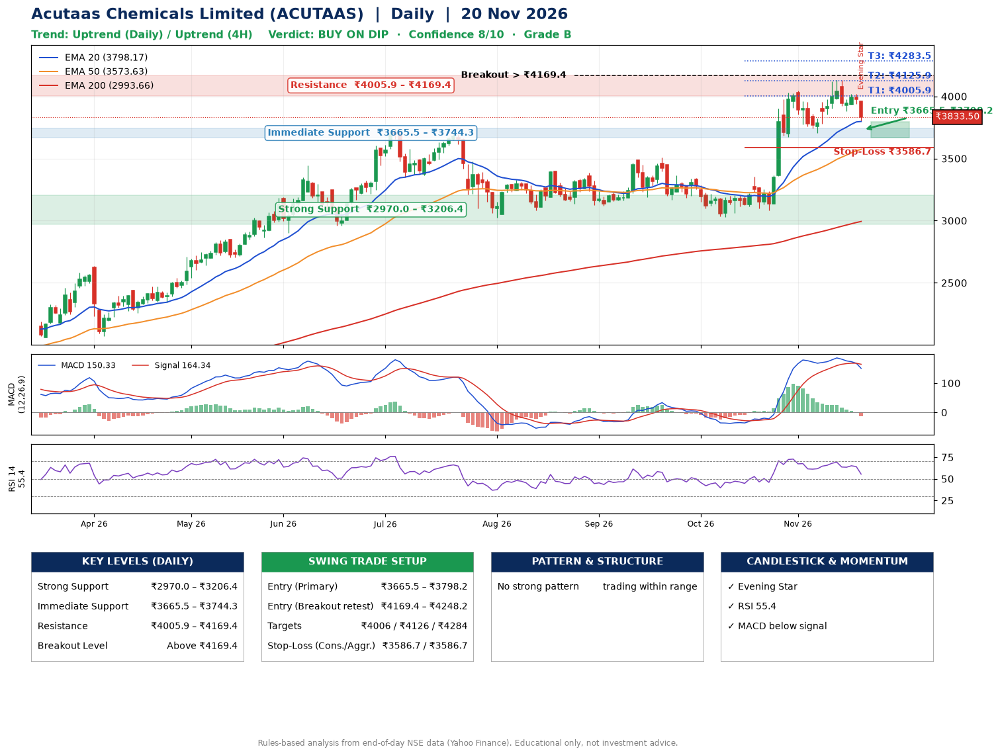

📌 **Acutaas Chemicals Limited (ACUTAAS) – Multi-Timeframe Technical Analysis (Daily + 4H Combined)**
_Data up to 20 Nov 2026 · Close ₹3833.50_

**📍 Daily Timeframe Trend**
- Trend: **Uptrend** (higher highs and higher lows)
- Recent swing highs: ₹3509.9, ₹4045.3, ₹4130.0 · swing lows: ₹3031.1, ₹3085.0, ₹3704.9
- EMAs: EMA20 ₹3798.2, EMA50 ₹3573.6, EMA200 ₹2993.7; bullish stack (EMA20 > EMA50 > EMA200); price above EMA20, EMA50, EMA200
- MACD 150.33 below signal 164.34 (above zero), fresh bearish crossover; histogram falling
- RSI(14) 55.4; no divergence on the last two swings

**📍 4-Hour Timeframe Trend**
- Structure: **Uptrend** (higher highs and higher lows)
- Pullback/support area: recent 4H swing lows ₹3705.0, ₹3884.1; EMA20 ₹3914.7
- EMA20/50: bullish stack (EMA20 > EMA50); price above EMA50
- MACD 49.14 below signal 80.83 (above zero); histogram falling
- RSI(14) 46.1; Hidden bullish divergence; Regular bearish divergence

**📍 Pattern Detection (Both Timeframes)**
- 4H: **Double Top** – tops near ₹4031.9/₹4129.7, neckline ₹3705.0, forming

**📍 Candlestick Patterns (last 3 daily candles)**
- **Evening Star** – 20 Nov: three-candle bearish reversal

**📍 Price Action Key Levels (Daily Structure)**

| Zone | Price Level (₹) | Context |
|------|-----------------|---------|
| Strong Support | ₹2970.0 – ₹3206.4 | Cluster of earlier swing lows (demand) |
| Immediate Support | ₹3665.5 – ₹3744.3 | Nearest swing-low / wick area |
| Resistance | ₹4005.9 – ₹4169.4 | Nearest swing-high supply |
| Breakout Level | Above ₹4169.4 | Swing continuation trigger (52-week high ₹4130.0) |

**📍 Swing Trade Setup**

🟢 **Entry Zone**
- Primary: ₹3665.5 – ₹3798.2 (daily support / EMA20 area; enter on a bullish 4H candle)
- Alternate: ₹4169.4 – ₹4248.2 (breakout retest)

🎯 **Profit Targets**
- T1: ₹4005.9
- T2: ₹4125.9
- T3: ₹4283.5

🛑 **Stop-Loss**
- Conservative: below daily swing low (₹3586.7)
- Aggressive: below 4H structure (₹3586.7)
- Risk per share ≈ ₹157.6; reward:risk to T1 ≈ 1.7
- Time to T1: about 8 trading days (it rose this much within 60 trading days 90% of the time in the last 2 years)
- Time to T2: about 14 trading days (it rose this much within 60 trading days 85% of the time in the last 2 years)

**📌 Strategy Notes**
- Higher timeframe: daily trend is uptrend; only take longs while price holds above ₹2970.0.
- Entry timing: wait for a bullish 4H candle (engulfing/hammer) inside ₹3665.5 – ₹3798.2 rather than buying mid-range.
- EMA stacking: bullish stack (EMA20 > EMA50 > EMA200); price above EMA20, EMA50, EMA200.
- Breakout rule: a daily close above ₹4169.4 with volume above its 20-day average (≈938,182) opens T2/T3.
- Momentum: RSI 55 – room to run; no divergence on the last two swings.
- Exit discipline: move the stop to entry once T1 is hit; book partial profits at each target.

**STEP 2 — Marked Up Chart**

**✅ Trade Validation Checklist**
- Trend + momentum aligned: No · Price at entry zone: No
- Stop defined (₹3586.7) · Reward:risk ≥ 1.5 to T1: Yes

## 📌 Final Verdict

Recommendation: **🟡 BUY ON DIP**

Confidence: **8/10**

Trade Quality: **B**

Reason:
• Daily uptrend (higher highs and higher lows)
• EMAs stacked bullishly

Next Action:
• Wait for a pullback to ₹3665.5–₹3798.2, or a breakout above ₹4169.4

_Rules-based analysis from end-of-day data. Educational only, not investment advice. Never place orders without your own confirmation._