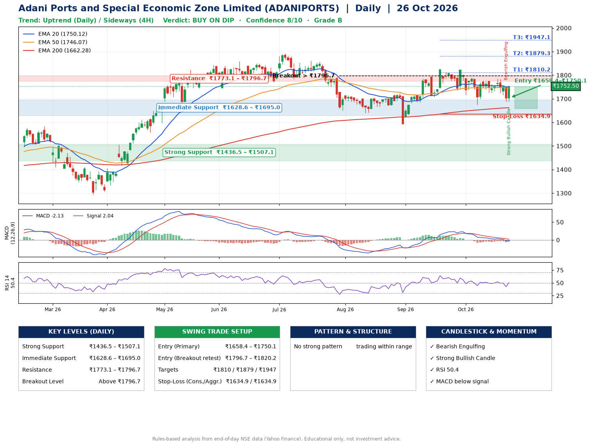

📌 **Adani Ports and Special Economic Zone Limited (ADANIPORTS) – Multi-Timeframe Technical Analysis (Daily + 4H Combined)**
_Data up to 26 Oct 2026 · Close ₹1752.50_

**📍 Daily Timeframe Trend**
- Trend: **Uptrend** (price above rising EMAs)
- Recent swing highs: ₹1723.9, ₹1824.0, ₹1822.0 · swing lows: ₹1640.4, ₹1593.1, ₹1674.2
- EMAs: EMA20 ₹1750.1, EMA50 ₹1746.1, EMA200 ₹1662.3; bullish stack (EMA20 > EMA50 > EMA200); price above EMA20, EMA50, EMA200
- MACD -2.13 below signal 2.04 (below zero); histogram rising
- RSI(14) 50.4; no divergence on the last two swings

**📍 4-Hour Timeframe Trend**
- Structure: **Sideways** (mixed swing structure)
- Pullback/support area: recent 4H swing lows ₹1725.2, ₹1688.0; EMA20 ₹1740.0
- EMA20/50: bearish stack (EMA20 < EMA50); price above EMA20, EMA50
- MACD -6.45 below signal -5.90 (below zero), fresh bearish crossover; histogram rising
- RSI(14) 51.9; no divergence

**📍 Pattern Detection (Both Timeframes)**
- 4H: **Double Top** – tops near ₹1777.7/₹1784.6, neckline ₹1725.2, forming
- 4H: **Double Bottom** – bottoms near ₹1725.2/₹1688.0, neckline ₹1784.6, forming

**📍 Candlestick Patterns (last 3 daily candles)**
- **Bearish Engulfing** – 23 Oct: sellers fully reversed the prior green candle
- **Strong Bullish Candle** – 26 Oct: wide-range green candle, buyers in control

**📍 Price Action Key Levels (Daily Structure)**

| Zone | Price Level (₹) | Context |
|------|-----------------|---------|
| Strong Support | ₹1436.5 – ₹1507.1 | Cluster of earlier swing lows (demand) |
| Immediate Support | ₹1628.6 – ₹1695.0 | Nearest swing-low / wick area |
| Resistance | ₹1773.1 – ₹1796.7 | Nearest swing-high supply |
| Breakout Level | Above ₹1796.7 | Swing continuation trigger (52-week high ₹1891.1) |

**📍 Swing Trade Setup**

🟢 **Entry Zone**
- Primary: ₹1658.4 – ₹1750.1 (daily support / EMA20 area; enter on a bullish 4H candle)
- Alternate: ₹1796.7 – ₹1820.2 (breakout retest)

🎯 **Profit Targets**
- T1: ₹1810.2
- T2: ₹1879.3
- T3: ₹1947.1

🛑 **Stop-Loss**
- Conservative: below daily swing low (₹1634.9)
- Aggressive: below 4H structure (₹1634.9)
- Risk per share ≈ ₹69.4; reward:risk to T1 ≈ 1.5

**📌 Strategy Notes**
- Higher timeframe: daily trend is uptrend; only take longs while price holds above ₹1436.5.
- Entry timing: wait for a bullish 4H candle (engulfing/hammer) inside ₹1658.4 – ₹1750.1 rather than buying mid-range.
- EMA stacking: bullish stack (EMA20 > EMA50 > EMA200); price above EMA20, EMA50, EMA200.
- Breakout rule: a daily close above ₹1796.7 with volume above its 20-day average (≈3,014,232) opens T2/T3.
- Momentum: RSI 50 – room to run; no divergence on the last two swings.
- Exit discipline: move the stop to entry once T1 is hit; book partial profits at each target.

**STEP 2 — Marked Up Chart**

**✅ Trade Validation Checklist**
- Trend + momentum aligned: No · Price at entry zone: No
- Stop defined (₹1634.9) · Reward:risk ≥ 1.5 to T1: Yes

## 📌 Final Verdict

Recommendation: **🟡 BUY ON DIP**

Confidence: **8/10**

Trade Quality: **B**

Reason:
• Daily uptrend (price above rising EMAs)
• EMAs stacked bullishly

Next Action:
• Wait for a pullback to ₹1658.4–₹1750.1, or a breakout above ₹1796.7

_Rules-based analysis from end-of-day data. Educational only, not investment advice. Never place orders without your own confirmation._