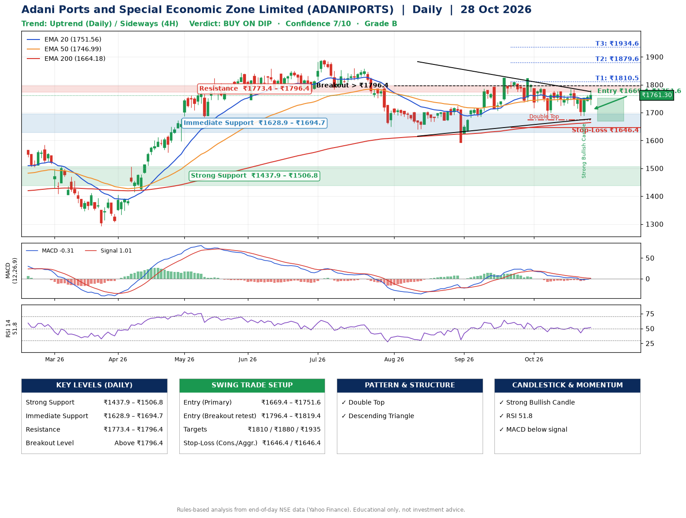

📌 **Adani Ports and Special Economic Zone Limited (ADANIPORTS) – Multi-Timeframe Technical Analysis (Daily + 4H Combined)**
_Data up to 28 Oct 2026 · Close ₹1761.30_

**📍 Daily Timeframe Trend**
- Trend: **Uptrend** (price above rising EMAs)
- Recent swing highs: ₹1824.0, ₹1822.0, ₹1784.9 · swing lows: ₹1640.4, ₹1593.1, ₹1674.2
- EMAs: EMA20 ₹1751.6, EMA50 ₹1747.0, EMA200 ₹1664.2; bullish stack (EMA20 > EMA50 > EMA200); price above EMA20, EMA50, EMA200
- MACD -0.31 below signal 1.01 (below zero); histogram rising
- RSI(14) 51.8; no divergence on the last two swings

**📍 4-Hour Timeframe Trend**
- Structure: **Sideways** (mixed swing structure)
- Pullback/support area: recent 4H swing lows ₹1725.2, ₹1688.0; EMA20 ₹1745.3
- EMA20/50: bearish stack (EMA20 < EMA50); price above EMA20, EMA50
- MACD 0.02 above signal -3.66 (above zero), fresh bullish crossover; histogram rising
- RSI(14) 53.6; no divergence

**📍 Pattern Detection (Both Timeframes)**
- Daily: **Double Top** – tops near ₹1822.0/₹1784.9, neckline ₹1674.2, forming
- Daily: **Descending Triangle** – converging swing highs and lows over the last ~60 sessions
- 4H: **Double Top** – tops near ₹1777.7/₹1784.6, neckline ₹1725.2, forming
- 4H: **Double Bottom** – bottoms near ₹1725.2/₹1688.0, neckline ₹1784.6, forming

**📍 Candlestick Patterns (last 3 daily candles)**
- **Strong Bullish Candle** – 26 Oct: wide-range green candle, buyers in control

**📍 Price Action Key Levels (Daily Structure)**

| Zone | Price Level (₹) | Context |
|------|-----------------|---------|
| Strong Support | ₹1437.9 – ₹1506.8 | Cluster of earlier swing lows (demand) |
| Immediate Support | ₹1628.9 – ₹1694.7 | Nearest swing-low / wick area |
| Resistance | ₹1773.4 – ₹1796.4 | Nearest swing-high supply |
| Breakout Level | Above ₹1796.4 | Swing continuation trigger (52-week high ₹1891.1) |

**📍 Swing Trade Setup**

🟢 **Entry Zone**
- Primary: ₹1669.4 – ₹1751.6 (daily support / EMA20 area; enter on a bullish 4H candle)
- Alternate: ₹1796.4 – ₹1819.4 (breakout retest)

🎯 **Profit Targets**
- T1: ₹1810.5
- T2: ₹1879.6
- T3: ₹1934.6

🛑 **Stop-Loss**
- Conservative: below daily swing low (₹1646.4)
- Aggressive: below 4H structure (₹1646.4)
- Risk per share ≈ ₹64.0; reward:risk to T1 ≈ 1.6

**📌 Strategy Notes**
- Higher timeframe: daily trend is uptrend; only take longs while price holds above ₹1437.9.
- Entry timing: wait for a bullish 4H candle (engulfing/hammer) inside ₹1669.4 – ₹1751.6 rather than buying mid-range.
- EMA stacking: bullish stack (EMA20 > EMA50 > EMA200); price above EMA20, EMA50, EMA200.
- Breakout rule: a daily close above ₹1796.4 with volume above its 20-day average (≈3,094,453) opens T2/T3.
- Momentum: RSI 52 – room to run; no divergence on the last two swings.
- Exit discipline: move the stop to entry once T1 is hit; book partial profits at each target.

**STEP 2 — Marked Up Chart**

**✅ Trade Validation Checklist**
- Trend + momentum aligned: No · Price at entry zone: No
- Stop defined (₹1646.4) · Reward:risk ≥ 1.5 to T1: Yes

## 📌 Final Verdict

Recommendation: **🟡 BUY ON DIP**

Confidence: **7/10**

Trade Quality: **B**

Reason:
• Daily uptrend (price above rising EMAs)
• EMAs stacked bullishly

Next Action:
• Wait for a pullback to ₹1669.4–₹1751.6, or a breakout above ₹1796.4

_Rules-based analysis from end-of-day data. Educational only, not investment advice. Never place orders without your own confirmation._