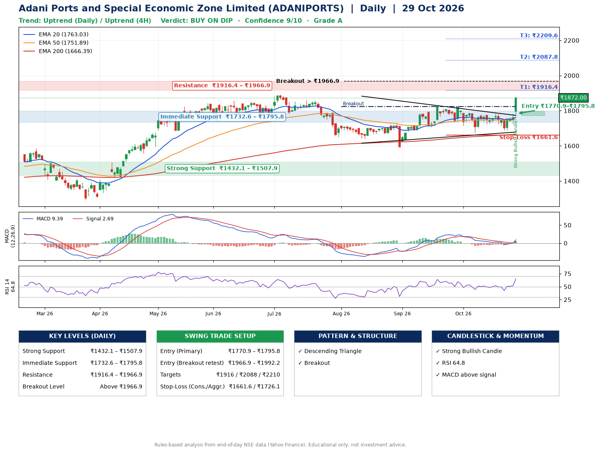

📌 **Adani Ports and Special Economic Zone Limited (ADANIPORTS) – Multi-Timeframe Technical Analysis (Daily + 4H Combined)**
_Data up to 29 Oct 2026 · Close ₹1872.00_

**📍 Daily Timeframe Trend**
- Trend: **Uptrend** (price above rising EMAs)
- Recent swing highs: ₹1824.0, ₹1822.0, ₹1784.9 · swing lows: ₹1640.4, ₹1593.1, ₹1674.2
- EMAs: EMA20 ₹1763.0, EMA50 ₹1751.9, EMA200 ₹1666.4; bullish stack (EMA20 > EMA50 > EMA200); price above EMA20, EMA50, EMA200
- MACD 9.39 above signal 2.69 (above zero), fresh bullish crossover; histogram rising
- RSI(14) 64.8; no divergence on the last two swings

**📍 4-Hour Timeframe Trend**
- Structure: **Uptrend** (higher highs and higher lows)
- Pullback/support area: recent 4H swing lows ₹1688.0, ₹1729.4; EMA20 ₹1767.3
- EMA20/50: bullish stack (EMA20 > EMA50); price above EMA20, EMA50
- MACD 17.09 above signal 2.53 (above zero); histogram rising
- RSI(14) 69.6; no divergence

**📍 Pattern Detection (Both Timeframes)**
- Daily: **Descending Triangle** – converging swing highs and lows over the last ~60 sessions
- Daily: **Breakout** – closed above the 60-session high ₹1824.0 on strong volume

**📍 Candlestick Patterns (last 3 daily candles)**
- **Strong Bullish Candle** – 29 Oct: wide-range green candle, buyers in control

**📍 Price Action Key Levels (Daily Structure)**

| Zone | Price Level (₹) | Context |
|------|-----------------|---------|
| Strong Support | ₹1432.1 – ₹1507.9 | Cluster of earlier swing lows (demand) |
| Immediate Support | ₹1732.6 – ₹1795.8 | Nearest swing-low / wick area |
| Resistance | ₹1916.4 – ₹1966.9 | Nearest swing-high supply |
| Breakout Level | Above ₹1966.9 | Swing continuation trigger (52-week high ₹1891.1) |

**📍 Swing Trade Setup**

🟢 **Entry Zone**
- Primary: ₹1770.9 – ₹1795.8 (daily support / EMA20 area; enter on a bullish 4H candle)
- Alternate: ₹1966.9 – ₹1992.2 (breakout retest)

🎯 **Profit Targets**
- T1: ₹1916.4
- T2: ₹2087.8
- T3: ₹2209.6

🛑 **Stop-Loss**
- Conservative: below daily swing low (₹1661.6)
- Aggressive: below 4H structure (₹1726.1)
- Risk per share ≈ ₹121.8; reward:risk to T1 ≈ 1.1

**📌 Strategy Notes**
- Higher timeframe: daily trend is uptrend; only take longs while price holds above ₹1432.1.
- Entry timing: wait for a bullish 4H candle (engulfing/hammer) inside ₹1770.9 – ₹1795.8 rather than buying mid-range.
- EMA stacking: bullish stack (EMA20 > EMA50 > EMA200); price above EMA20, EMA50, EMA200.
- Breakout rule: a daily close above ₹1966.9 with volume above its 20-day average (≈3,273,373) opens T2/T3.
- Momentum: RSI 65 – room to run; no divergence on the last two swings.
- Exit discipline: move the stop to entry once T1 is hit; book partial profits at each target.

**STEP 2 — Marked Up Chart**

**✅ Trade Validation Checklist**
- Trend + momentum aligned: Yes · Price at entry zone: No
- Stop defined (₹1661.6) · Reward:risk ≥ 1.5 to T1: No

## 📌 Final Verdict

Recommendation: **🟡 BUY ON DIP**

Confidence: **9/10**

Trade Quality: **A**

Reason:
• Daily uptrend (price above rising EMAs)
• EMAs stacked bullishly

Next Action:
• Wait for a pullback to ₹1770.9–₹1795.8

_Rules-based analysis from end-of-day data. Educational only, not investment advice. Never place orders without your own confirmation._