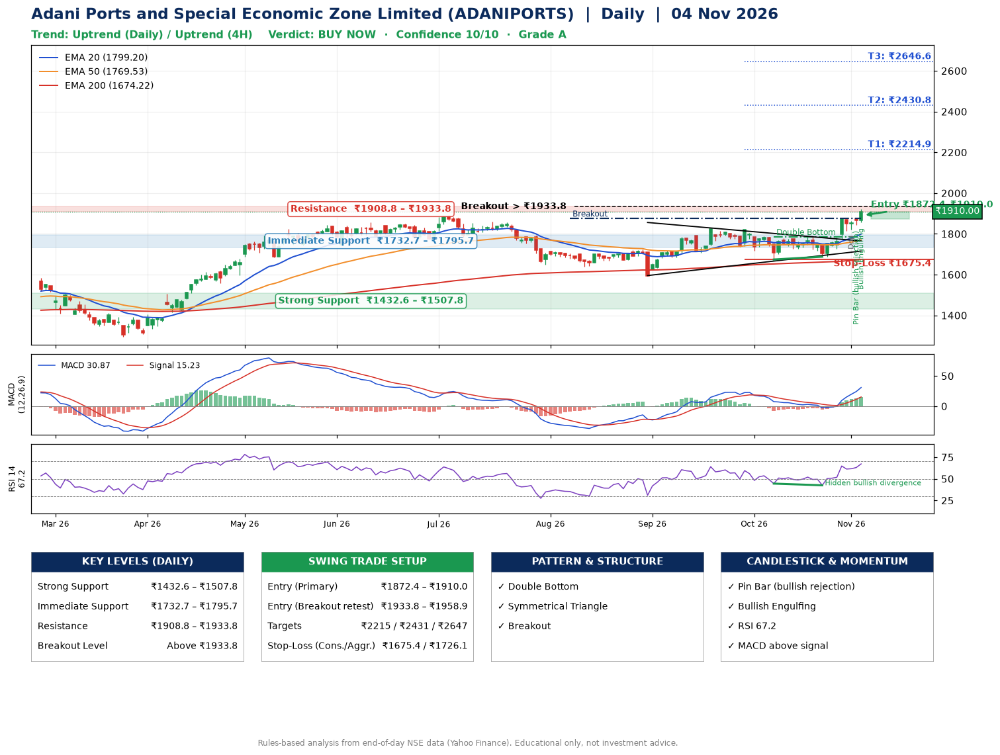

📌 **Adani Ports and Special Economic Zone Limited (ADANIPORTS) – Multi-Timeframe Technical Analysis (Daily + 4H Combined)**
_Data up to 04 Nov 2026 · Close ₹1910.00_

**📍 Daily Timeframe Trend**
- Trend: **Uptrend** (price above rising EMAs)
- Recent swing highs: ₹1824.0, ₹1822.0, ₹1784.9 · swing lows: ₹1593.1, ₹1674.2, ₹1687.9
- EMAs: EMA20 ₹1799.2, EMA50 ₹1769.5, EMA200 ₹1674.2; bullish stack (EMA20 > EMA50 > EMA200); price above EMA20, EMA50, EMA200
- MACD 30.87 above signal 15.23 (above zero), fresh bullish crossover; histogram rising
- RSI(14) 67.2; Hidden bullish divergence

**📍 4-Hour Timeframe Trend**
- Structure: **Uptrend** (higher highs and higher lows)
- Pullback/support area: recent 4H swing lows ₹1688.0, ₹1729.4; EMA20 ₹1823.7
- EMA20/50: bullish stack (EMA20 > EMA50); price above EMA20, EMA50
- MACD 37.31 above signal 26.14 (above zero); histogram rising
- RSI(14) 69.9; no divergence

**📍 Pattern Detection (Both Timeframes)**
- Daily: **Double Bottom** – bottoms near ₹1674.2/₹1687.9, neckline ₹1784.9, confirmed (closed above neckline)
- Daily: **Symmetrical Triangle** – converging swing highs and lows over the last ~60 sessions
- Daily: **Breakout** – closed above the 60-session high ₹1875.2 (volume not confirming yet)

**📍 Candlestick Patterns (last 3 daily candles)**
- **Doji** – 02 Nov: indecision; wait for the next candle to confirm direction
- **Pin Bar (bullish rejection)** – 03 Nov: long lower wick shows dip-buying near ₹1843.7
- **Bullish Engulfing** – 04 Nov: buyers fully reversed the prior red candle

**📍 Price Action Key Levels (Daily Structure)**

| Zone | Price Level (₹) | Context |
|------|-----------------|---------|
| Strong Support | ₹1432.6 – ₹1507.8 | Cluster of earlier swing lows (demand) |
| Immediate Support | ₹1732.7 – ₹1795.7 | Nearest swing-low / wick area |
| Resistance | ₹1908.8 – ₹1933.8 | Nearest swing-high supply |
| Breakout Level | Above ₹1933.8 | Swing continuation trigger (52-week high ₹1921.3) |

**📍 Swing Trade Setup**

🟢 **Entry Zone**
- Primary: ₹1872.4 – ₹1910.0 (daily support / EMA20 area; enter on a bullish 4H candle)
- Alternate: ₹1933.8 – ₹1958.9 (breakout retest)

🎯 **Profit Targets**
- T1: ₹2214.9
- T2: ₹2430.8
- T3: ₹2646.6

🛑 **Stop-Loss**
- Conservative: below daily swing low (₹1675.4)
- Aggressive: below 4H structure (₹1726.1)
- Risk per share ≈ ₹215.8; reward:risk to T1 ≈ 1.5

**📌 Strategy Notes**
- Higher timeframe: daily trend is uptrend; only take longs while price holds above ₹1432.6.
- Entry timing: wait for a bullish 4H candle (engulfing/hammer) inside ₹1872.4 – ₹1910.0 rather than buying mid-range.
- EMA stacking: bullish stack (EMA20 > EMA50 > EMA200); price above EMA20, EMA50, EMA200.
- Breakout rule: a daily close above ₹1933.8 with volume above its 20-day average (≈3,577,493) opens T2/T3.
- Momentum: RSI 67 – elevated, prefer dips; Hidden bullish divergence.
- Exit discipline: move the stop to entry once T1 is hit; book partial profits at each target.

**STEP 2 — Marked Up Chart**

**✅ Trade Validation Checklist**
- Trend + momentum aligned: Yes · Price at entry zone: Yes
- Stop defined (₹1675.4) · Reward:risk ≥ 1.5 to T1: No

## 📌 Final Verdict

Recommendation: **🟢 BUY NOW**

Confidence: **10/10**

Trade Quality: **A**

Reason:
• Daily uptrend (price above rising EMAs)
• EMAs stacked bullishly

Next Action:
• Buy now within the entry zone, with the stop-loss in place

_Rules-based analysis from end-of-day data. Educational only, not investment advice. Never place orders without your own confirmation._