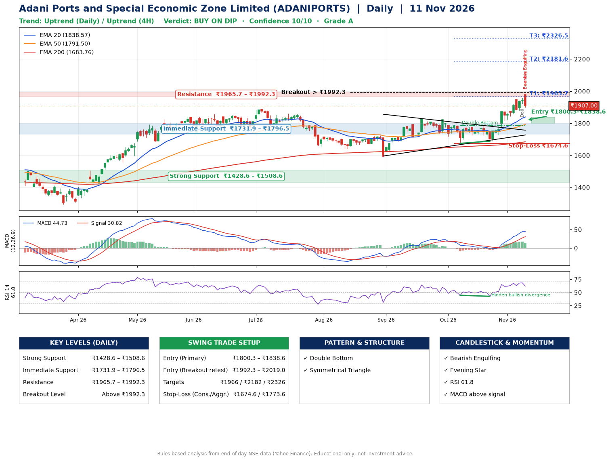

📌 **Adani Ports and Special Economic Zone Limited (ADANIPORTS) – Multi-Timeframe Technical Analysis (Daily + 4H Combined)**
_Data up to 11 Nov 2026 · Close ₹1907.00_

**📍 Daily Timeframe Trend**
- Trend: **Uptrend** (price above rising EMAs)
- Recent swing highs: ₹1824.0, ₹1822.0, ₹1784.9 · swing lows: ₹1593.1, ₹1674.2, ₹1687.9
- EMAs: EMA20 ₹1838.6, EMA50 ₹1791.5, EMA200 ₹1683.8; bullish stack (EMA20 > EMA50 > EMA200); price above EMA20, EMA50, EMA200
- MACD 44.73 above signal 30.82 (above zero); histogram falling
- RSI(14) 61.8; Hidden bullish divergence

**📍 4-Hour Timeframe Trend**
- Structure: **Uptrend** (higher highs and higher lows)
- Pullback/support area: recent 4H swing lows ₹1729.4, ₹1882.3; EMA20 ₹1879.8
- EMA20/50: bullish stack (EMA20 > EMA50); price above EMA20, EMA50
- MACD 41.53 above signal 40.38 (above zero); histogram falling
- RSI(14) 58.7; no divergence

**📍 Pattern Detection (Both Timeframes)**
- Daily: **Double Bottom** – bottoms near ₹1674.2/₹1687.9, neckline ₹1784.9, confirmed (closed above neckline)
- Daily: **Symmetrical Triangle** – converging swing highs and lows over the last ~60 sessions

**📍 Candlestick Patterns (last 3 daily candles)**
- **Doji** – 09 Nov: indecision; wait for the next candle to confirm direction
- **Bearish Engulfing** – 11 Nov: sellers fully reversed the prior green candle
- **Evening Star** – 11 Nov: three-candle bearish reversal

**📍 Price Action Key Levels (Daily Structure)**

| Zone | Price Level (₹) | Context |
|------|-----------------|---------|
| Strong Support | ₹1428.6 – ₹1508.6 | Cluster of earlier swing lows (demand) |
| Immediate Support | ₹1731.9 – ₹1796.5 | Nearest swing-low / wick area |
| Resistance | ₹1965.7 – ₹1992.3 | Nearest swing-high supply |
| Breakout Level | Above ₹1992.3 | Swing continuation trigger (52-week high ₹1979.0) |

**📍 Swing Trade Setup**

🟢 **Entry Zone**
- Primary: ₹1800.3 – ₹1838.6 (daily support / EMA20 area; enter on a bullish 4H candle)
- Alternate: ₹1992.3 – ₹2019.0 (breakout retest)

🎯 **Profit Targets**
- T1: ₹1965.7
- T2: ₹2181.6
- T3: ₹2326.5

🛑 **Stop-Loss**
- Conservative: below daily swing low (₹1674.6)
- Aggressive: below 4H structure (₹1773.6)
- Risk per share ≈ ₹144.9; reward:risk to T1 ≈ 1.0

**📌 Strategy Notes**
- Higher timeframe: daily trend is uptrend; only take longs while price holds above ₹1428.6.
- Entry timing: wait for a bullish 4H candle (engulfing/hammer) inside ₹1800.3 – ₹1838.6 rather than buying mid-range.
- EMA stacking: bullish stack (EMA20 > EMA50 > EMA200); price above EMA20, EMA50, EMA200.
- Breakout rule: a daily close above ₹1992.3 with volume above its 20-day average (≈2,931,250) opens T2/T3.
- Momentum: RSI 62 – room to run; Hidden bullish divergence.
- Exit discipline: move the stop to entry once T1 is hit; book partial profits at each target.

**STEP 2 — Marked Up Chart**

**✅ Trade Validation Checklist**
- Trend + momentum aligned: Yes · Price at entry zone: No
- Stop defined (₹1674.6) · Reward:risk ≥ 1.5 to T1: No

## 📌 Final Verdict

Recommendation: **🟡 BUY ON DIP**

Confidence: **10/10**

Trade Quality: **A**

Reason:
• Daily uptrend (price above rising EMAs)
• EMAs stacked bullishly

Next Action:
• Wait for a pullback to ₹1800.3–₹1838.6

_Rules-based analysis from end-of-day data. Educational only, not investment advice. Never place orders without your own confirmation._