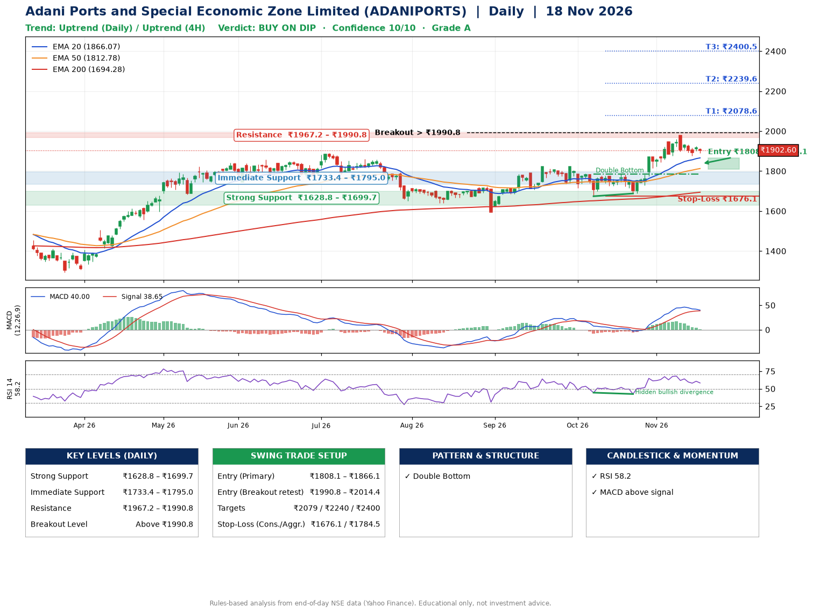

📌 **Adani Ports and Special Economic Zone Limited (ADANIPORTS) – Multi-Timeframe Technical Analysis (Daily + 4H Combined)**
_Data up to 18 Nov 2026 · Close ₹1902.60_

**📍 Daily Timeframe Trend**
- Trend: **Uptrend** (higher highs and higher lows)
- Recent swing highs: ₹1822.0, ₹1784.9, ₹1979.0 · swing lows: ₹1593.1, ₹1674.2, ₹1687.9
- EMAs: EMA20 ₹1866.1, EMA50 ₹1812.8, EMA200 ₹1694.3; bullish stack (EMA20 > EMA50 > EMA200); price above EMA20, EMA50, EMA200
- MACD 40.00 above signal 38.65 (above zero); histogram falling
- RSI(14) 58.2; Hidden bullish divergence

**📍 4-Hour Timeframe Trend**
- Structure: **Uptrend** (price above rising EMAs)
- Pullback/support area: recent 4H swing lows ₹1898.1, ₹1876.0; EMA20 ₹1896.6
- EMA20/50: bullish stack (EMA20 > EMA50); price above EMA20, EMA50
- MACD 18.78 below signal 26.25 (above zero); histogram rising
- RSI(14) 54.3; no divergence

**📍 Pattern Detection (Both Timeframes)**
- Daily: **Double Bottom** – bottoms near ₹1674.2/₹1687.9, neckline ₹1784.9, confirmed (closed above neckline)
- 4H: **Descending Triangle** – converging swing highs and lows over the last ~60 sessions

**📍 Candlestick Patterns (last 3 daily candles)**
- No notable candlestick signal in the last 3 sessions.

**📍 Price Action Key Levels (Daily Structure)**

| Zone | Price Level (₹) | Context |
|------|-----------------|---------|
| Strong Support | ₹1628.8 – ₹1699.7 | Cluster of earlier swing lows (demand) |
| Immediate Support | ₹1733.4 – ₹1795.0 | Nearest swing-low / wick area |
| Resistance | ₹1967.2 – ₹1990.8 | Nearest swing-high supply |
| Breakout Level | Above ₹1990.8 | Swing continuation trigger (52-week high ₹1979.0) |

**📍 Swing Trade Setup**

🟢 **Entry Zone**
- Primary: ₹1808.1 – ₹1866.1 (daily support / EMA20 area; enter on a bullish 4H candle)
- Alternate: ₹1990.8 – ₹2014.4 (breakout retest)

🎯 **Profit Targets**
- T1: ₹2078.6
- T2: ₹2239.6
- T3: ₹2400.5

🛑 **Stop-Loss**
- Conservative: below daily swing low (₹1676.1)
- Aggressive: below 4H structure (₹1784.5)
- Risk per share ≈ ₹161.0; reward:risk to T1 ≈ 1.5
- Time to T1: about 31 trading days (it rose this much within 60 trading days 38% of the time in the last 2 years)
- Time to T2: about 38 trading days (it rose this much within 60 trading days 19% of the time in the last 2 years)

**📌 Strategy Notes**
- Higher timeframe: daily trend is uptrend; only take longs while price holds above ₹1628.8.
- Entry timing: wait for a bullish 4H candle (engulfing/hammer) inside ₹1808.1 – ₹1866.1 rather than buying mid-range.
- EMA stacking: bullish stack (EMA20 > EMA50 > EMA200); price above EMA20, EMA50, EMA200.
- Breakout rule: a daily close above ₹1990.8 with volume above its 20-day average (≈2,750,483) opens T2/T3.
- Momentum: RSI 58 – room to run; Hidden bullish divergence.
- Exit discipline: move the stop to entry once T1 is hit; book partial profits at each target.

**STEP 2 — Marked Up Chart**

**✅ Trade Validation Checklist**
- Trend + momentum aligned: Yes · Price at entry zone: No
- Stop defined (₹1676.1) · Reward:risk ≥ 1.5 to T1: Yes

## 📌 Final Verdict

Recommendation: **🟡 BUY ON DIP**

Confidence: **10/10**

Trade Quality: **A**

Reason:
• Daily uptrend (higher highs and higher lows)
• EMAs stacked bullishly

Next Action:
• Wait for a pullback to ₹1808.1–₹1866.1, or a breakout above ₹1990.8

_Rules-based analysis from end-of-day data. Educational only, not investment advice. Never place orders without your own confirmation._