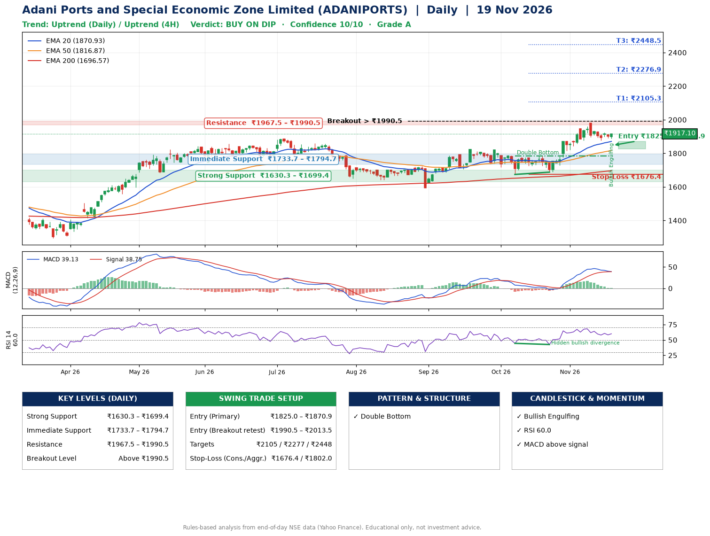

📌 **Adani Ports and Special Economic Zone Limited (ADANIPORTS) – Multi-Timeframe Technical Analysis (Daily + 4H Combined)**
_Data up to 19 Nov 2026 · Close ₹1917.10_

**📍 Daily Timeframe Trend**
- Trend: **Uptrend** (higher highs and higher lows)
- Recent swing highs: ₹1822.0, ₹1784.9, ₹1979.0 · swing lows: ₹1593.1, ₹1674.2, ₹1687.9
- EMAs: EMA20 ₹1870.9, EMA50 ₹1816.9, EMA200 ₹1696.6; bullish stack (EMA20 > EMA50 > EMA200); price above EMA20, EMA50, EMA200
- MACD 39.13 above signal 38.75 (above zero); histogram falling
- RSI(14) 60.0; Hidden bullish divergence

**📍 4-Hour Timeframe Trend**
- Structure: **Uptrend** (price above rising EMAs)
- Pullback/support area: recent 4H swing lows ₹1898.1, ₹1876.0; EMA20 ₹1898.8
- EMA20/50: bullish stack (EMA20 > EMA50); price above EMA20, EMA50
- MACD 16.63 below signal 22.83 (above zero); histogram rising
- RSI(14) 57.4; no divergence

**📍 Pattern Detection (Both Timeframes)**
- Daily: **Double Bottom** – bottoms near ₹1674.2/₹1687.9, neckline ₹1784.9, confirmed (closed above neckline)
- 4H: **Descending Triangle** – converging swing highs and lows over the last ~60 sessions

**📍 Candlestick Patterns (last 3 daily candles)**
- **Bullish Engulfing** – 19 Nov: buyers fully reversed the prior red candle

**📍 Price Action Key Levels (Daily Structure)**

| Zone | Price Level (₹) | Context |
|------|-----------------|---------|
| Strong Support | ₹1630.3 – ₹1699.4 | Cluster of earlier swing lows (demand) |
| Immediate Support | ₹1733.7 – ₹1794.7 | Nearest swing-low / wick area |
| Resistance | ₹1967.5 – ₹1990.5 | Nearest swing-high supply |
| Breakout Level | Above ₹1990.5 | Swing continuation trigger (52-week high ₹1979.0) |

**📍 Swing Trade Setup**

🟢 **Entry Zone**
- Primary: ₹1825.0 – ₹1870.9 (daily support / EMA20 area; enter on a bullish 4H candle)
- Alternate: ₹1990.5 – ₹2013.5 (breakout retest)

🎯 **Profit Targets**
- T1: ₹2105.3
- T2: ₹2276.9
- T3: ₹2448.5

🛑 **Stop-Loss**
- Conservative: below daily swing low (₹1676.4)
- Aggressive: below 4H structure (₹1802.0)
- Risk per share ≈ ₹171.6; reward:risk to T1 ≈ 1.5
- Time to T1: about 31 trading days (it rose this much within 60 trading days 37% of the time in the last 2 years)
- Time to T2: about 38 trading days (it rose this much within 60 trading days 17% of the time in the last 2 years)

**📌 Strategy Notes**
- Higher timeframe: daily trend is uptrend; only take longs while price holds above ₹1630.3.
- Entry timing: wait for a bullish 4H candle (engulfing/hammer) inside ₹1825.0 – ₹1870.9 rather than buying mid-range.
- EMA stacking: bullish stack (EMA20 > EMA50 > EMA200); price above EMA20, EMA50, EMA200.
- Breakout rule: a daily close above ₹1990.5 with volume above its 20-day average (≈2,700,910) opens T2/T3.
- Momentum: RSI 60 – room to run; Hidden bullish divergence.
- Exit discipline: move the stop to entry once T1 is hit; book partial profits at each target.

**STEP 2 — Marked Up Chart**

**✅ Trade Validation Checklist**
- Trend + momentum aligned: Yes · Price at entry zone: No
- Stop defined (₹1676.4) · Reward:risk ≥ 1.5 to T1: No

## 📌 Final Verdict

Recommendation: **🟡 BUY ON DIP**

Confidence: **10/10**

Trade Quality: **A**

Reason:
• Daily uptrend (higher highs and higher lows)
• EMAs stacked bullishly

Next Action:
• Wait for a pullback to ₹1825.0–₹1870.9, or a breakout above ₹1990.5

_Rules-based analysis from end-of-day data. Educational only, not investment advice. Never place orders without your own confirmation._