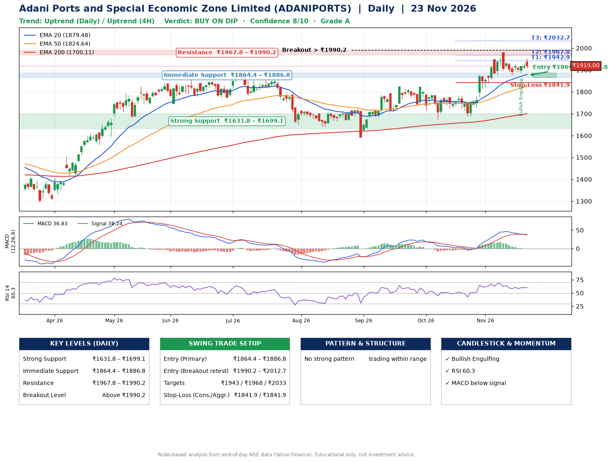

📌 **Adani Ports and Special Economic Zone Limited (ADANIPORTS) – Multi-Timeframe Technical Analysis (Daily + 4H Combined)**
_Data up to 23 Nov 2026 · Close ₹1919.00_

**📍 Daily Timeframe Trend**
- Trend: **Uptrend** (higher highs and higher lows)
- Recent swing highs: ₹1822.0, ₹1784.9, ₹1979.0 · swing lows: ₹1674.2, ₹1687.9, ₹1875.6
- EMAs: EMA20 ₹1879.5, EMA50 ₹1824.6, EMA200 ₹1700.1; bullish stack (EMA20 > EMA50 > EMA200); price above EMA20, EMA50, EMA200
- MACD 36.83 below signal 38.24 (above zero), fresh bearish crossover; histogram falling
- RSI(14) 60.3; no divergence on the last two swings

**📍 4-Hour Timeframe Trend**
- Structure: **Uptrend** (price above rising EMAs)
- Pullback/support area: recent 4H swing lows ₹1876.0, ₹1888.0; EMA20 ₹1906.2
- EMA20/50: bullish stack (EMA20 > EMA50); price above EMA20, EMA50
- MACD 15.35 below signal 18.84 (above zero); histogram rising
- RSI(14) 56.6; Hidden bullish divergence

**📍 Pattern Detection (Both Timeframes)**
- No strong pattern detected. Trading within range.

**📍 Candlestick Patterns (last 3 daily candles)**
- **Bullish Engulfing** – 19 Nov: buyers fully reversed the prior red candle

**📍 Price Action Key Levels (Daily Structure)**

| Zone | Price Level (₹) | Context |
|------|-----------------|---------|
| Strong Support | ₹1631.8 – ₹1699.1 | Cluster of earlier swing lows (demand) |
| Immediate Support | ₹1864.4 – ₹1886.8 | Nearest swing-low / wick area |
| Resistance | ₹1967.8 – ₹1990.2 | Nearest swing-high supply |
| Breakout Level | Above ₹1990.2 | Swing continuation trigger (52-week high ₹1979.0) |

**📍 Swing Trade Setup**

🟢 **Entry Zone**
- Primary: ₹1864.4 – ₹1886.8 (daily support / EMA20 area; enter on a bullish 4H candle)
- Alternate: ₹1990.2 – ₹2012.7 (breakout retest)

🎯 **Profit Targets**
- T1: ₹1942.9
- T2: ₹1967.8
- T3: ₹2032.7

🛑 **Stop-Loss**
- Conservative: below daily swing low (₹1841.9)
- Aggressive: below 4H structure (₹1841.9)
- Risk per share ≈ ₹44.9; reward:risk to T1 ≈ 1.5
- Time to T1: about 8 trading days (it rose this much within 60 trading days 84% of the time in the last 2 years)
- Time to T2: about 12 trading days (it rose this much within 60 trading days 77% of the time in the last 2 years)

**📌 Strategy Notes**
- Higher timeframe: daily trend is uptrend; only take longs while price holds above ₹1631.8.
- Entry timing: wait for a bullish 4H candle (engulfing/hammer) inside ₹1864.4 – ₹1886.8 rather than buying mid-range.
- EMA stacking: bullish stack (EMA20 > EMA50 > EMA200); price above EMA20, EMA50, EMA200.
- Breakout rule: a daily close above ₹1990.2 with volume above its 20-day average (≈2,760,882) opens T2/T3.
- Momentum: RSI 60 – room to run; no divergence on the last two swings.
- Exit discipline: move the stop to entry once T1 is hit; book partial profits at each target.

**STEP 2 — Marked Up Chart**

**✅ Trade Validation Checklist**
- Trend + momentum aligned: No · Price at entry zone: No
- Stop defined (₹1841.9) · Reward:risk ≥ 1.5 to T1: No

## 📌 Final Verdict

Recommendation: **🟡 BUY ON DIP**

Confidence: **8/10**

Trade Quality: **A**

Reason:
• Daily uptrend (higher highs and higher lows)
• EMAs stacked bullishly

Next Action:
• Wait for a pullback to ₹1864.4–₹1886.8, or a breakout above ₹1990.2

_Rules-based analysis from end-of-day data. Educational only, not investment advice. Never place orders without your own confirmation._