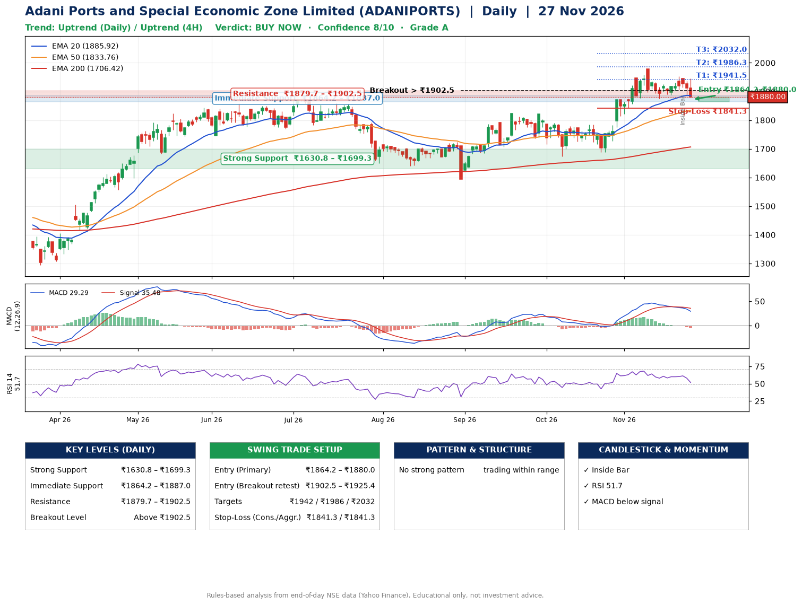

📌 **Adani Ports and Special Economic Zone Limited (ADANIPORTS) – Multi-Timeframe Technical Analysis (Daily + 4H Combined)**
_Data up to 27 Nov 2026 · Close ₹1880.00_

**📍 Daily Timeframe Trend**
- Trend: **Uptrend** (higher highs and higher lows)
- Recent swing highs: ₹1822.0, ₹1784.9, ₹1979.0 · swing lows: ₹1674.2, ₹1687.9, ₹1875.6
- EMAs: EMA20 ₹1885.9, EMA50 ₹1833.8, EMA200 ₹1706.4; bullish stack (EMA20 > EMA50 > EMA200); price above EMA50, EMA200
- MACD 29.29 below signal 35.48 (above zero), fresh bearish crossover; histogram falling
- RSI(14) 51.7; no divergence on the last two swings

**📍 4-Hour Timeframe Trend**
- Structure: **Uptrend** (higher highs and higher lows)
- Pullback/support area: recent 4H swing lows ₹1876.0, ₹1888.0; EMA20 ₹1905.3
- EMA20/50: bullish stack (EMA20 > EMA50); price above EMA50
- MACD 5.93 below signal 12.55 (above zero); histogram falling
- RSI(14) 43.6; Hidden bullish divergence; Regular bearish divergence

**📍 Pattern Detection (Both Timeframes)**
- No strong pattern detected. Trading within range.

**📍 Candlestick Patterns (last 3 daily candles)**
- **Inside Bar** – 25 Nov: compression inside the prior range ₹1906.6–₹1952.9

**📍 Price Action Key Levels (Daily Structure)**

| Zone | Price Level (₹) | Context |
|------|-----------------|---------|
| Strong Support | ₹1630.8 – ₹1699.3 | Cluster of earlier swing lows (demand) |
| Immediate Support | ₹1864.2 – ₹1887.0 | Nearest swing-low / wick area |
| Resistance | ₹1879.7 – ₹1902.5 | Nearest swing-high supply |
| Breakout Level | Above ₹1902.5 | Swing continuation trigger (52-week high ₹1979.0) |

**📍 Swing Trade Setup**

🟢 **Entry Zone**
- Primary: ₹1864.2 – ₹1880.0 (daily support / EMA20 area; enter on a bullish 4H candle)
- Alternate: ₹1902.5 – ₹1925.4 (breakout retest)

🎯 **Profit Targets**
- T1: ₹1941.5
- T2: ₹1986.3
- T3: ₹2032.0

🛑 **Stop-Loss**
- Conservative: below daily swing low (₹1841.3)
- Aggressive: below 4H structure (₹1841.3)
- Risk per share ≈ ₹45.7; reward:risk to T1 ≈ 1.5
- Time to T1: about 9 trading days (it rose this much within 60 trading days 84% of the time in the last 2 years)
- Time to T2: about 14 trading days (it rose this much within 60 trading days 68% of the time in the last 2 years)

**📌 Strategy Notes**
- Higher timeframe: daily trend is uptrend; only take longs while price holds above ₹1630.8.
- Entry timing: wait for a bullish 4H candle (engulfing/hammer) inside ₹1864.2 – ₹1880.0 rather than buying mid-range.
- EMA stacking: bullish stack (EMA20 > EMA50 > EMA200); price above EMA50, EMA200.
- Breakout rule: a daily close above ₹1902.5 with volume above its 20-day average (≈3,096,861) opens T2/T3.
- Momentum: RSI 52 – room to run; no divergence on the last two swings.
- Exit discipline: move the stop to entry once T1 is hit; book partial profits at each target.

**STEP 2 — Marked Up Chart**

**✅ Trade Validation Checklist**
- Trend + momentum aligned: No · Price at entry zone: Yes
- Stop defined (₹1841.3) · Reward:risk ≥ 1.5 to T1: Yes

## 📌 Final Verdict

Recommendation: **🟢 BUY NOW**

Confidence: **8/10**

Trade Quality: **A**

Reason:
• Daily uptrend (higher highs and higher lows)
• EMAs stacked bullishly

Next Action:
• Buy now within the entry zone, with the stop-loss in place

_Rules-based analysis from end-of-day data. Educational only, not investment advice. Never place orders without your own confirmation._