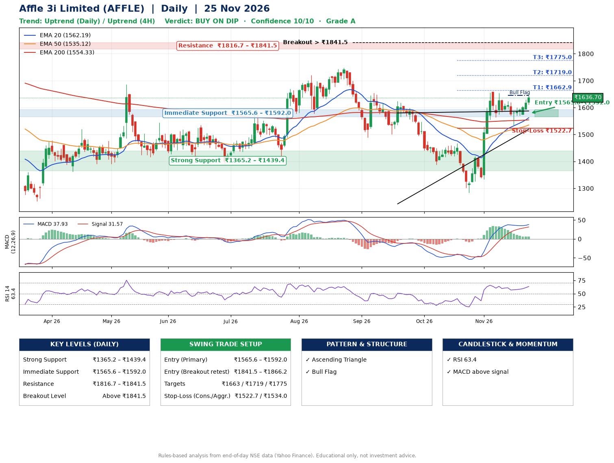

📌 **Affle 3i Limited (AFFLE) – Multi-Timeframe Technical Analysis (Daily + 4H Combined)**
_Data up to 25 Nov 2026 · Close ₹1636.70_

**📍 Daily Timeframe Trend**
- Trend: **Uptrend** (higher highs and higher lows)
- Recent swing highs: ₹1623.5, ₹1466.9, ₹1658.0 · swing lows: ₹1388.1, ₹1283.0, ₹1535.1
- EMAs: EMA20 ₹1562.2, EMA50 ₹1535.1, EMA200 ₹1554.3; mixed / crossing; price above EMA20, EMA50, EMA200
- MACD 37.93 above signal 31.57 (above zero); histogram rising
- RSI(14) 63.4; no divergence on the last two swings

**📍 4-Hour Timeframe Trend**
- Structure: **Uptrend** (price above rising EMAs)
- Pullback/support area: recent 4H swing lows ₹1563.5, ₹1536.7; EMA20 ₹1593.3
- EMA20/50: bullish stack (EMA20 > EMA50); price above EMA20, EMA50
- MACD 24.55 below signal 25.47 (above zero); histogram rising
- RSI(14) 66.6; no divergence

**📍 Pattern Detection (Both Timeframes)**
- Daily: **Ascending Triangle** – converging swing highs and lows over the last ~60 sessions
- Daily: **Bull Flag** – 16% pole then a tight 7% flag; trigger above ₹1645.6
- 4H: **Double Bottom** – bottoms near ₹1563.5/₹1536.7, neckline ₹1651.0, forming
- 4H: **Symmetrical Triangle** – converging swing highs and lows over the last ~60 sessions
- 4H: **Bull Flag** – 18% pole then a tight 5% flag; trigger above ₹1644.3

**📍 Candlestick Patterns (last 3 daily candles)**
- No notable candlestick signal in the last 3 sessions.

**📍 Price Action Key Levels (Daily Structure)**

| Zone | Price Level (₹) | Context |
|------|-----------------|---------|
| Strong Support | ₹1365.2 – ₹1439.4 | Cluster of earlier swing lows (demand) |
| Immediate Support | ₹1565.6 – ₹1592.0 | Nearest swing-low / wick area |
| Resistance | ₹1816.7 – ₹1841.5 | Nearest swing-high supply |
| Breakout Level | Above ₹1841.5 | Swing continuation trigger (52-week high ₹1829.1) |

**📍 Swing Trade Setup**

🟢 **Entry Zone**
- Primary: ₹1565.6 – ₹1592.0 (daily support / EMA20 area; enter on a bullish 4H candle)
- Alternate: ₹1841.5 – ₹1866.2 (breakout retest)

🎯 **Profit Targets**
- T1: ₹1662.9
- T2: ₹1719.0
- T3: ₹1775.0

🛑 **Stop-Loss**
- Conservative: below daily swing low (₹1522.7)
- Aggressive: below 4H structure (₹1534.0)
- Risk per share ≈ ₹56.1; reward:risk to T1 ≈ 1.5
- Time to T1: about 8 trading days (it rose this much within 60 trading days 76% of the time in the last 2 years)
- Time to T2: about 15 trading days (it rose this much within 60 trading days 64% of the time in the last 2 years)

**📌 Strategy Notes**
- Higher timeframe: daily trend is uptrend; only take longs while price holds above ₹1365.2.
- Entry timing: wait for a bullish 4H candle (engulfing/hammer) inside ₹1565.6 – ₹1592.0 rather than buying mid-range.
- EMA stacking: mixed / crossing; price above EMA20, EMA50, EMA200.
- Breakout rule: a daily close above ₹1841.5 with volume above its 20-day average (≈416,284) opens T2/T3.
- Momentum: RSI 63 – room to run; no divergence on the last two swings.
- Exit discipline: move the stop to entry once T1 is hit; book partial profits at each target.

**STEP 2 — Marked Up Chart**

**✅ Trade Validation Checklist**
- Trend + momentum aligned: Yes · Price at entry zone: No
- Stop defined (₹1522.7) · Reward:risk ≥ 1.5 to T1: Yes

## 📌 Final Verdict

Recommendation: **🟡 BUY ON DIP**

Confidence: **10/10**

Trade Quality: **A**

Reason:
• Daily uptrend (higher highs and higher lows)
• Ascending Triangle: converging swing highs and lows over the last ~60 sessions

Next Action:
• Wait for a pullback to ₹1565.6–₹1592.0, or a breakout above ₹1841.5

_Rules-based analysis from end-of-day data. Educational only, not investment advice. Never place orders without your own confirmation._