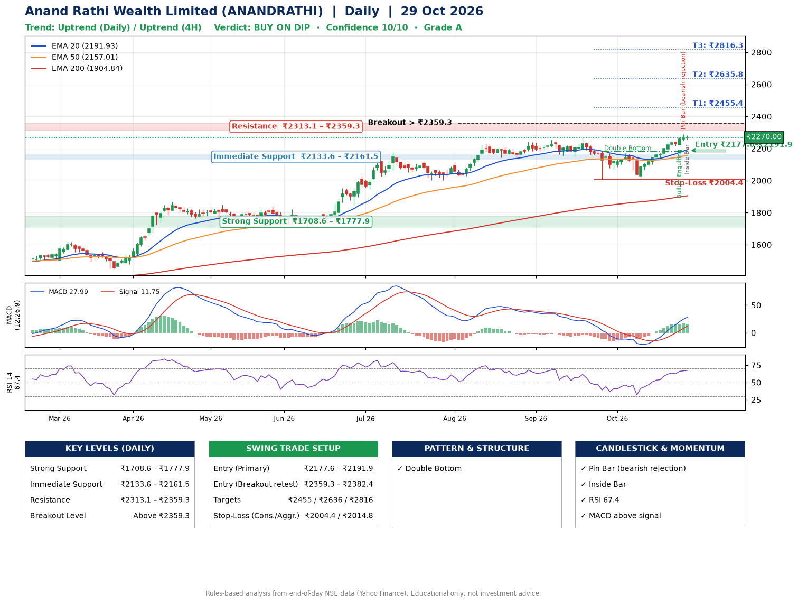

📌 **Anand Rathi Wealth Limited (ANANDRATHI) – Multi-Timeframe Technical Analysis (Daily + 4H Combined)**
_Data up to 29 Oct 2026 · Close ₹2270.00_

**📍 Daily Timeframe Trend**
- Trend: **Uptrend** (price above rising EMAs)
- Recent swing highs: ₹2255.0, ₹2268.4, ₹2169.9 · swing lows: ₹2150.0, ₹2007.0, ₹2015.9
- EMAs: EMA20 ₹2191.9, EMA50 ₹2157.0, EMA200 ₹1904.8; bullish stack (EMA20 > EMA50 > EMA200); price above EMA20, EMA50, EMA200
- MACD 27.99 above signal 11.75 (above zero); histogram falling
- RSI(14) 67.4; no divergence on the last two swings

**📍 4-Hour Timeframe Trend**
- Structure: **Uptrend** (price above rising EMAs)
- Pullback/support area: recent 4H swing lows ₹2073.1, ₹2017.5; EMA20 ₹2218.6
- EMA20/50: bullish stack (EMA20 > EMA50); price above EMA20, EMA50
- MACD 35.59 above signal 30.34 (above zero); histogram falling
- RSI(14) 70.8; Regular bullish divergence

**📍 Pattern Detection (Both Timeframes)**
- Daily: **Double Bottom** – bottoms near ₹2007.0/₹2015.9, neckline ₹2178.9, confirmed (closed above neckline)
- 4H: **Double Bottom** – bottoms near ₹2073.1/₹2017.5, neckline ₹2169.9, confirmed (closed above neckline)

**📍 Candlestick Patterns (last 3 daily candles)**
- **Bullish Engulfing** – 27 Oct: buyers fully reversed the prior red candle
- **Pin Bar (bearish rejection)** – 28 Oct: long upper wick shows selling near ₹2290.0
- **Inside Bar** – 29 Oct: compression inside the prior range ₹2248.2–₹2290.0

**📍 Price Action Key Levels (Daily Structure)**

| Zone | Price Level (₹) | Context |
|------|-----------------|---------|
| Strong Support | ₹1708.6 – ₹1777.9 | Cluster of earlier swing lows (demand) |
| Immediate Support | ₹2133.6 – ₹2161.5 | Nearest swing-low / wick area |
| Resistance | ₹2313.1 – ₹2359.3 | Nearest swing-high supply |
| Breakout Level | Above ₹2359.3 | Swing continuation trigger (52-week high ₹2290.0) |

**📍 Swing Trade Setup**

🟢 **Entry Zone**
- Primary: ₹2177.6 – ₹2191.9 (daily support / EMA20 area; enter on a bullish 4H candle)
- Alternate: ₹2359.3 – ₹2382.4 (breakout retest)

🎯 **Profit Targets**
- T1: ₹2455.4
- T2: ₹2635.8
- T3: ₹2816.3

🛑 **Stop-Loss**
- Conservative: below daily swing low (₹2004.4)
- Aggressive: below 4H structure (₹2014.8)
- Risk per share ≈ ₹180.4; reward:risk to T1 ≈ 1.5

**📌 Strategy Notes**
- Higher timeframe: daily trend is uptrend; only take longs while price holds above ₹1708.6.
- Entry timing: wait for a bullish 4H candle (engulfing/hammer) inside ₹2177.6 – ₹2191.9 rather than buying mid-range.
- EMA stacking: bullish stack (EMA20 > EMA50 > EMA200); price above EMA20, EMA50, EMA200.
- Breakout rule: a daily close above ₹2359.3 with volume above its 20-day average (≈509,005) opens T2/T3.
- Momentum: RSI 67 – elevated, prefer dips; no divergence on the last two swings.
- Exit discipline: move the stop to entry once T1 is hit; book partial profits at each target.

**STEP 2 — Marked Up Chart**

**✅ Trade Validation Checklist**
- Trend + momentum aligned: Yes · Price at entry zone: No
- Stop defined (₹2004.4) · Reward:risk ≥ 1.5 to T1: No

## 📌 Final Verdict

Recommendation: **🟡 BUY ON DIP**

Confidence: **10/10**

Trade Quality: **A**

Reason:
• Daily uptrend (price above rising EMAs)
• EMAs stacked bullishly

Next Action:
• Wait for a pullback to ₹2177.6–₹2191.9

_Rules-based analysis from end-of-day data. Educational only, not investment advice. Never place orders without your own confirmation._