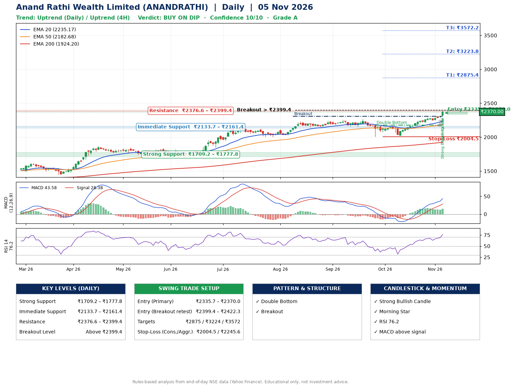

📌 **Anand Rathi Wealth Limited (ANANDRATHI) – Multi-Timeframe Technical Analysis (Daily + 4H Combined)**
_Data up to 05 Nov 2026 · Close ₹2370.00_

**📍 Daily Timeframe Trend**
- Trend: **Uptrend** (price above rising EMAs)
- Recent swing highs: ₹2255.0, ₹2268.4, ₹2169.9 · swing lows: ₹2150.0, ₹2007.0, ₹2015.9
- EMAs: EMA20 ₹2235.2, EMA50 ₹2182.7, EMA200 ₹1924.2; bullish stack (EMA20 > EMA50 > EMA200); price above EMA20, EMA50, EMA200
- MACD 43.58 above signal 28.38 (above zero); histogram rising
- RSI(14) 76.2; no divergence on the last two swings

**📍 4-Hour Timeframe Trend**
- Structure: **Uptrend** (higher highs and higher lows)
- Pullback/support area: recent 4H swing lows ₹2017.5, ₹2248.3; EMA20 ₹2276.0
- EMA20/50: bullish stack (EMA20 > EMA50); price above EMA20, EMA50
- MACD 41.57 above signal 35.18 (above zero), fresh bullish crossover; histogram rising
- RSI(14) 78.7; no divergence

**📍 Pattern Detection (Both Timeframes)**
- Daily: **Double Bottom** – bottoms near ₹2007.0/₹2015.9, neckline ₹2178.9, confirmed (closed above neckline)
- Daily: **Breakout** – closed above the 60-session high ₹2309.0 on strong volume

**📍 Candlestick Patterns (last 3 daily candles)**
- **Doji** – 04 Nov: indecision; wait for the next candle to confirm direction
- **Strong Bullish Candle** – 05 Nov: wide-range green candle, buyers in control
- **Morning Star** – 05 Nov: three-candle bullish reversal

**📍 Price Action Key Levels (Daily Structure)**

| Zone | Price Level (₹) | Context |
|------|-----------------|---------|
| Strong Support | ₹1709.2 – ₹1777.8 | Cluster of earlier swing lows (demand) |
| Immediate Support | ₹2133.7 – ₹2161.4 | Nearest swing-low / wick area |
| Resistance | ₹2376.6 – ₹2399.4 | Nearest swing-high supply |
| Breakout Level | Above ₹2399.4 | Swing continuation trigger (52-week high ₹2388.0) |

**📍 Swing Trade Setup**

🟢 **Entry Zone**
- Primary: ₹2335.7 – ₹2370.0 (daily support / EMA20 area; enter on a bullish 4H candle)
- Alternate: ₹2399.4 – ₹2422.3 (breakout retest)

🎯 **Profit Targets**
- T1: ₹2875.4
- T2: ₹3223.8
- T3: ₹3572.2

🛑 **Stop-Loss**
- Conservative: below daily swing low (₹2004.5)
- Aggressive: below 4H structure (₹2245.6)
- Risk per share ≈ ₹348.4; reward:risk to T1 ≈ 1.5

**📌 Strategy Notes**
- Higher timeframe: daily trend is uptrend; only take longs while price holds above ₹1709.2.
- Entry timing: wait for a bullish 4H candle (engulfing/hammer) inside ₹2335.7 – ₹2370.0 rather than buying mid-range.
- EMA stacking: bullish stack (EMA20 > EMA50 > EMA200); price above EMA20, EMA50, EMA200.
- Breakout rule: a daily close above ₹2399.4 with volume above its 20-day average (≈502,163) opens T2/T3.
- Momentum: RSI 76 – elevated, prefer dips; no divergence on the last two swings.
- Exit discipline: move the stop to entry once T1 is hit; book partial profits at each target.

**STEP 2 — Marked Up Chart**

**✅ Trade Validation Checklist**
- Trend + momentum aligned: Yes · Price at entry zone: Yes
- Stop defined (₹2004.5) · Reward:risk ≥ 1.5 to T1: No

## 📌 Final Verdict

Recommendation: **🟡 BUY ON DIP**

Confidence: **10/10**

Trade Quality: **A**

Reason:
• Daily uptrend (price above rising EMAs)
• EMAs stacked bullishly

Next Action:
• Wait for a pullback to ₹2335.7–₹2370.0, or a breakout above ₹2399.4

_Rules-based analysis from end-of-day data. Educational only, not investment advice. Never place orders without your own confirmation._