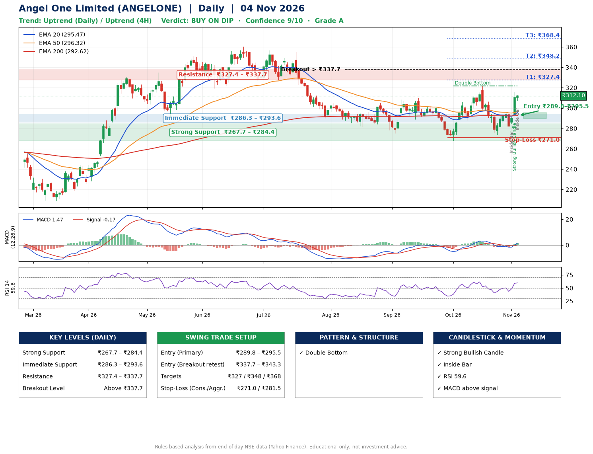

📌 **Angel One Limited (ANGELONE) – Multi-Timeframe Technical Analysis (Daily + 4H Combined)**
_Data up to 04 Nov 2026 · Close ₹312.10_

**📍 Daily Timeframe Trend**
- Trend: **Uptrend** (higher highs and higher lows)
- Recent swing highs: ₹308.4, ₹310.0, ₹321.9 · swing lows: ₹289.0, ₹267.8, ₹273.8
- EMAs: EMA20 ₹295.5, EMA50 ₹296.3, EMA200 ₹292.6; mixed / crossing; price above EMA20, EMA50, EMA200
- MACD 1.47 above signal -0.17 (above zero), fresh bullish crossover; histogram rising
- RSI(14) 59.6; no divergence on the last two swings

**📍 4-Hour Timeframe Trend**
- Structure: **Uptrend** (price above rising EMAs)
- Pullback/support area: recent 4H swing lows ₹274.0, ₹282.2; EMA20 ₹297.3
- EMA20/50: bullish stack (EMA20 > EMA50); price above EMA20, EMA50
- MACD 3.60 above signal 0.69 (above zero), fresh bullish crossover; histogram rising
- RSI(14) 63.5; Hidden bullish divergence; Hidden bearish divergence

**📍 Pattern Detection (Both Timeframes)**
- Daily: **Double Bottom** – bottoms near ₹267.8/₹273.8, neckline ₹321.9, forming

**📍 Candlestick Patterns (last 3 daily candles)**
- **Inside Bar** – 02 Nov: compression inside the prior range ₹282.2–₹293.6
- **Strong Bullish Candle** – 03 Nov: wide-range green candle, buyers in control
- **Inside Bar** – 04 Nov: compression inside the prior range ₹292.1–₹315.9

**📍 Price Action Key Levels (Daily Structure)**

| Zone | Price Level (₹) | Context |
|------|-----------------|---------|
| Strong Support | ₹267.7 – ₹284.4 | Cluster of earlier swing lows (demand) |
| Immediate Support | ₹286.3 – ₹293.6 | Nearest swing-low / wick area |
| Resistance | ₹327.4 – ₹337.7 | Nearest swing-high supply |
| Breakout Level | Above ₹337.7 | Swing continuation trigger (52-week high ₹360.5) |

**📍 Swing Trade Setup**

🟢 **Entry Zone**
- Primary: ₹289.8 – ₹295.5 (daily support / EMA20 area; enter on a bullish 4H candle)
- Alternate: ₹337.7 – ₹343.3 (breakout retest)

🎯 **Profit Targets**
- T1: ₹327.4
- T2: ₹348.2
- T3: ₹368.4

🛑 **Stop-Loss**
- Conservative: below daily swing low (₹271.0)
- Aggressive: below 4H structure (₹281.5)
- Risk per share ≈ ₹21.6; reward:risk to T1 ≈ 1.6

**📌 Strategy Notes**
- Higher timeframe: daily trend is uptrend; only take longs while price holds above ₹267.7.
- Entry timing: wait for a bullish 4H candle (engulfing/hammer) inside ₹289.8 – ₹295.5 rather than buying mid-range.
- EMA stacking: mixed / crossing; price above EMA20, EMA50, EMA200.
- Breakout rule: a daily close above ₹337.7 with volume above its 20-day average (≈6,730,028) opens T2/T3.
- Momentum: RSI 60 – room to run; no divergence on the last two swings.
- Exit discipline: move the stop to entry once T1 is hit; book partial profits at each target.

**STEP 2 — Marked Up Chart**

**✅ Trade Validation Checklist**
- Trend + momentum aligned: Yes · Price at entry zone: No
- Stop defined (₹271.0) · Reward:risk ≥ 1.5 to T1: Yes

## 📌 Final Verdict

Recommendation: **🟡 BUY ON DIP**

Confidence: **9/10**

Trade Quality: **A**

Reason:
• Daily uptrend (higher highs and higher lows)
• Double Bottom: bottoms near ₹267.8/₹273.8, neckline ₹321.9, forming

Next Action:
• Wait for a pullback to ₹289.8–₹295.5

_Rules-based analysis from end-of-day data. Educational only, not investment advice. Never place orders without your own confirmation._