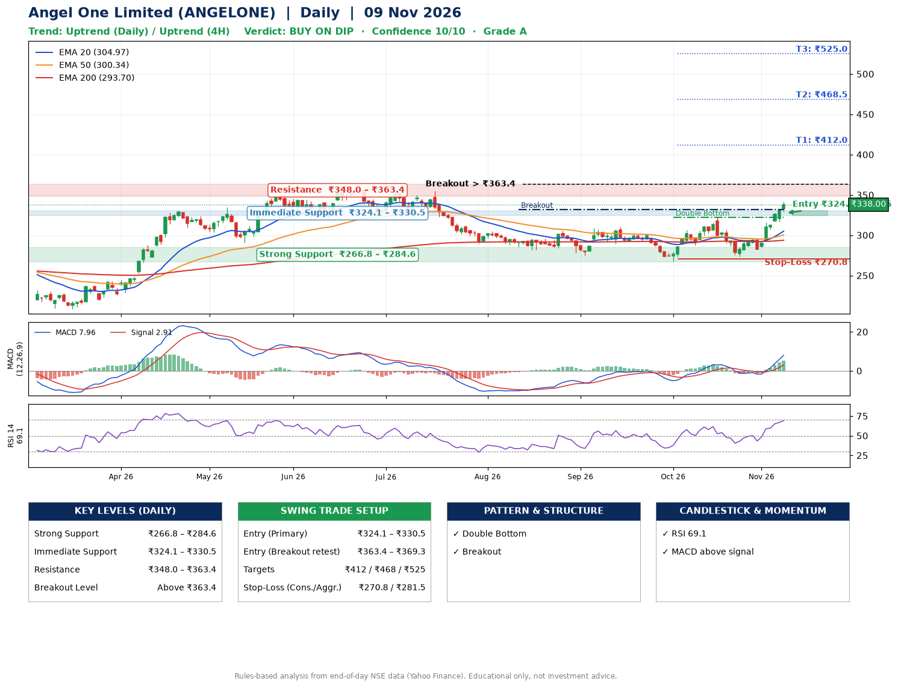

📌 **Angel One Limited (ANGELONE) – Multi-Timeframe Technical Analysis (Daily + 4H Combined)**
_Data up to 09 Nov 2026 · Close ₹338.00_

**📍 Daily Timeframe Trend**
- Trend: **Uptrend** (higher highs and higher lows)
- Recent swing highs: ₹308.4, ₹310.0, ₹321.9 · swing lows: ₹289.0, ₹267.8, ₹273.8
- EMAs: EMA20 ₹305.0, EMA50 ₹300.3, EMA200 ₹293.7; bullish stack (EMA20 > EMA50 > EMA200); price above EMA20, EMA50, EMA200
- MACD 7.96 above signal 2.91 (above zero), fresh bullish crossover; histogram rising
- RSI(14) 69.1; no divergence on the last two swings

**📍 4-Hour Timeframe Trend**
- Structure: **Uptrend** (price above rising EMAs)
- Pullback/support area: recent 4H swing lows ₹274.0, ₹282.2; EMA20 ₹312.7
- EMA20/50: bullish stack (EMA20 > EMA50); price above EMA20, EMA50
- MACD 10.99 above signal 6.80 (above zero); histogram falling
- RSI(14) 74.9; Hidden bullish divergence; Hidden bearish divergence

**📍 Pattern Detection (Both Timeframes)**
- Daily: **Double Bottom** – bottoms near ₹267.8/₹273.8, neckline ₹321.9, confirmed (closed above neckline)
- Daily: **Breakout** – closed above the 60-session high ₹331.8 (volume not confirming yet)

**📍 Candlestick Patterns (last 3 daily candles)**
- No notable candlestick signal in the last 3 sessions.

**📍 Price Action Key Levels (Daily Structure)**

| Zone | Price Level (₹) | Context |
|------|-----------------|---------|
| Strong Support | ₹266.8 – ₹284.6 | Cluster of earlier swing lows (demand) |
| Immediate Support | ₹324.1 – ₹330.5 | Nearest swing-low / wick area |
| Resistance | ₹348.0 – ₹363.4 | Nearest swing-high supply |
| Breakout Level | Above ₹363.4 | Swing continuation trigger (52-week high ₹360.5) |

**📍 Swing Trade Setup**

🟢 **Entry Zone**
- Primary: ₹324.1 – ₹330.5 (daily support / EMA20 area; enter on a bullish 4H candle)
- Alternate: ₹363.4 – ₹369.3 (breakout retest)

🎯 **Profit Targets**
- T1: ₹412.0
- T2: ₹468.5
- T3: ₹525.0

🛑 **Stop-Loss**
- Conservative: below daily swing low (₹270.8)
- Aggressive: below 4H structure (₹281.5)
- Risk per share ≈ ₹56.5; reward:risk to T1 ≈ 1.5

**📌 Strategy Notes**
- Higher timeframe: daily trend is uptrend; only take longs while price holds above ₹266.8.
- Entry timing: wait for a bullish 4H candle (engulfing/hammer) inside ₹324.1 – ₹330.5 rather than buying mid-range.
- EMA stacking: bullish stack (EMA20 > EMA50 > EMA200); price above EMA20, EMA50, EMA200.
- Breakout rule: a daily close above ₹363.4 with volume above its 20-day average (≈6,793,865) opens T2/T3.
- Momentum: RSI 69 – elevated, prefer dips; no divergence on the last two swings.
- Exit discipline: move the stop to entry once T1 is hit; book partial profits at each target.

**STEP 2 — Marked Up Chart**

**✅ Trade Validation Checklist**
- Trend + momentum aligned: Yes · Price at entry zone: No
- Stop defined (₹270.8) · Reward:risk ≥ 1.5 to T1: No

## 📌 Final Verdict

Recommendation: **🟡 BUY ON DIP**

Confidence: **10/10**

Trade Quality: **A**

Reason:
• Daily uptrend (higher highs and higher lows)
• EMAs stacked bullishly

Next Action:
• Wait for a pullback to ₹324.1–₹330.5, or a breakout above ₹363.4

_Rules-based analysis from end-of-day data. Educational only, not investment advice. Never place orders without your own confirmation._