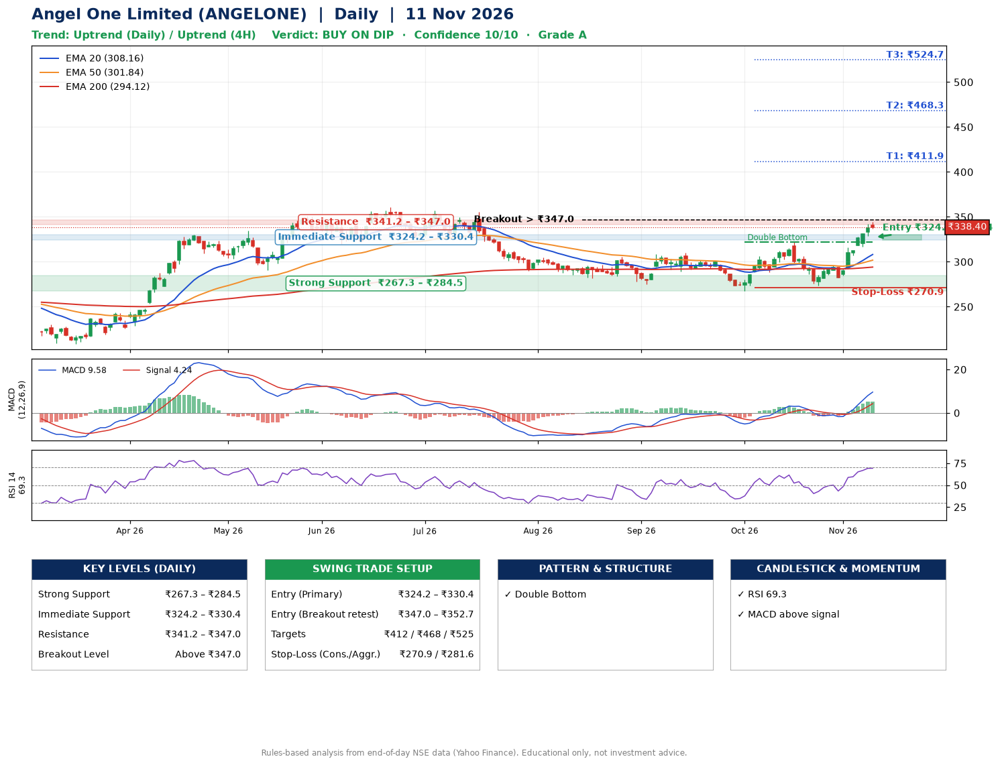

📌 **Angel One Limited (ANGELONE) – Multi-Timeframe Technical Analysis (Daily + 4H Combined)**
_Data up to 11 Nov 2026 · Close ₹338.40_

**📍 Daily Timeframe Trend**
- Trend: **Uptrend** (higher highs and higher lows)
- Recent swing highs: ₹308.4, ₹310.0, ₹321.9 · swing lows: ₹289.0, ₹267.8, ₹273.8
- EMAs: EMA20 ₹308.2, EMA50 ₹301.8, EMA200 ₹294.1; bullish stack (EMA20 > EMA50 > EMA200); price above EMA20, EMA50, EMA200
- MACD 9.58 above signal 4.24 (above zero); histogram rising
- RSI(14) 69.3; no divergence on the last two swings

**📍 4-Hour Timeframe Trend**
- Structure: **Uptrend** (price above rising EMAs)
- Pullback/support area: recent 4H swing lows ₹274.0, ₹282.2; EMA20 ₹322.0
- EMA20/50: bullish stack (EMA20 > EMA50); price above EMA20, EMA50
- MACD 12.69 above signal 10.12 (above zero); histogram falling
- RSI(14) 72.0; Hidden bullish divergence; Hidden bearish divergence

**📍 Pattern Detection (Both Timeframes)**
- Daily: **Double Bottom** – bottoms near ₹267.8/₹273.8, neckline ₹321.9, confirmed (closed above neckline)

**📍 Candlestick Patterns (last 3 daily candles)**
- No notable candlestick signal in the last 3 sessions.

**📍 Price Action Key Levels (Daily Structure)**

| Zone | Price Level (₹) | Context |
|------|-----------------|---------|
| Strong Support | ₹267.3 – ₹284.5 | Cluster of earlier swing lows (demand) |
| Immediate Support | ₹324.2 – ₹330.4 | Nearest swing-low / wick area |
| Resistance | ₹341.2 – ₹347.0 | Nearest swing-high supply |
| Breakout Level | Above ₹347.0 | Swing continuation trigger (52-week high ₹360.5) |

**📍 Swing Trade Setup**

🟢 **Entry Zone**
- Primary: ₹324.2 – ₹330.4 (daily support / EMA20 area; enter on a bullish 4H candle)
- Alternate: ₹347.0 – ₹352.7 (breakout retest)

🎯 **Profit Targets**
- T1: ₹411.9
- T2: ₹468.3
- T3: ₹524.7

🛑 **Stop-Loss**
- Conservative: below daily swing low (₹270.9)
- Aggressive: below 4H structure (₹281.6)
- Risk per share ≈ ₹56.4; reward:risk to T1 ≈ 1.5
- Time to T1: about 29 trading days (it rose this much within 60 trading days 32% of the time in the last 2 years)
- Time to T2: about 36 trading days (it rose this much within 60 trading days 10% of the time in the last 2 years)

**📌 Strategy Notes**
- Higher timeframe: daily trend is uptrend; only take longs while price holds above ₹267.3.
- Entry timing: wait for a bullish 4H candle (engulfing/hammer) inside ₹324.2 – ₹330.4 rather than buying mid-range.
- EMA stacking: bullish stack (EMA20 > EMA50 > EMA200); price above EMA20, EMA50, EMA200.
- Breakout rule: a daily close above ₹347.0 with volume above its 20-day average (≈6,800,666) opens T2/T3.
- Momentum: RSI 69 – elevated, prefer dips; no divergence on the last two swings.
- Exit discipline: move the stop to entry once T1 is hit; book partial profits at each target.

**STEP 2 — Marked Up Chart**

**✅ Trade Validation Checklist**
- Trend + momentum aligned: Yes · Price at entry zone: No
- Stop defined (₹270.9) · Reward:risk ≥ 1.5 to T1: No

## 📌 Final Verdict

Recommendation: **🟡 BUY ON DIP**

Confidence: **10/10**

Trade Quality: **A**

Reason:
• Daily uptrend (higher highs and higher lows)
• EMAs stacked bullishly

Next Action:
• Wait for a pullback to ₹324.2–₹330.4, or a breakout above ₹347.0

_Rules-based analysis from end-of-day data. Educational only, not investment advice. Never place orders without your own confirmation._