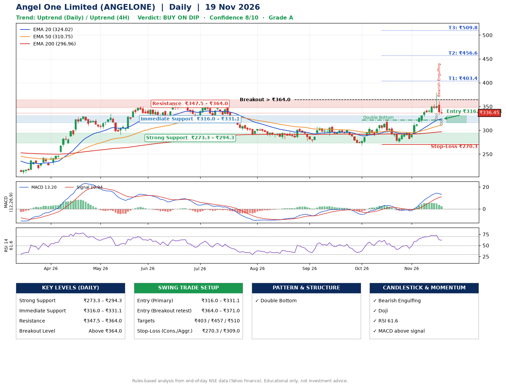

📌 **Angel One Limited (ANGELONE) – Multi-Timeframe Technical Analysis (Daily + 4H Combined)**
_Data up to 19 Nov 2026 · Close ₹336.45_

**📍 Daily Timeframe Trend**
- Trend: **Uptrend** (higher highs and higher lows)
- Recent swing highs: ₹308.4, ₹310.0, ₹321.9 · swing lows: ₹289.0, ₹267.8, ₹273.8
- EMAs: EMA20 ₹324.0, EMA50 ₹310.7, EMA200 ₹297.0; bullish stack (EMA20 > EMA50 > EMA200); price above EMA20, EMA50, EMA200
- MACD 13.20 above signal 10.94 (above zero); histogram falling
- RSI(14) 61.6; no divergence on the last two swings

**📍 4-Hour Timeframe Trend**
- Structure: **Uptrend** (price above rising EMAs)
- Pullback/support area: recent 4H swing lows ₹337.2, ₹333.4; EMA20 ₹335.8
- EMA20/50: bullish stack (EMA20 > EMA50); price above EMA20, EMA50
- MACD 8.62 below signal 11.08 (above zero), fresh bearish crossover; histogram falling
- RSI(14) 54.9; no divergence

**📍 Pattern Detection (Both Timeframes)**
- Daily: **Double Bottom** – bottoms near ₹267.8/₹273.8, neckline ₹321.9, confirmed (closed above neckline)

**📍 Candlestick Patterns (last 3 daily candles)**
- **Doji** – 17 Nov: indecision; wait for the next candle to confirm direction
- **Bearish Engulfing** – 18 Nov: sellers fully reversed the prior green candle
- **Doji** – 19 Nov: indecision; wait for the next candle to confirm direction

**📍 Price Action Key Levels (Daily Structure)**

| Zone | Price Level (₹) | Context |
|------|-----------------|---------|
| Strong Support | ₹273.3 – ₹294.3 | Cluster of earlier swing lows (demand) |
| Immediate Support | ₹316.0 – ₹331.1 | Nearest swing-low / wick area |
| Resistance | ₹347.5 – ₹364.0 | Nearest swing-high supply |
| Breakout Level | Above ₹364.0 | Swing continuation trigger (52-week high ₹379.1) |

**📍 Swing Trade Setup**

🟢 **Entry Zone**
- Primary: ₹316.0 – ₹331.1 (daily support / EMA20 area; enter on a bullish 4H candle)
- Alternate: ₹364.0 – ₹371.0 (breakout retest)

🎯 **Profit Targets**
- T1: ₹403.4
- T2: ₹456.6
- T3: ₹509.8

🛑 **Stop-Loss**
- Conservative: below daily swing low (₹270.3)
- Aggressive: below 4H structure (₹309.0)
- Risk per share ≈ ₹53.2; reward:risk to T1 ≈ 1.5
- Time to T1: about 28 trading days (it rose this much within 60 trading days 33% of the time in the last 2 years)
- Time to T2: about 33 trading days (it rose this much within 60 trading days 13% of the time in the last 2 years)

**📌 Strategy Notes**
- Higher timeframe: daily trend is uptrend; only take longs while price holds above ₹273.3.
- Entry timing: wait for a bullish 4H candle (engulfing/hammer) inside ₹316.0 – ₹331.1 rather than buying mid-range.
- EMA stacking: bullish stack (EMA20 > EMA50 > EMA200); price above EMA20, EMA50, EMA200.
- Breakout rule: a daily close above ₹364.0 with volume above its 20-day average (≈10,518,717) opens T2/T3.
- Momentum: RSI 62 – room to run; no divergence on the last two swings.
- Exit discipline: move the stop to entry once T1 is hit; book partial profits at each target.

**STEP 2 — Marked Up Chart**

**✅ Trade Validation Checklist**
- Trend + momentum aligned: Yes · Price at entry zone: No
- Stop defined (₹270.3) · Reward:risk ≥ 1.5 to T1: Yes

## 📌 Final Verdict

Recommendation: **🟡 BUY ON DIP**

Confidence: **8/10**

Trade Quality: **A**

Reason:
• Sharp pullback: 11% below the recent ₹379.1 high
• Daily uptrend (higher highs and higher lows)

Next Action:
• Wait for a pullback to ₹316.0–₹331.1, or a breakout above ₹364.0

_Rules-based analysis from end-of-day data. Educational only, not investment advice. Never place orders without your own confirmation._