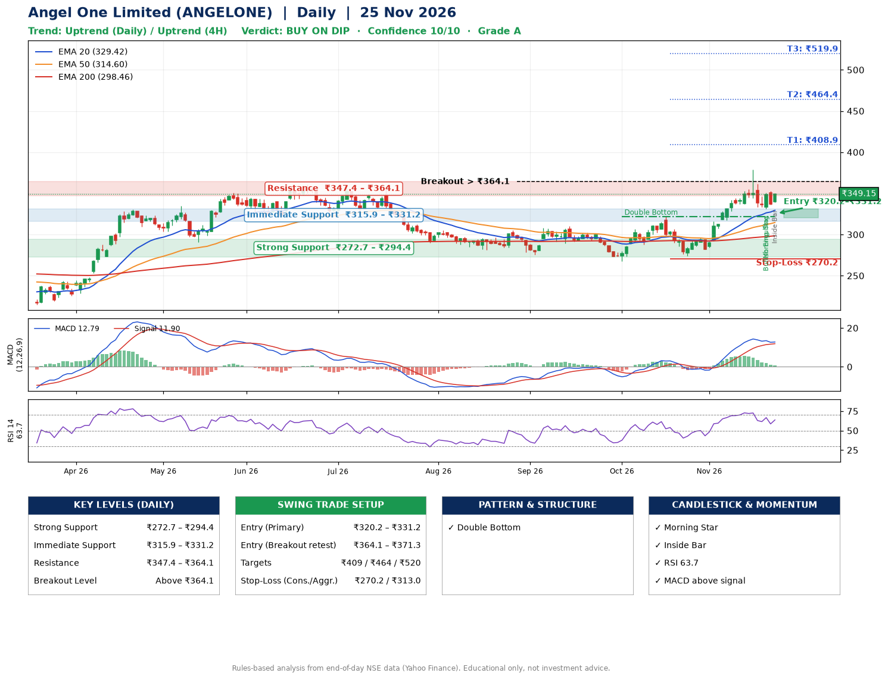

📌 **Angel One Limited (ANGELONE) – Multi-Timeframe Technical Analysis (Daily + 4H Combined)**
_Data up to 25 Nov 2026 · Close ₹349.15_

**📍 Daily Timeframe Trend**
- Trend: **Uptrend** (higher highs and higher lows)
- Recent swing highs: ₹310.0, ₹321.9, ₹379.1 · swing lows: ₹289.0, ₹267.8, ₹273.8
- EMAs: EMA20 ₹329.4, EMA50 ₹314.6, EMA200 ₹298.5; bullish stack (EMA20 > EMA50 > EMA200); price above EMA20, EMA50, EMA200
- MACD 12.79 above signal 11.90 (above zero); histogram falling
- RSI(14) 63.7; no divergence on the last two swings

**📍 4-Hour Timeframe Trend**
- Structure: **Uptrend** (price above rising EMAs)
- Pullback/support area: recent 4H swing lows ₹333.4, ₹331.6; EMA20 ₹339.5
- EMA20/50: bullish stack (EMA20 > EMA50); price above EMA20, EMA50
- MACD 6.40 below signal 8.02 (above zero); histogram rising
- RSI(14) 61.0; Regular bullish divergence

**📍 Pattern Detection (Both Timeframes)**
- Daily: **Double Bottom** – bottoms near ₹267.8/₹273.8, neckline ₹321.9, confirmed (closed above neckline)
- 4H: **Bull Flag** – 17% pole then a tight 6% flag; trigger above ₹352.6

**📍 Candlestick Patterns (last 3 daily candles)**
- **Bullish Engulfing** – 20 Nov: buyers fully reversed the prior red candle
- **Morning Star** – 20 Nov: three-candle bullish reversal
- **Inside Bar** – 25 Nov: compression inside the prior range ₹336.0–₹353.0

**📍 Price Action Key Levels (Daily Structure)**

| Zone | Price Level (₹) | Context |
|------|-----------------|---------|
| Strong Support | ₹272.7 – ₹294.4 | Cluster of earlier swing lows (demand) |
| Immediate Support | ₹315.9 – ₹331.2 | Nearest swing-low / wick area |
| Resistance | ₹347.4 – ₹364.1 | Nearest swing-high supply |
| Breakout Level | Above ₹364.1 | Swing continuation trigger (52-week high ₹379.1) |

**📍 Swing Trade Setup**

🟢 **Entry Zone**
- Primary: ₹320.2 – ₹331.2 (daily support / EMA20 area; enter on a bullish 4H candle)
- Alternate: ₹364.1 – ₹371.3 (breakout retest)

🎯 **Profit Targets**
- T1: ₹408.9
- T2: ₹464.4
- T3: ₹519.9

🛑 **Stop-Loss**
- Conservative: below daily swing low (₹270.2)
- Aggressive: below 4H structure (₹313.0)
- Risk per share ≈ ₹55.5; reward:risk to T1 ≈ 1.5
- Time to T1: about 32 trading days (it rose this much within 60 trading days 32% of the time in the last 2 years)
- Time to T2: about 35 trading days (it rose this much within 60 trading days 11% of the time in the last 2 years)

**📌 Strategy Notes**
- Higher timeframe: daily trend is uptrend; only take longs while price holds above ₹272.7.
- Entry timing: wait for a bullish 4H candle (engulfing/hammer) inside ₹320.2 – ₹331.2 rather than buying mid-range.
- EMA stacking: bullish stack (EMA20 > EMA50 > EMA200); price above EMA20, EMA50, EMA200.
- Breakout rule: a daily close above ₹364.1 with volume above its 20-day average (≈10,974,341) opens T2/T3.
- Momentum: RSI 64 – room to run; no divergence on the last two swings.
- Exit discipline: move the stop to entry once T1 is hit; book partial profits at each target.

**STEP 2 — Marked Up Chart**

**✅ Trade Validation Checklist**
- Trend + momentum aligned: Yes · Price at entry zone: No
- Stop defined (₹270.2) · Reward:risk ≥ 1.5 to T1: No

## 📌 Final Verdict

Recommendation: **🟡 BUY ON DIP**

Confidence: **10/10**

Trade Quality: **A**

Reason:
• Daily uptrend (higher highs and higher lows)
• EMAs stacked bullishly

Next Action:
• Wait for a pullback to ₹320.2–₹331.2

_Rules-based analysis from end-of-day data. Educational only, not investment advice. Never place orders without your own confirmation._