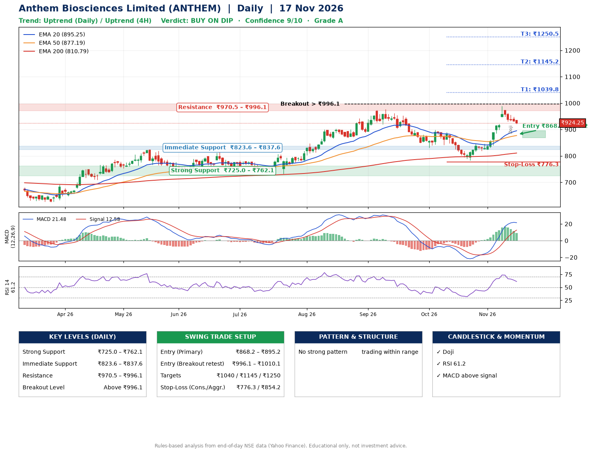

📌 **Anthem Biosciences Limited (ANTHEM) – Multi-Timeframe Technical Analysis (Daily + 4H Combined)**
_Data up to 17 Nov 2026 · Close ₹924.25_

**📍 Daily Timeframe Trend**
- Trend: **Uptrend** (price above rising EMAs)
- Recent swing highs: ₹977.5, ₹898.7, ₹989.1 · swing lows: ₹732.0, ₹830.6, ₹783.3
- EMAs: EMA20 ₹895.2, EMA50 ₹877.2, EMA200 ₹810.8; bullish stack (EMA20 > EMA50 > EMA200); price above EMA20, EMA50, EMA200
- MACD 21.48 above signal 12.58 (above zero); histogram falling
- RSI(14) 61.2; no divergence on the last two swings

**📍 4-Hour Timeframe Trend**
- Structure: **Uptrend** (higher highs and higher lows)
- Pullback/support area: recent 4H swing lows ₹825.0, ₹931.0; EMA20 ₹917.1
- EMA20/50: bullish stack (EMA20 > EMA50); price above EMA50
- MACD 16.08 below signal 21.78 (above zero), fresh bearish crossover; histogram falling
- RSI(14) 54.0; no divergence

**📍 Pattern Detection (Both Timeframes)**
- No strong pattern detected. Trading within range.

**📍 Candlestick Patterns (last 3 daily candles)**
- **Doji** – 13 Nov: indecision; wait for the next candle to confirm direction

**📍 Price Action Key Levels (Daily Structure)**

| Zone | Price Level (₹) | Context |
|------|-----------------|---------|
| Strong Support | ₹725.0 – ₹762.1 | Cluster of earlier swing lows (demand) |
| Immediate Support | ₹823.6 – ₹837.6 | Nearest swing-low / wick area |
| Resistance | ₹970.5 – ₹996.1 | Nearest swing-high supply |
| Breakout Level | Above ₹996.1 | Swing continuation trigger (52-week high ₹989.1) |

**📍 Swing Trade Setup**

🟢 **Entry Zone**
- Primary: ₹868.2 – ₹895.2 (daily support / EMA20 area; enter on a bullish 4H candle)
- Alternate: ₹996.1 – ₹1010.1 (breakout retest)

🎯 **Profit Targets**
- T1: ₹1039.8
- T2: ₹1145.2
- T3: ₹1250.5

🛑 **Stop-Loss**
- Conservative: below daily swing low (₹776.3)
- Aggressive: below 4H structure (₹854.2)
- Risk per share ≈ ₹105.4; reward:risk to T1 ≈ 1.5
- Time to T1: about 33 trading days (it rose this much within 60 trading days 41% of the time in the last 2 years)
- Time to T2: about 43 trading days (it rose this much within 60 trading days 4% of the time in the last 2 years)

**📌 Strategy Notes**
- Higher timeframe: daily trend is uptrend; only take longs while price holds above ₹725.0.
- Entry timing: wait for a bullish 4H candle (engulfing/hammer) inside ₹868.2 – ₹895.2 rather than buying mid-range.
- EMA stacking: bullish stack (EMA20 > EMA50 > EMA200); price above EMA20, EMA50, EMA200.
- Breakout rule: a daily close above ₹996.1 with volume above its 20-day average (≈438,166) opens T2/T3.
- Momentum: RSI 61 – room to run; no divergence on the last two swings.
- Exit discipline: move the stop to entry once T1 is hit; book partial profits at each target.

**STEP 2 — Marked Up Chart**

**✅ Trade Validation Checklist**
- Trend + momentum aligned: Yes · Price at entry zone: No
- Stop defined (₹776.3) · Reward:risk ≥ 1.5 to T1: Yes

## 📌 Final Verdict

Recommendation: **🟡 BUY ON DIP**

Confidence: **9/10**

Trade Quality: **A**

Reason:
• Daily uptrend (price above rising EMAs)
• EMAs stacked bullishly

Next Action:
• Wait for a pullback to ₹868.2–₹895.2

_Rules-based analysis from end-of-day data. Educational only, not investment advice. Never place orders without your own confirmation._