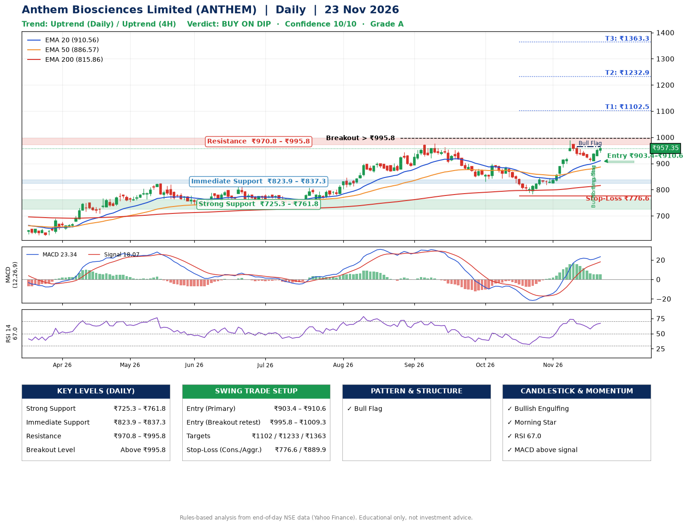

📌 **Anthem Biosciences Limited (ANTHEM) – Multi-Timeframe Technical Analysis (Daily + 4H Combined)**
_Data up to 23 Nov 2026 · Close ₹957.35_

**📍 Daily Timeframe Trend**
- Trend: **Uptrend** (price above rising EMAs)
- Recent swing highs: ₹977.5, ₹898.7, ₹989.1 · swing lows: ₹732.0, ₹830.6, ₹783.3
- EMAs: EMA20 ₹910.6, EMA50 ₹886.6, EMA200 ₹815.9; bullish stack (EMA20 > EMA50 > EMA200); price above EMA20, EMA50, EMA200
- MACD 23.34 above signal 18.07 (above zero); histogram falling
- RSI(14) 67.0; no divergence on the last two swings

**📍 4-Hour Timeframe Trend**
- Structure: **Uptrend** (price above rising EMAs)
- Pullback/support area: recent 4H swing lows ₹931.0, ₹907.5; EMA20 ₹931.2
- EMA20/50: bullish stack (EMA20 > EMA50); price above EMA20, EMA50
- MACD 16.80 below signal 17.54 (above zero); histogram rising
- RSI(14) 68.2; no divergence

**📍 Pattern Detection (Both Timeframes)**
- Daily: **Bull Flag** – 15% pole then a tight 6% flag; trigger above ₹964.9

**📍 Candlestick Patterns (last 3 daily candles)**
- **Bullish Engulfing** – 19 Nov: buyers fully reversed the prior red candle
- **Morning Star** – 19 Nov: three-candle bullish reversal

**📍 Price Action Key Levels (Daily Structure)**

| Zone | Price Level (₹) | Context |
|------|-----------------|---------|
| Strong Support | ₹725.3 – ₹761.8 | Cluster of earlier swing lows (demand) |
| Immediate Support | ₹823.9 – ₹837.3 | Nearest swing-low / wick area |
| Resistance | ₹970.8 – ₹995.8 | Nearest swing-high supply |
| Breakout Level | Above ₹995.8 | Swing continuation trigger (52-week high ₹989.1) |

**📍 Swing Trade Setup**

🟢 **Entry Zone**
- Primary: ₹903.4 – ₹910.6 (daily support / EMA20 area; enter on a bullish 4H candle)
- Alternate: ₹995.8 – ₹1009.3 (breakout retest)

🎯 **Profit Targets**
- T1: ₹1102.5
- T2: ₹1232.9
- T3: ₹1363.3

🛑 **Stop-Loss**
- Conservative: below daily swing low (₹776.6)
- Aggressive: below 4H structure (₹889.9)
- Risk per share ≈ ₹130.4; reward:risk to T1 ≈ 1.5
- Time to T1: about 41 trading days (it rose this much within 60 trading days 28% of the time in the last 2 years)
- Time to T2: it never rose this much within 60 trading days in the price history

**📌 Strategy Notes**
- Higher timeframe: daily trend is uptrend; only take longs while price holds above ₹725.3.
- Entry timing: wait for a bullish 4H candle (engulfing/hammer) inside ₹903.4 – ₹910.6 rather than buying mid-range.
- EMA stacking: bullish stack (EMA20 > EMA50 > EMA200); price above EMA20, EMA50, EMA200.
- Breakout rule: a daily close above ₹995.8 with volume above its 20-day average (≈427,996) opens T2/T3.
- Momentum: RSI 67 – elevated, prefer dips; no divergence on the last two swings.
- Exit discipline: move the stop to entry once T1 is hit; book partial profits at each target.

**STEP 2 — Marked Up Chart**

**✅ Trade Validation Checklist**
- Trend + momentum aligned: Yes · Price at entry zone: No
- Stop defined (₹776.6) · Reward:risk ≥ 1.5 to T1: No

## 📌 Final Verdict

Recommendation: **🟡 BUY ON DIP**

Confidence: **10/10**

Trade Quality: **A**

Reason:
• Daily uptrend (price above rising EMAs)
• EMAs stacked bullishly

Next Action:
• Wait for a pullback to ₹903.4–₹910.6

_Rules-based analysis from end-of-day data. Educational only, not investment advice. Never place orders without your own confirmation._