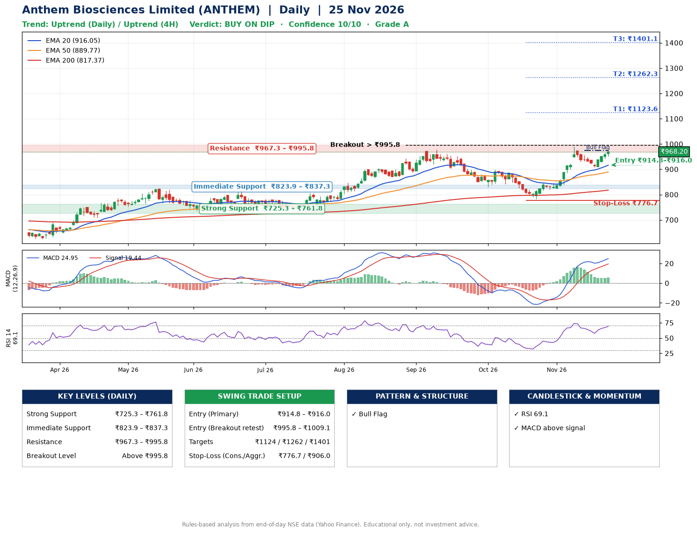

📌 **Anthem Biosciences Limited (ANTHEM) – Multi-Timeframe Technical Analysis (Daily + 4H Combined)**
_Data up to 25 Nov 2026 · Close ₹968.20_

**📍 Daily Timeframe Trend**
- Trend: **Uptrend** (price above rising EMAs)
- Recent swing highs: ₹977.5, ₹898.7, ₹989.1 · swing lows: ₹732.0, ₹830.6, ₹783.3
- EMAs: EMA20 ₹916.0, EMA50 ₹889.8, EMA200 ₹817.4; bullish stack (EMA20 > EMA50 > EMA200); price above EMA20, EMA50, EMA200
- MACD 24.95 above signal 19.44 (above zero); histogram rising
- RSI(14) 69.1; no divergence on the last two swings

**📍 4-Hour Timeframe Trend**
- Structure: **Uptrend** (price above rising EMAs)
- Pullback/support area: recent 4H swing lows ₹931.0, ₹907.5; EMA20 ₹937.8
- EMA20/50: bullish stack (EMA20 > EMA50); price above EMA20, EMA50
- MACD 18.19 above signal 17.68 (above zero), fresh bullish crossover; histogram rising
- RSI(14) 71.7; no divergence

**📍 Pattern Detection (Both Timeframes)**
- Daily: **Bull Flag** – 15% pole then a tight 7% flag; trigger above ₹974.0

**📍 Candlestick Patterns (last 3 daily candles)**
- No notable candlestick signal in the last 3 sessions.

**📍 Price Action Key Levels (Daily Structure)**

| Zone | Price Level (₹) | Context |
|------|-----------------|---------|
| Strong Support | ₹725.3 – ₹761.8 | Cluster of earlier swing lows (demand) |
| Immediate Support | ₹823.9 – ₹837.3 | Nearest swing-low / wick area |
| Resistance | ₹967.3 – ₹995.8 | Nearest swing-high supply |
| Breakout Level | Above ₹995.8 | Swing continuation trigger (52-week high ₹989.1) |

**📍 Swing Trade Setup**

🟢 **Entry Zone**
- Primary: ₹914.8 – ₹916.0 (daily support / EMA20 area; enter on a bullish 4H candle)
- Alternate: ₹995.8 – ₹1009.1 (breakout retest)

🎯 **Profit Targets**
- T1: ₹1123.6
- T2: ₹1262.3
- T3: ₹1401.1

🛑 **Stop-Loss**
- Conservative: below daily swing low (₹776.7)
- Aggressive: below 4H structure (₹906.0)
- Risk per share ≈ ₹138.8; reward:risk to T1 ≈ 1.5
- Time to T1: about 42 trading days (it rose this much within 60 trading days 27% of the time in the last 2 years)
- Time to T2: it never rose this much within 60 trading days in the price history

**📌 Strategy Notes**
- Higher timeframe: daily trend is uptrend; only take longs while price holds above ₹725.3.
- Entry timing: wait for a bullish 4H candle (engulfing/hammer) inside ₹914.8 – ₹916.0 rather than buying mid-range.
- EMA stacking: bullish stack (EMA20 > EMA50 > EMA200); price above EMA20, EMA50, EMA200.
- Breakout rule: a daily close above ₹995.8 with volume above its 20-day average (≈441,261) opens T2/T3.
- Momentum: RSI 69 – elevated, prefer dips; no divergence on the last two swings.
- Exit discipline: move the stop to entry once T1 is hit; book partial profits at each target.

**STEP 2 — Marked Up Chart**

**✅ Trade Validation Checklist**
- Trend + momentum aligned: Yes · Price at entry zone: No
- Stop defined (₹776.7) · Reward:risk ≥ 1.5 to T1: Yes

## 📌 Final Verdict

Recommendation: **🟡 BUY ON DIP**

Confidence: **10/10**

Trade Quality: **A**

Reason:
• Daily uptrend (price above rising EMAs)
• EMAs stacked bullishly

Next Action:
• Wait for a pullback to ₹914.8–₹916.0

_Rules-based analysis from end-of-day data. Educational only, not investment advice. Never place orders without your own confirmation._