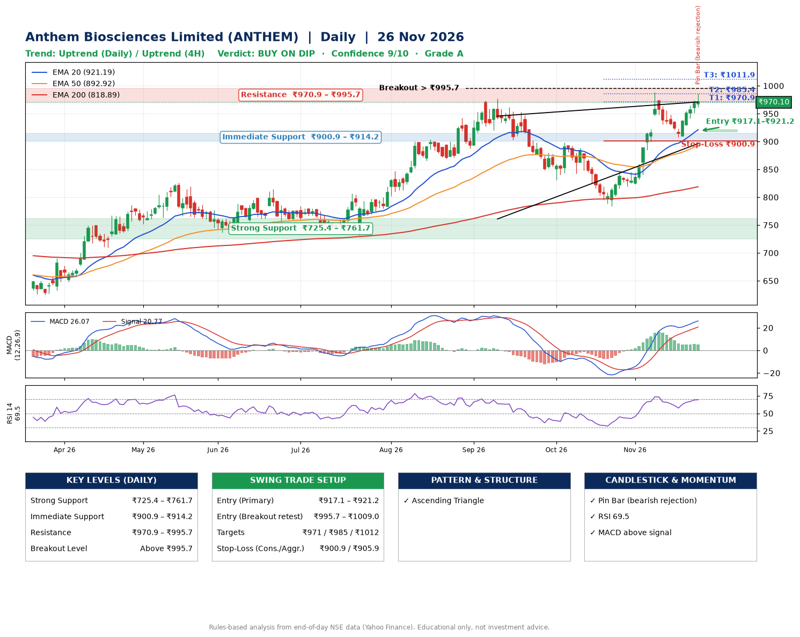

📌 **Anthem Biosciences Limited (ANTHEM) – Multi-Timeframe Technical Analysis (Daily + 4H Combined)**
_Data up to 26 Nov 2026 · Close ₹970.10_

**📍 Daily Timeframe Trend**
- Trend: **Uptrend** (higher highs and higher lows)
- Recent swing highs: ₹977.5, ₹898.7, ₹989.1 · swing lows: ₹830.6, ₹783.3, ₹907.5
- EMAs: EMA20 ₹921.2, EMA50 ₹892.9, EMA200 ₹818.9; bullish stack (EMA20 > EMA50 > EMA200); price above EMA20, EMA50, EMA200
- MACD 26.07 above signal 20.77 (above zero); histogram falling
- RSI(14) 69.5; no divergence on the last two swings

**📍 4-Hour Timeframe Trend**
- Structure: **Uptrend** (price above rising EMAs)
- Pullback/support area: recent 4H swing lows ₹931.0, ₹907.5; EMA20 ₹943.5
- EMA20/50: bullish stack (EMA20 > EMA50); price above EMA20, EMA50
- MACD 18.59 above signal 17.99 (above zero), fresh bullish crossover; histogram falling
- RSI(14) 72.3; no divergence

**📍 Pattern Detection (Both Timeframes)**
- Daily: **Ascending Triangle** – converging swing highs and lows over the last ~60 sessions

**📍 Candlestick Patterns (last 3 daily candles)**
- **Pin Bar (bearish rejection)** – 26 Nov: long upper wick shows selling near ₹986.0

**📍 Price Action Key Levels (Daily Structure)**

| Zone | Price Level (₹) | Context |
|------|-----------------|---------|
| Strong Support | ₹725.4 – ₹761.7 | Cluster of earlier swing lows (demand) |
| Immediate Support | ₹900.9 – ₹914.2 | Nearest swing-low / wick area |
| Resistance | ₹970.9 – ₹995.7 | Nearest swing-high supply |
| Breakout Level | Above ₹995.7 | Swing continuation trigger (52-week high ₹989.1) |

**📍 Swing Trade Setup**

🟢 **Entry Zone**
- Primary: ₹917.1 – ₹921.2 (daily support / EMA20 area; enter on a bullish 4H candle)
- Alternate: ₹995.7 – ₹1009.0 (breakout retest)

🎯 **Profit Targets**
- T1: ₹970.9
- T2: ₹985.4
- T3: ₹1011.9

🛑 **Stop-Loss**
- Conservative: below daily swing low (₹900.9)
- Aggressive: below 4H structure (₹905.9)
- Risk per share ≈ ₹26.5; reward:risk to T1 ≈ 2.0
- Time to T1: about 9 trading days (it rose this much within 60 trading days 80% of the time in the last 2 years)
- Time to T2: about 13 trading days (it rose this much within 60 trading days 72% of the time in the last 2 years)

**📌 Strategy Notes**
- Higher timeframe: daily trend is uptrend; only take longs while price holds above ₹725.4.
- Entry timing: wait for a bullish 4H candle (engulfing/hammer) inside ₹917.1 – ₹921.2 rather than buying mid-range.
- EMA stacking: bullish stack (EMA20 > EMA50 > EMA200); price above EMA20, EMA50, EMA200.
- Breakout rule: a daily close above ₹995.7 with volume above its 20-day average (≈451,314) opens T2/T3.
- Momentum: RSI 69 – elevated, prefer dips; no divergence on the last two swings.
- Exit discipline: move the stop to entry once T1 is hit; book partial profits at each target.

**STEP 2 — Marked Up Chart**

**✅ Trade Validation Checklist**
- Trend + momentum aligned: Yes · Price at entry zone: No
- Stop defined (₹900.9) · Reward:risk ≥ 1.5 to T1: Yes

## 📌 Final Verdict

Recommendation: **🟡 BUY ON DIP**

Confidence: **9/10**

Trade Quality: **A**

Reason:
• Daily uptrend (higher highs and higher lows)
• EMAs stacked bullishly

Next Action:
• Wait for a pullback to ₹917.1–₹921.2

_Rules-based analysis from end-of-day data. Educational only, not investment advice. Never place orders without your own confirmation._