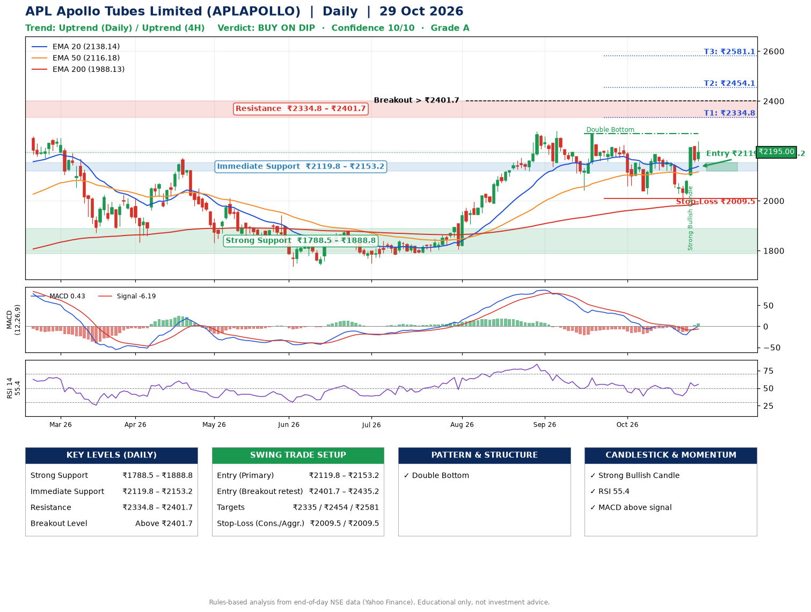

📌 **APL Apollo Tubes Limited (APLAPOLLO) – Multi-Timeframe Technical Analysis (Daily + 4H Combined)**
_Data up to 29 Oct 2026 · Close ₹2195.00_

**📍 Daily Timeframe Trend**
- Trend: **Uptrend** (price above rising EMAs)
- Recent swing highs: ₹2270.1, ₹2224.5, ₹2188.7 · swing lows: ₹2136.5, ₹2041.3, ₹2026.2
- EMAs: EMA20 ₹2138.1, EMA50 ₹2116.2, EMA200 ₹1988.1; bullish stack (EMA20 > EMA50 > EMA200); price above EMA20, EMA50, EMA200
- MACD 0.43 above signal -6.19 (above zero), fresh bullish crossover; histogram rising
- RSI(14) 55.4; no divergence on the last two swings

**📍 4-Hour Timeframe Trend**
- Structure: **Uptrend** (price above rising EMAs)
- Pullback/support area: recent 4H swing lows ₹2121.0, ₹1994.1; EMA20 ₹2138.7
- EMA20/50: bullish stack (EMA20 > EMA50); price above EMA20, EMA50
- MACD 14.50 above signal -1.30 (above zero); histogram falling
- RSI(14) 57.5; no divergence

**📍 Pattern Detection (Both Timeframes)**
- Daily: **Double Bottom** – bottoms near ₹2041.3/₹2026.2, neckline ₹2270.1, forming

**📍 Candlestick Patterns (last 3 daily candles)**
- **Strong Bullish Candle** – 27 Oct: wide-range green candle, buyers in control

**📍 Price Action Key Levels (Daily Structure)**

| Zone | Price Level (₹) | Context |
|------|-----------------|---------|
| Strong Support | ₹1788.5 – ₹1888.8 | Cluster of earlier swing lows (demand) |
| Immediate Support | ₹2119.8 – ₹2153.2 | Nearest swing-low / wick area |
| Resistance | ₹2334.8 – ₹2401.7 | Nearest swing-high supply |
| Breakout Level | Above ₹2401.7 | Swing continuation trigger (52-week high ₹2301.4) |

**📍 Swing Trade Setup**

🟢 **Entry Zone**
- Primary: ₹2119.8 – ₹2153.2 (daily support / EMA20 area; enter on a bullish 4H candle)
- Alternate: ₹2401.7 – ₹2435.2 (breakout retest)

🎯 **Profit Targets**
- T1: ₹2334.8
- T2: ₹2454.1
- T3: ₹2581.1

🛑 **Stop-Loss**
- Conservative: below daily swing low (₹2009.5)
- Aggressive: below 4H structure (₹2009.5)
- Risk per share ≈ ₹127.0; reward:risk to T1 ≈ 1.6

**📌 Strategy Notes**
- Higher timeframe: daily trend is uptrend; only take longs while price holds above ₹1788.5.
- Entry timing: wait for a bullish 4H candle (engulfing/hammer) inside ₹2119.8 – ₹2153.2 rather than buying mid-range.
- EMA stacking: bullish stack (EMA20 > EMA50 > EMA200); price above EMA20, EMA50, EMA200.
- Breakout rule: a daily close above ₹2401.7 with volume above its 20-day average (≈684,156) opens T2/T3.
- Momentum: RSI 55 – room to run; no divergence on the last two swings.
- Exit discipline: move the stop to entry once T1 is hit; book partial profits at each target.

**STEP 2 — Marked Up Chart**

**✅ Trade Validation Checklist**
- Trend + momentum aligned: Yes · Price at entry zone: No
- Stop defined (₹2009.5) · Reward:risk ≥ 1.5 to T1: Yes

## 📌 Final Verdict

Recommendation: **🟡 BUY ON DIP**

Confidence: **10/10**

Trade Quality: **A**

Reason:
• Daily uptrend (price above rising EMAs)
• EMAs stacked bullishly

Next Action:
• Wait for a pullback to ₹2119.8–₹2153.2, or a breakout above ₹2401.7

_Rules-based analysis from end-of-day data. Educational only, not investment advice. Never place orders without your own confirmation._