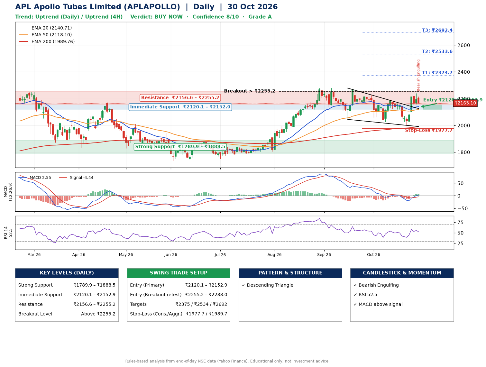

📌 **APL Apollo Tubes Limited (APLAPOLLO) – Multi-Timeframe Technical Analysis (Daily + 4H Combined)**
_Data up to 30 Oct 2026 · Close ₹2165.10_

**📍 Daily Timeframe Trend**
- Trend: **Uptrend** (price above rising EMAs)
- Recent swing highs: ₹2270.1, ₹2224.5, ₹2188.7 · swing lows: ₹2041.3, ₹2026.2, ₹1994.1
- EMAs: EMA20 ₹2140.7, EMA50 ₹2118.1, EMA200 ₹1989.8; bullish stack (EMA20 > EMA50 > EMA200); price above EMA20, EMA50, EMA200
- MACD 2.55 above signal -4.44 (above zero), fresh bullish crossover; histogram rising
- RSI(14) 52.5; no divergence on the last two swings

**📍 4-Hour Timeframe Trend**
- Structure: **Uptrend** (price above rising EMAs)
- Pullback/support area: recent 4H swing lows ₹2121.0, ₹1994.1; EMA20 ₹2145.2
- EMA20/50: bullish stack (EMA20 > EMA50); price above EMA20, EMA50
- MACD 15.67 above signal 4.88 (above zero); histogram falling
- RSI(14) 53.2; no divergence

**📍 Pattern Detection (Both Timeframes)**
- Daily: **Descending Triangle** – converging swing highs and lows over the last ~60 sessions
- 4H: **Double Top** – tops near ₹2188.7/₹2239.0, neckline ₹1994.1, forming

**📍 Candlestick Patterns (last 3 daily candles)**
- **Bearish Engulfing** – 30 Oct: sellers fully reversed the prior green candle

**📍 Price Action Key Levels (Daily Structure)**

| Zone | Price Level (₹) | Context |
|------|-----------------|---------|
| Strong Support | ₹1789.9 – ₹1888.5 | Cluster of earlier swing lows (demand) |
| Immediate Support | ₹2120.1 – ₹2152.9 | Nearest swing-low / wick area |
| Resistance | ₹2156.6 – ₹2255.2 | Nearest swing-high supply |
| Breakout Level | Above ₹2255.2 | Swing continuation trigger (52-week high ₹2301.4) |

**📍 Swing Trade Setup**

🟢 **Entry Zone**
- Primary: ₹2120.1 – ₹2152.9 (daily support / EMA20 area; enter on a bullish 4H candle)
- Alternate: ₹2255.2 – ₹2288.0 (breakout retest)

🎯 **Profit Targets**
- T1: ₹2374.7
- T2: ₹2533.6
- T3: ₹2692.4

🛑 **Stop-Loss**
- Conservative: below daily swing low (₹1977.7)
- Aggressive: below 4H structure (₹1989.7)
- Risk per share ≈ ₹158.8; reward:risk to T1 ≈ 1.5

**📌 Strategy Notes**
- Higher timeframe: daily trend is uptrend; only take longs while price holds above ₹1789.9.
- Entry timing: wait for a bullish 4H candle (engulfing/hammer) inside ₹2120.1 – ₹2152.9 rather than buying mid-range.
- EMA stacking: bullish stack (EMA20 > EMA50 > EMA200); price above EMA20, EMA50, EMA200.
- Breakout rule: a daily close above ₹2255.2 with volume above its 20-day average (≈709,881) opens T2/T3.
- Momentum: RSI 52 – room to run; no divergence on the last two swings.
- Exit discipline: move the stop to entry once T1 is hit; book partial profits at each target.

**STEP 2 — Marked Up Chart**

**✅ Trade Validation Checklist**
- Trend + momentum aligned: Yes · Price at entry zone: No
- Stop defined (₹1977.7) · Reward:risk ≥ 1.5 to T1: No

## 📌 Final Verdict

Recommendation: **🟢 BUY NOW**

Confidence: **8/10**

Trade Quality: **A**

Reason:
• Daily uptrend (price above rising EMAs)
• EMAs stacked bullishly

Next Action:
• Buy now within the entry zone, with the stop-loss in place

_Rules-based analysis from end-of-day data. Educational only, not investment advice. Never place orders without your own confirmation._