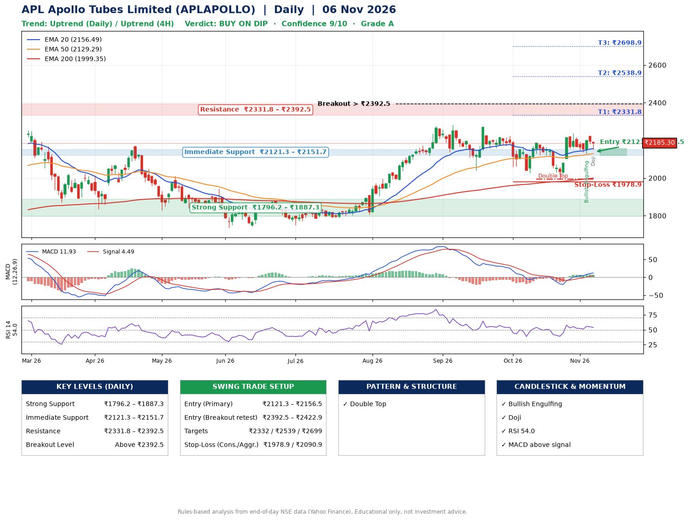

📌 **APL Apollo Tubes Limited (APLAPOLLO) – Multi-Timeframe Technical Analysis (Daily + 4H Combined)**
_Data up to 06 Nov 2026 · Close ₹2185.30_

**📍 Daily Timeframe Trend**
- Trend: **Uptrend** (price above rising EMAs)
- Recent swing highs: ₹2224.5, ₹2188.7, ₹2239.0 · swing lows: ₹2041.3, ₹2026.2, ₹1994.1
- EMAs: EMA20 ₹2156.5, EMA50 ₹2129.3, EMA200 ₹1999.4; bullish stack (EMA20 > EMA50 > EMA200); price above EMA20, EMA50, EMA200
- MACD 11.93 above signal 4.49 (above zero); histogram falling
- RSI(14) 54.0; no divergence on the last two swings

**📍 4-Hour Timeframe Trend**
- Structure: **Uptrend** (price above rising EMAs)
- Pullback/support area: recent 4H swing lows ₹1994.1, ₹2129.2; EMA20 ₹2167.1
- EMA20/50: bullish stack (EMA20 > EMA50); price above EMA20, EMA50
- MACD 14.87 above signal 13.72 (above zero); histogram falling
- RSI(14) 54.8; no divergence

**📍 Pattern Detection (Both Timeframes)**
- Daily: **Double Top** – tops near ₹2188.7/₹2239.0, neckline ₹1994.1, forming
- 4H: **Double Top** – tops near ₹2239.0/₹2222.3, neckline ₹2129.2, forming
- 4H: **Inverse Head & Shoulders** – head ₹1994.1, neckline ₹2239.0

**📍 Candlestick Patterns (last 3 daily candles)**
- **Bullish Engulfing** – 04 Nov: buyers fully reversed the prior red candle
- **Doji** – 06 Nov: indecision; wait for the next candle to confirm direction

**📍 Price Action Key Levels (Daily Structure)**

| Zone | Price Level (₹) | Context |
|------|-----------------|---------|
| Strong Support | ₹1796.2 – ₹1887.3 | Cluster of earlier swing lows (demand) |
| Immediate Support | ₹2121.3 – ₹2151.7 | Nearest swing-low / wick area |
| Resistance | ₹2331.8 – ₹2392.5 | Nearest swing-high supply |
| Breakout Level | Above ₹2392.5 | Swing continuation trigger (52-week high ₹2301.4) |

**📍 Swing Trade Setup**

🟢 **Entry Zone**
- Primary: ₹2121.3 – ₹2156.5 (daily support / EMA20 area; enter on a bullish 4H candle)
- Alternate: ₹2392.5 – ₹2422.9 (breakout retest)

🎯 **Profit Targets**
- T1: ₹2331.8
- T2: ₹2538.9
- T3: ₹2698.9

🛑 **Stop-Loss**
- Conservative: below daily swing low (₹1978.9)
- Aggressive: below 4H structure (₹2090.9)
- Risk per share ≈ ₹160.0; reward:risk to T1 ≈ 1.2

**📌 Strategy Notes**
- Higher timeframe: daily trend is uptrend; only take longs while price holds above ₹1796.2.
- Entry timing: wait for a bullish 4H candle (engulfing/hammer) inside ₹2121.3 – ₹2156.5 rather than buying mid-range.
- EMA stacking: bullish stack (EMA20 > EMA50 > EMA200); price above EMA20, EMA50, EMA200.
- Breakout rule: a daily close above ₹2392.5 with volume above its 20-day average (≈665,009) opens T2/T3.
- Momentum: RSI 54 – room to run; no divergence on the last two swings.
- Exit discipline: move the stop to entry once T1 is hit; book partial profits at each target.

**STEP 2 — Marked Up Chart**

**✅ Trade Validation Checklist**
- Trend + momentum aligned: Yes · Price at entry zone: No
- Stop defined (₹1978.9) · Reward:risk ≥ 1.5 to T1: No

## 📌 Final Verdict

Recommendation: **🟡 BUY ON DIP**

Confidence: **9/10**

Trade Quality: **A**

Reason:
• Daily uptrend (price above rising EMAs)
• EMAs stacked bullishly

Next Action:
• Wait for a pullback to ₹2121.3–₹2156.5, or a breakout above ₹2392.5

_Rules-based analysis from end-of-day data. Educational only, not investment advice. Never place orders without your own confirmation._