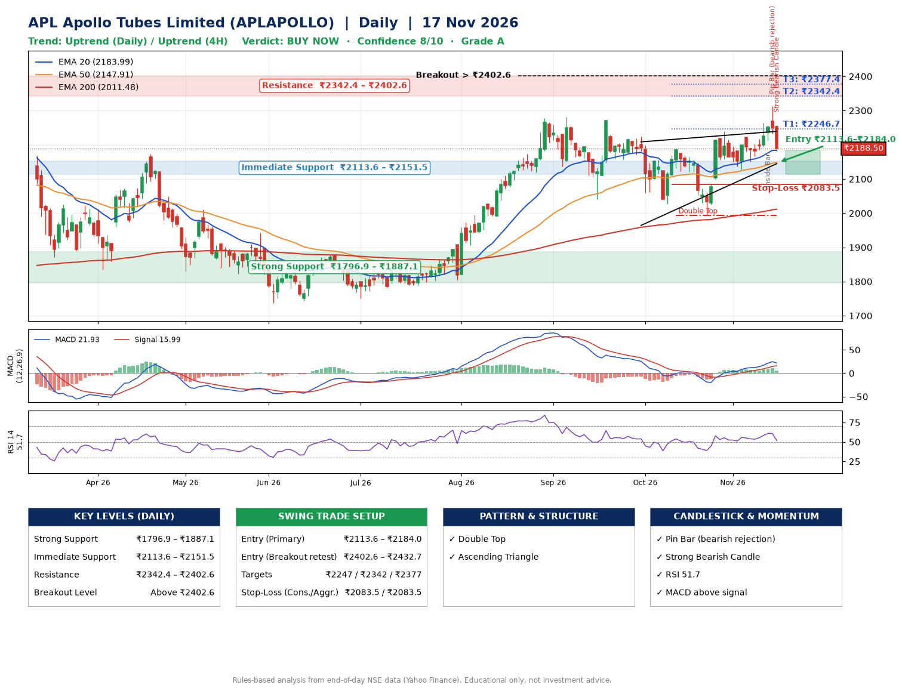

📌 **APL Apollo Tubes Limited (APLAPOLLO) – Multi-Timeframe Technical Analysis (Daily + 4H Combined)**
_Data up to 17 Nov 2026 · Close ₹2188.50_

**📍 Daily Timeframe Trend**
- Trend: **Uptrend** (higher highs and higher lows)
- Recent swing highs: ₹2224.5, ₹2188.7, ₹2239.0 · swing lows: ₹2026.2, ₹1994.1, ₹2128.6
- EMAs: EMA20 ₹2184.0, EMA50 ₹2147.9, EMA200 ₹2011.5; bullish stack (EMA20 > EMA50 > EMA200); price above EMA20, EMA50, EMA200
- MACD 21.93 above signal 15.99 (above zero); histogram falling
- RSI(14) 51.7; no divergence on the last two swings

**📍 4-Hour Timeframe Trend**
- Structure: **Uptrend** (higher highs and higher lows)
- Pullback/support area: recent 4H swing lows ₹2129.2, ₹2151.0; EMA20 ₹2203.4
- EMA20/50: bullish stack (EMA20 > EMA50); price above EMA50
- MACD 17.62 below signal 20.05 (above zero), fresh bearish crossover; histogram falling
- RSI(14) 48.5; Hidden bullish divergence

**📍 Pattern Detection (Both Timeframes)**
- Daily: **Double Top** – tops near ₹2188.7/₹2239.0, neckline ₹1994.1, forming
- Daily: **Ascending Triangle** – converging swing highs and lows over the last ~60 sessions

**📍 Candlestick Patterns (last 3 daily candles)**
- **Inside Bar** – 13 Nov: compression inside the prior range ₹2193.7–₹2264.2
- **Pin Bar (bearish rejection)** – 16 Nov: long upper wick shows selling near ₹2312.3
- **Strong Bearish Candle** – 17 Nov: wide-range red candle, sellers in control

**📍 Price Action Key Levels (Daily Structure)**

| Zone | Price Level (₹) | Context |
|------|-----------------|---------|
| Strong Support | ₹1796.9 – ₹1887.1 | Cluster of earlier swing lows (demand) |
| Immediate Support | ₹2113.6 – ₹2151.5 | Nearest swing-low / wick area |
| Resistance | ₹2342.4 – ₹2402.6 | Nearest swing-high supply |
| Breakout Level | Above ₹2402.6 | Swing continuation trigger (52-week high ₹2312.3) |

**📍 Swing Trade Setup**

🟢 **Entry Zone**
- Primary: ₹2113.6 – ₹2184.0 (daily support / EMA20 area; enter on a bullish 4H candle)
- Alternate: ₹2402.6 – ₹2432.7 (breakout retest)

🎯 **Profit Targets**
- T1: ₹2246.7
- T2: ₹2342.4
- T3: ₹2377.4

🛑 **Stop-Loss**
- Conservative: below daily swing low (₹2083.5)
- Aggressive: below 4H structure (₹2083.5)
- Risk per share ≈ ₹65.3; reward:risk to T1 ≈ 1.5
- Time to T1: about 10 trading days (it rose this much within 60 trading days 80% of the time in the last 2 years)
- Time to T2: about 19 trading days (it rose this much within 60 trading days 64% of the time in the last 2 years)

**📌 Strategy Notes**
- Higher timeframe: daily trend is uptrend; only take longs while price holds above ₹1796.9.
- Entry timing: wait for a bullish 4H candle (engulfing/hammer) inside ₹2113.6 – ₹2184.0 rather than buying mid-range.
- EMA stacking: bullish stack (EMA20 > EMA50 > EMA200); price above EMA20, EMA50, EMA200.
- Breakout rule: a daily close above ₹2402.6 with volume above its 20-day average (≈824,914) opens T2/T3.
- Momentum: RSI 52 – room to run; no divergence on the last two swings.
- Exit discipline: move the stop to entry once T1 is hit; book partial profits at each target.

**STEP 2 — Marked Up Chart**

**✅ Trade Validation Checklist**
- Trend + momentum aligned: Yes · Price at entry zone: No
- Stop defined (₹2083.5) · Reward:risk ≥ 1.5 to T1: No

## 📌 Final Verdict

Recommendation: **🟢 BUY NOW**

Confidence: **8/10**

Trade Quality: **A**

Reason:
• Daily uptrend (higher highs and higher lows)
• EMAs stacked bullishly

Next Action:
• Buy now within the entry zone, with the stop-loss in place

_Rules-based analysis from end-of-day data. Educational only, not investment advice. Never place orders without your own confirmation._