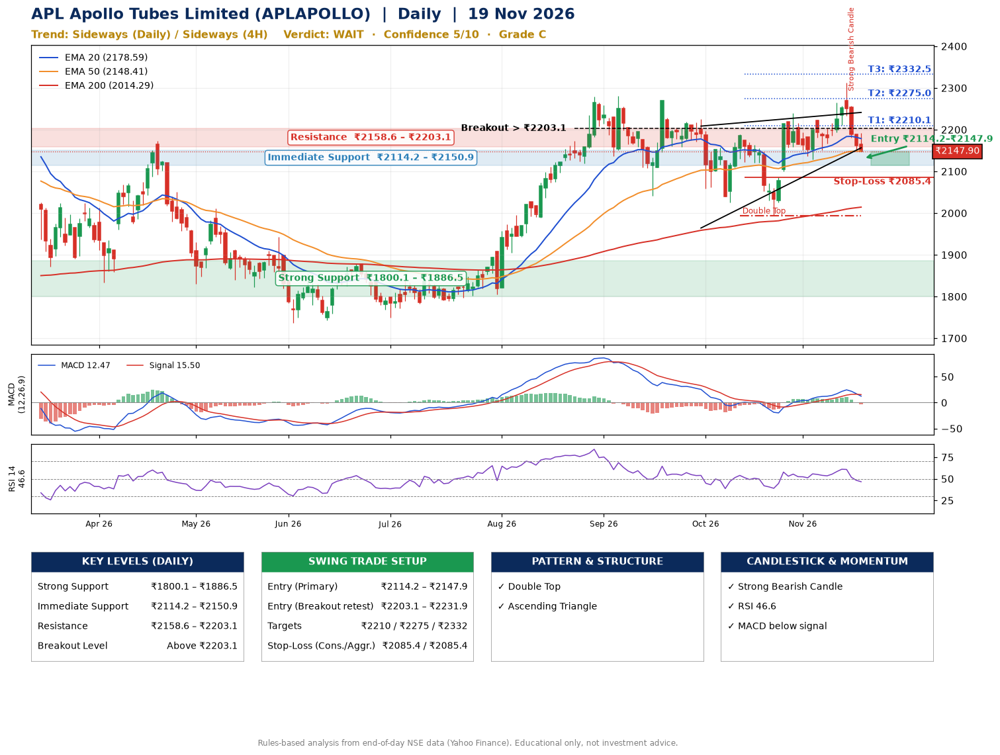

📌 **APL Apollo Tubes Limited (APLAPOLLO) – Multi-Timeframe Technical Analysis (Daily + 4H Combined)**
_Data up to 19 Nov 2026 · Close ₹2147.90_

**📍 Daily Timeframe Trend**
- Trend: **Sideways** (mixed swing structure)
- Recent swing highs: ₹2224.5, ₹2188.7, ₹2239.0 · swing lows: ₹2026.2, ₹1994.1, ₹2128.6
- EMAs: EMA20 ₹2178.6, EMA50 ₹2148.4, EMA200 ₹2014.3; bullish stack (EMA20 > EMA50 > EMA200); price above EMA200
- MACD 12.47 below signal 15.50 (above zero), fresh bearish crossover; histogram falling
- RSI(14) 46.6; no divergence on the last two swings

**📍 4-Hour Timeframe Trend**
- Structure: **Sideways** (mixed swing structure)
- Pullback/support area: recent 4H swing lows ₹2129.2, ₹2151.0; EMA20 ₹2189.4
- EMA20/50: bullish stack (EMA20 > EMA50); price below all EMAs
- MACD 1.14 below signal 11.48 (above zero), fresh bearish crossover; histogram falling
- RSI(14) 41.4; Hidden bullish divergence

**📍 Pattern Detection (Both Timeframes)**
- Daily: **Double Top** – tops near ₹2188.7/₹2239.0, neckline ₹1994.1, forming
- Daily: **Ascending Triangle** – converging swing highs and lows over the last ~60 sessions

**📍 Candlestick Patterns (last 3 daily candles)**
- **Strong Bearish Candle** – 17 Nov: wide-range red candle, sellers in control

**📍 Price Action Key Levels (Daily Structure)**

| Zone | Price Level (₹) | Context |
|------|-----------------|---------|
| Strong Support | ₹1800.1 – ₹1886.5 | Cluster of earlier swing lows (demand) |
| Immediate Support | ₹2114.2 – ₹2150.9 | Nearest swing-low / wick area |
| Resistance | ₹2158.6 – ₹2203.1 | Nearest swing-high supply |
| Breakout Level | Above ₹2203.1 | Swing continuation trigger (52-week high ₹2312.3) |

**📍 Swing Trade Setup**

🟢 **Entry Zone**
- Primary: ₹2114.2 – ₹2147.9 (daily support / EMA20 area; enter on a bullish 4H candle)
- Alternate: ₹2203.1 – ₹2231.9 (breakout retest)

🎯 **Profit Targets**
- T1: ₹2210.1
- T2: ₹2275.0
- T3: ₹2332.5

🛑 **Stop-Loss**
- Conservative: below daily swing low (₹2085.4)
- Aggressive: below 4H structure (₹2085.4)
- Risk per share ≈ ₹57.6; reward:risk to T1 ≈ 1.4
- Time to T1: about 7 trading days (it rose this much within 60 trading days 83% of the time in the last 2 years)
- Time to T2: about 15 trading days (it rose this much within 60 trading days 73% of the time in the last 2 years)

**📌 Strategy Notes**
- Higher timeframe: daily trend is sideways; only take longs while price holds above ₹1800.1.
- Entry timing: wait for a bullish 4H candle (engulfing/hammer) inside ₹2114.2 – ₹2147.9 rather than buying mid-range.
- EMA stacking: bullish stack (EMA20 > EMA50 > EMA200); price above EMA200.
- Breakout rule: a daily close above ₹2203.1 with volume above its 20-day average (≈815,716) opens T2/T3.
- Momentum: RSI 47 – room to run; no divergence on the last two swings.
- Exit discipline: move the stop to entry once T1 is hit; book partial profits at each target.

**STEP 2 — Marked Up Chart**

**✅ Trade Validation Checklist**
- Trend + momentum aligned: No · Price at entry zone: Yes
- Stop defined (₹2085.4) · Reward:risk ≥ 1.5 to T1: No

## 📌 Final Verdict

Recommendation: **🟠 WAIT**

Confidence: **5/10**

Trade Quality: **C**

Reason:
• EMAs stacked bullishly
• Double Top: tops near ₹2188.7/₹2239.0, neckline ₹1994.1, forming

Next Action:
• Wait for a breakout above ₹2203.1

_Rules-based analysis from end-of-day data. Educational only, not investment advice. Never place orders without your own confirmation._