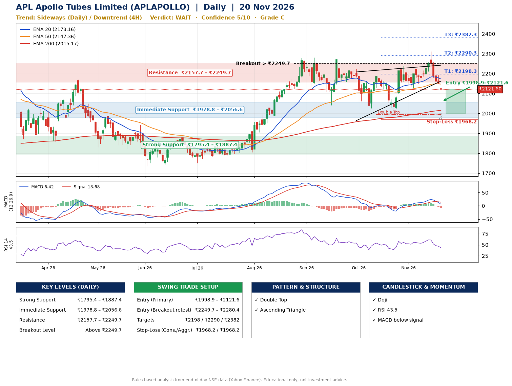

📌 **APL Apollo Tubes Limited (APLAPOLLO) – Multi-Timeframe Technical Analysis (Daily + 4H Combined)**
_Data up to 20 Nov 2026 · Close ₹2121.60_

**📍 Daily Timeframe Trend**
- Trend: **Sideways** (mixed swing structure)
- Recent swing highs: ₹2224.5, ₹2188.7, ₹2239.0 · swing lows: ₹2026.2, ₹1994.1, ₹2128.6
- EMAs: EMA20 ₹2173.2, EMA50 ₹2147.4, EMA200 ₹2015.2; bullish stack (EMA20 > EMA50 > EMA200); price above EMA200
- MACD 6.42 below signal 13.68 (above zero), fresh bearish crossover; histogram falling
- RSI(14) 43.5; no divergence on the last two swings

**📍 4-Hour Timeframe Trend**
- Structure: **Downtrend** (price below falling EMAs)
- Pullback/support area: recent 4H swing lows ₹2129.2, ₹2151.0; EMA20 ₹2174.8
- EMA20/50: bullish stack (EMA20 > EMA50); price below all EMAs
- MACD -10.03 below signal 4.33 (below zero); histogram falling
- RSI(14) 39.7; Hidden bullish divergence

**📍 Pattern Detection (Both Timeframes)**
- Daily: **Double Top** – tops near ₹2188.7/₹2239.0, neckline ₹1994.1, forming
- Daily: **Ascending Triangle** – converging swing highs and lows over the last ~60 sessions

**📍 Candlestick Patterns (last 3 daily candles)**
- **Doji** – 20 Nov: indecision; wait for the next candle to confirm direction

**📍 Price Action Key Levels (Daily Structure)**

| Zone | Price Level (₹) | Context |
|------|-----------------|---------|
| Strong Support | ₹1795.4 – ₹1887.4 | Cluster of earlier swing lows (demand) |
| Immediate Support | ₹1978.8 – ₹2056.6 | Nearest swing-low / wick area |
| Resistance | ₹2157.7 – ₹2249.7 | Nearest swing-high supply |
| Breakout Level | Above ₹2249.7 | Swing continuation trigger (52-week high ₹2312.3) |

**📍 Swing Trade Setup**

🟢 **Entry Zone**
- Primary: ₹1998.9 – ₹2121.6 (daily support / EMA20 area; enter on a bullish 4H candle)
- Alternate: ₹2249.7 – ₹2280.4 (breakout retest)

🎯 **Profit Targets**
- T1: ₹2198.3
- T2: ₹2290.3
- T3: ₹2382.3

🛑 **Stop-Loss**
- Conservative: below daily swing low (₹1968.2)
- Aggressive: below 4H structure (₹1968.2)
- Risk per share ≈ ₹92.0; reward:risk to T1 ≈ 1.5
- Time to T1: about 15 trading days (it rose this much within 60 trading days 73% of the time in the last 2 years)
- Time to T2: about 24 trading days (it rose this much within 60 trading days 57% of the time in the last 2 years)

**📌 Strategy Notes**
- Higher timeframe: daily trend is sideways; only take longs while price holds above ₹1795.4.
- Entry timing: wait for a bullish 4H candle (engulfing/hammer) inside ₹1998.9 – ₹2121.6 rather than buying mid-range.
- EMA stacking: bullish stack (EMA20 > EMA50 > EMA200); price above EMA200.
- Breakout rule: a daily close above ₹2249.7 with volume above its 20-day average (≈934,729) opens T2/T3.
- Momentum: RSI 44 – room to run; no divergence on the last two swings.
- Exit discipline: move the stop to entry once T1 is hit; book partial profits at each target.

**STEP 2 — Marked Up Chart**

**✅ Trade Validation Checklist**
- Trend + momentum aligned: No · Price at entry zone: Yes
- Stop defined (₹1968.2) · Reward:risk ≥ 1.5 to T1: Yes

## 📌 Final Verdict

Recommendation: **🟠 WAIT**

Confidence: **5/10**

Trade Quality: **C**

Reason:
• EMAs stacked bullishly
• Double Top: tops near ₹2188.7/₹2239.0, neckline ₹1994.1, forming

Next Action:
• Wait for a breakout above ₹2249.7

_Rules-based analysis from end-of-day data. Educational only, not investment advice. Never place orders without your own confirmation._