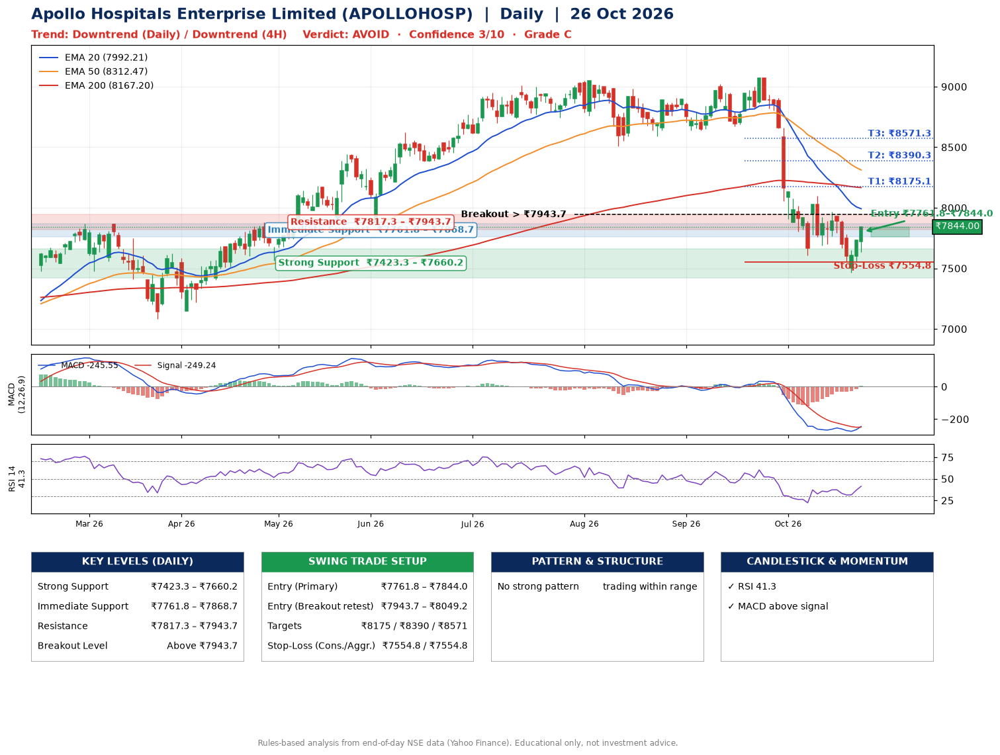

📌 **Apollo Hospitals Enterprise Limited (APOLLOHOSP) – Multi-Timeframe Technical Analysis (Daily + 4H Combined)**
_Data up to 26 Oct 2026 · Close ₹7844.00_

**📍 Daily Timeframe Trend**
- Trend: **Downtrend** (lower highs and lower lows)
- Recent swing highs: ₹9024.0, ₹9070.5, ₹8100.0 · swing lows: ₹8640.0, ₹8672.5, ₹7607.5
- EMAs: EMA20 ₹7992.2, EMA50 ₹8312.5, EMA200 ₹8167.2; mixed / crossing; price below all EMAs
- MACD -245.55 above signal -249.24 (below zero), fresh bullish crossover; histogram rising
- RSI(14) 41.3; no divergence on the last two swings

**📍 4-Hour Timeframe Trend**
- Structure: **Downtrend** (lower highs and lower lows)
- Pullback/support area: recent 4H swing lows ₹7688.0, ₹7468.0; EMA20 ₹7790.1
- EMA20/50: bearish stack (EMA20 < EMA50); price above EMA20
- MACD -115.23 above signal -149.19 (below zero); histogram rising
- RSI(14) 49.3; Hidden bearish divergence

**📍 Pattern Detection (Both Timeframes)**
- 4H: **Double Bottom** – bottoms near ₹7688.0/₹7468.0, neckline ₹7965.0, forming

**📍 Candlestick Patterns (last 3 daily candles)**
- No notable candlestick signal in the last 3 sessions.

**📍 Price Action Key Levels (Daily Structure)**

| Zone | Price Level (₹) | Context |
|------|-----------------|---------|
| Strong Support | ₹7423.3 – ₹7660.2 | Cluster of earlier swing lows (demand) |
| Immediate Support | ₹7761.8 – ₹7868.7 | Nearest swing-low / wick area |
| Resistance | ₹7817.3 – ₹7943.7 | Nearest swing-high supply |
| Breakout Level | Above ₹7943.7 | Swing continuation trigger (52-week high ₹9070.5) |

**📍 Swing Trade Setup**

🟢 **Entry Zone**
- Primary: ₹7761.8 – ₹7844.0 (daily support / EMA20 area; enter on a bullish 4H candle)
- Alternate: ₹7943.7 – ₹8049.2 (breakout retest)

🎯 **Profit Targets**
- T1: ₹8175.1
- T2: ₹8390.3
- T3: ₹8571.3

🛑 **Stop-Loss**
- Conservative: below daily swing low (₹7554.8)
- Aggressive: below 4H structure (₹7554.8)
- Risk per share ≈ ₹248.1; reward:risk to T1 ≈ 1.5

**📌 Strategy Notes**
- Higher timeframe: daily trend is downtrend; only take longs while price holds above ₹7423.3.
- Entry timing: wait for a bullish 4H candle (engulfing/hammer) inside ₹7761.8 – ₹7844.0 rather than buying mid-range.
- EMA stacking: mixed / crossing; price below all EMAs.
- Breakout rule: a daily close above ₹7943.7 with volume above its 20-day average (≈721,624) opens T2/T3.
- Momentum: RSI 41 – room to run; no divergence on the last two swings.
- Exit discipline: move the stop to entry once T1 is hit; book partial profits at each target.

**STEP 2 — Marked Up Chart**

**✅ Trade Validation Checklist**
- Trend + momentum aligned: No · Price at entry zone: Yes
- Stop defined (₹7554.8) · Reward:risk ≥ 1.5 to T1: Yes

## 📌 Final Verdict

Recommendation: **🔴 AVOID**

Confidence: **3/10**

Trade Quality: **C**

Reason:
• Daily downtrend (lower highs and lower lows)

Next Action:
• Avoid until the trend changes (reclaim EMA50 and a higher low)

_Rules-based analysis from end-of-day data. Educational only, not investment advice. Never place orders without your own confirmation._