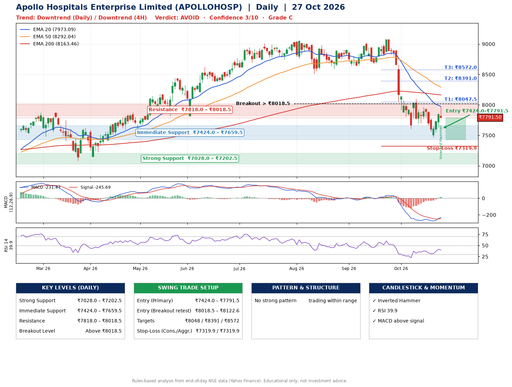

📌 **Apollo Hospitals Enterprise Limited (APOLLOHOSP) – Multi-Timeframe Technical Analysis (Daily + 4H Combined)**
_Data up to 27 Oct 2026 · Close ₹7791.50_

**📍 Daily Timeframe Trend**
- Trend: **Downtrend** (lower highs and lower lows)
- Recent swing highs: ₹9024.0, ₹9070.5, ₹8100.0 · swing lows: ₹8640.0, ₹8672.5, ₹7607.5
- EMAs: EMA20 ₹7973.1, EMA50 ₹8292.0, EMA200 ₹8163.5; mixed / crossing; price below all EMAs
- MACD -231.47 above signal -245.69 (below zero), fresh bullish crossover; histogram rising
- RSI(14) 39.9; no divergence on the last two swings

**📍 4-Hour Timeframe Trend**
- Structure: **Downtrend** (lower highs and lower lows)
- Pullback/support area: recent 4H swing lows ₹7688.0, ₹7468.0; EMA20 ₹7798.5
- EMA20/50: bearish stack (EMA20 < EMA50); price below all EMAs
- MACD -84.65 above signal -127.53 (below zero); histogram falling
- RSI(14) 46.6; Hidden bearish divergence

**📍 Pattern Detection (Both Timeframes)**
- 4H: **Double Bottom** – bottoms near ₹7688.0/₹7468.0, neckline ₹7965.0, forming

**📍 Candlestick Patterns (last 3 daily candles)**
- **Inverted Hammer** – 27 Oct: long upper wick shows selling near ₹7965.0

**📍 Price Action Key Levels (Daily Structure)**

| Zone | Price Level (₹) | Context |
|------|-----------------|---------|
| Strong Support | ₹7028.0 – ₹7202.5 | Cluster of earlier swing lows (demand) |
| Immediate Support | ₹7424.0 – ₹7659.5 | Nearest swing-low / wick area |
| Resistance | ₹7818.0 – ₹8018.5 | Nearest swing-high supply |
| Breakout Level | Above ₹8018.5 | Swing continuation trigger (52-week high ₹9070.5) |

**📍 Swing Trade Setup**

🟢 **Entry Zone**
- Primary: ₹7424.0 – ₹7791.5 (daily support / EMA20 area; enter on a bullish 4H candle)
- Alternate: ₹8018.5 – ₹8122.6 (breakout retest)

🎯 **Profit Targets**
- T1: ₹8047.5
- T2: ₹8391.0
- T3: ₹8572.0

🛑 **Stop-Loss**
- Conservative: below daily swing low (₹7319.9)
- Aggressive: below 4H structure (₹7319.9)
- Risk per share ≈ ₹287.9; reward:risk to T1 ≈ 1.5

**📌 Strategy Notes**
- Higher timeframe: daily trend is downtrend; only take longs while price holds above ₹7028.0.
- Entry timing: wait for a bullish 4H candle (engulfing/hammer) inside ₹7424.0 – ₹7791.5 rather than buying mid-range.
- EMA stacking: mixed / crossing; price below all EMAs.
- Breakout rule: a daily close above ₹8018.5 with volume above its 20-day average (≈723,727) opens T2/T3.
- Momentum: RSI 40 – room to run; no divergence on the last two swings.
- Exit discipline: move the stop to entry once T1 is hit; book partial profits at each target.

**STEP 2 — Marked Up Chart**

**✅ Trade Validation Checklist**
- Trend + momentum aligned: No · Price at entry zone: Yes
- Stop defined (₹7319.9) · Reward:risk ≥ 1.5 to T1: Yes

## 📌 Final Verdict

Recommendation: **🔴 AVOID**

Confidence: **3/10**

Trade Quality: **C**

Reason:
• Daily downtrend (lower highs and lower lows)

Next Action:
• Avoid until the trend changes (reclaim EMA50 and a higher low)

_Rules-based analysis from end-of-day data. Educational only, not investment advice. Never place orders without your own confirmation._