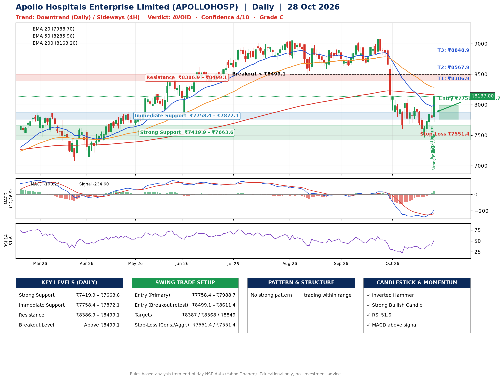

📌 **Apollo Hospitals Enterprise Limited (APOLLOHOSP) – Multi-Timeframe Technical Analysis (Daily + 4H Combined)**
_Data up to 28 Oct 2026 · Close ₹8137.00_

**📍 Daily Timeframe Trend**
- Trend: **Downtrend** (lower highs and lower lows)
- Recent swing highs: ₹9024.0, ₹9070.5, ₹8100.0 · swing lows: ₹8640.0, ₹8672.5, ₹7607.5
- EMAs: EMA20 ₹7988.7, EMA50 ₹8286.0, EMA200 ₹8163.2; mixed / crossing; price above EMA20
- MACD -190.23 above signal -234.60 (below zero), fresh bullish crossover; histogram rising
- RSI(14) 51.6; no divergence on the last two swings

**📍 4-Hour Timeframe Trend**
- Structure: **Sideways** (mixed swing structure)
- Pullback/support area: recent 4H swing lows ₹7688.0, ₹7468.0; EMA20 ₹7853.4
- EMA20/50: bearish stack (EMA20 < EMA50); price above EMA20, EMA50
- MACD -24.12 above signal -95.14 (below zero); histogram rising
- RSI(14) 61.2; Hidden bearish divergence

**📍 Pattern Detection (Both Timeframes)**
- 4H: **Double Bottom** – bottoms near ₹7688.0/₹7468.0, neckline ₹7965.0, confirmed (closed above neckline)

**📍 Candlestick Patterns (last 3 daily candles)**
- **Inverted Hammer** – 27 Oct: long upper wick shows selling near ₹7965.0
- **Strong Bullish Candle** – 28 Oct: wide-range green candle, buyers in control

**📍 Price Action Key Levels (Daily Structure)**

| Zone | Price Level (₹) | Context |
|------|-----------------|---------|
| Strong Support | ₹7419.9 – ₹7663.6 | Cluster of earlier swing lows (demand) |
| Immediate Support | ₹7758.4 – ₹7872.1 | Nearest swing-low / wick area |
| Resistance | ₹8386.9 – ₹8499.1 | Nearest swing-high supply |
| Breakout Level | Above ₹8499.1 | Swing continuation trigger (52-week high ₹9070.5) |

**📍 Swing Trade Setup**

🟢 **Entry Zone**
- Primary: ₹7758.4 – ₹7988.7 (daily support / EMA20 area; enter on a bullish 4H candle)
- Alternate: ₹8499.1 – ₹8611.4 (breakout retest)

🎯 **Profit Targets**
- T1: ₹8386.9
- T2: ₹8567.9
- T3: ₹8848.9

🛑 **Stop-Loss**
- Conservative: below daily swing low (₹7551.4)
- Aggressive: below 4H structure (₹7551.4)
- Risk per share ≈ ₹322.2; reward:risk to T1 ≈ 1.6

**📌 Strategy Notes**
- Higher timeframe: daily trend is downtrend; only take longs while price holds above ₹7419.9.
- Entry timing: wait for a bullish 4H candle (engulfing/hammer) inside ₹7758.4 – ₹7988.7 rather than buying mid-range.
- EMA stacking: mixed / crossing; price above EMA20.
- Breakout rule: a daily close above ₹8499.1 with volume above its 20-day average (≈740,469) opens T2/T3.
- Momentum: RSI 52 – room to run; no divergence on the last two swings.
- Exit discipline: move the stop to entry once T1 is hit; book partial profits at each target.

**STEP 2 — Marked Up Chart**

**✅ Trade Validation Checklist**
- Trend + momentum aligned: No · Price at entry zone: No
- Stop defined (₹7551.4) · Reward:risk ≥ 1.5 to T1: Yes

## 📌 Final Verdict

Recommendation: **🔴 AVOID**

Confidence: **4/10**

Trade Quality: **C**

Reason:
• Daily downtrend (lower highs and lower lows)

Next Action:
• Avoid until the trend changes (reclaim EMA50 and a higher low)

_Rules-based analysis from end-of-day data. Educational only, not investment advice. Never place orders without your own confirmation._