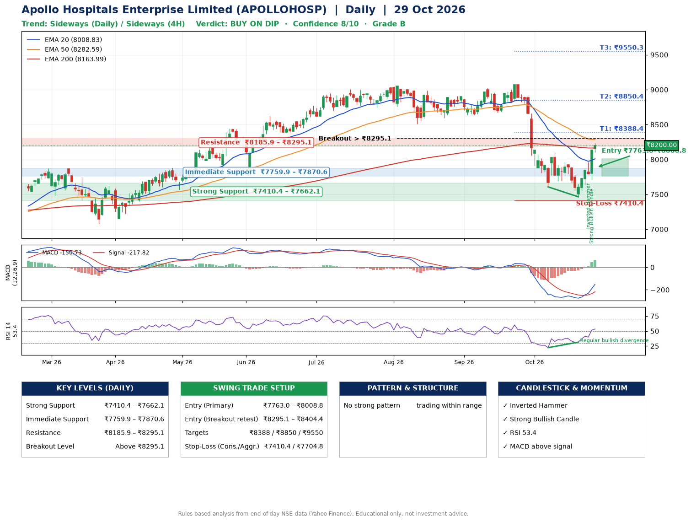

📌 **Apollo Hospitals Enterprise Limited (APOLLOHOSP) – Multi-Timeframe Technical Analysis (Daily + 4H Combined)**
_Data up to 29 Oct 2026 · Close ₹8200.00_

**📍 Daily Timeframe Trend**
- Trend: **Sideways** (mixed swing structure)
- Recent swing highs: ₹9024.0, ₹9070.5, ₹8100.0 · swing lows: ₹8672.5, ₹7607.5, ₹7465.0
- EMAs: EMA20 ₹8008.8, EMA50 ₹8282.6, EMA200 ₹8164.0; mixed / crossing; price above EMA20, EMA200
- MACD -150.73 above signal -217.82 (below zero), fresh bullish crossover; histogram rising
- RSI(14) 53.4; Regular bullish divergence

**📍 4-Hour Timeframe Trend**
- Structure: **Sideways** (mixed swing structure)
- Pullback/support area: recent 4H swing lows ₹7468.0, ₹7719.0; EMA20 ₹7911.8
- EMA20/50: bearish stack (EMA20 < EMA50); price above EMA20, EMA50
- MACD 24.45 above signal -55.87 (above zero); histogram rising
- RSI(14) 63.4; Hidden bearish divergence

**📍 Pattern Detection (Both Timeframes)**
- 4H: **Descending Triangle** – converging swing highs and lows over the last ~60 sessions

**📍 Candlestick Patterns (last 3 daily candles)**
- **Inverted Hammer** – 27 Oct: long upper wick shows selling near ₹7965.0
- **Strong Bullish Candle** – 28 Oct: wide-range green candle, buyers in control

**📍 Price Action Key Levels (Daily Structure)**

| Zone | Price Level (₹) | Context |
|------|-----------------|---------|
| Strong Support | ₹7410.4 – ₹7662.1 | Cluster of earlier swing lows (demand) |
| Immediate Support | ₹7759.9 – ₹7870.6 | Nearest swing-low / wick area |
| Resistance | ₹8185.9 – ₹8295.1 | Nearest swing-high supply |
| Breakout Level | Above ₹8295.1 | Swing continuation trigger (52-week high ₹9070.5) |

**📍 Swing Trade Setup**

🟢 **Entry Zone**
- Primary: ₹7763.0 – ₹8008.8 (daily support / EMA20 area; enter on a bullish 4H candle)
- Alternate: ₹8295.1 – ₹8404.4 (breakout retest)

🎯 **Profit Targets**
- T1: ₹8388.4
- T2: ₹8850.4
- T3: ₹9550.3

🛑 **Stop-Loss**
- Conservative: below daily swing low (₹7410.4)
- Aggressive: below 4H structure (₹7704.8)
- Risk per share ≈ ₹475.5; reward:risk to T1 ≈ 1.1

**📌 Strategy Notes**
- Higher timeframe: daily trend is sideways; only take longs while price holds above ₹7410.4.
- Entry timing: wait for a bullish 4H candle (engulfing/hammer) inside ₹7763.0 – ₹8008.8 rather than buying mid-range.
- EMA stacking: mixed / crossing; price above EMA20, EMA200.
- Breakout rule: a daily close above ₹8295.1 with volume above its 20-day average (≈739,185) opens T2/T3.
- Momentum: RSI 53 – room to run; Regular bullish divergence.
- Exit discipline: move the stop to entry once T1 is hit; book partial profits at each target.

**STEP 2 — Marked Up Chart**

**✅ Trade Validation Checklist**
- Trend + momentum aligned: No · Price at entry zone: No
- Stop defined (₹7410.4) · Reward:risk ≥ 1.5 to T1: No

## 📌 Final Verdict

Recommendation: **🟡 BUY ON DIP**

Confidence: **8/10**

Trade Quality: **B**

Reason:
• No strong edge from trend, momentum or patterns

Next Action:
• Wait for a pullback to ₹7763.0–₹8008.8, or a breakout above ₹8295.1

_Rules-based analysis from end-of-day data. Educational only, not investment advice. Never place orders without your own confirmation._