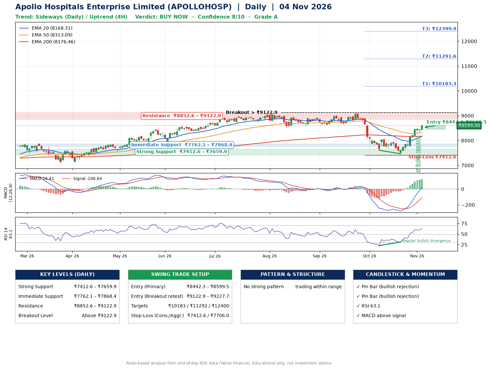

📌 **Apollo Hospitals Enterprise Limited (APOLLOHOSP) – Multi-Timeframe Technical Analysis (Daily + 4H Combined)**
_Data up to 04 Nov 2026 · Close ₹8599.50_

**📍 Daily Timeframe Trend**
- Trend: **Sideways** (mixed swing structure)
- Recent swing highs: ₹9024.0, ₹9070.5, ₹8100.0 · swing lows: ₹8672.5, ₹7607.5, ₹7465.0
- EMAs: EMA20 ₹8168.3, EMA50 ₹8313.1, EMA200 ₹8176.5; mixed / crossing; price above EMA20, EMA50, EMA200
- MACD 16.41 above signal -106.64 (above zero); histogram rising
- RSI(14) 63.1; Regular bullish divergence

**📍 4-Hour Timeframe Trend**
- Structure: **Uptrend** (price above rising EMAs)
- Pullback/support area: recent 4H swing lows ₹7468.0, ₹7719.0; EMA20 ₹8215.6
- EMA20/50: bullish stack (EMA20 > EMA50); price above EMA20, EMA50
- MACD 165.86 above signal 102.49 (above zero); histogram falling
- RSI(14) 71.6; Hidden bearish divergence

**📍 Pattern Detection (Both Timeframes)**
- 4H: **Descending Triangle** – converging swing highs and lows over the last ~60 sessions

**📍 Candlestick Patterns (last 3 daily candles)**
- **Pin Bar (bullish rejection)** – 02 Nov: long lower wick shows dip-buying near ₹8301.0
- **Pin Bar (bullish rejection)** – 03 Nov: long lower wick shows dip-buying near ₹8312.0

**📍 Price Action Key Levels (Daily Structure)**

| Zone | Price Level (₹) | Context |
|------|-----------------|---------|
| Strong Support | ₹7412.6 – ₹7659.9 | Cluster of earlier swing lows (demand) |
| Immediate Support | ₹7762.1 – ₹7868.4 | Nearest swing-low / wick area |
| Resistance | ₹8852.6 – ₹9122.9 | Nearest swing-high supply |
| Breakout Level | Above ₹9122.9 | Swing continuation trigger (52-week high ₹9070.5) |

**📍 Swing Trade Setup**

🟢 **Entry Zone**
- Primary: ₹8442.3 – ₹8599.5 (daily support / EMA20 area; enter on a bullish 4H candle)
- Alternate: ₹9122.9 – ₹9227.7 (breakout retest)

🎯 **Profit Targets**
- T1: ₹10183.3
- T2: ₹11291.6
- T3: ₹12399.9

🛑 **Stop-Loss**
- Conservative: below daily swing low (₹7412.6)
- Aggressive: below 4H structure (₹7706.0)
- Risk per share ≈ ₹1108.3; reward:risk to T1 ≈ 1.5

**📌 Strategy Notes**
- Higher timeframe: daily trend is sideways; only take longs while price holds above ₹7412.6.
- Entry timing: wait for a bullish 4H candle (engulfing/hammer) inside ₹8442.3 – ₹8599.5 rather than buying mid-range.
- EMA stacking: mixed / crossing; price above EMA20, EMA50, EMA200.
- Breakout rule: a daily close above ₹9122.9 with volume above its 20-day average (≈582,555) opens T2/T3.
- Momentum: RSI 63 – room to run; Regular bullish divergence.
- Exit discipline: move the stop to entry once T1 is hit; book partial profits at each target.

**STEP 2 — Marked Up Chart**

**✅ Trade Validation Checklist**
- Trend + momentum aligned: No · Price at entry zone: Yes
- Stop defined (₹7412.6) · Reward:risk ≥ 1.5 to T1: No

## 📌 Final Verdict

Recommendation: **🟢 BUY NOW**

Confidence: **8/10**

Trade Quality: **A**

Reason:
• No strong edge from trend, momentum or patterns

Next Action:
• Buy now within the entry zone, with the stop-loss in place

_Rules-based analysis from end-of-day data. Educational only, not investment advice. Never place orders without your own confirmation._