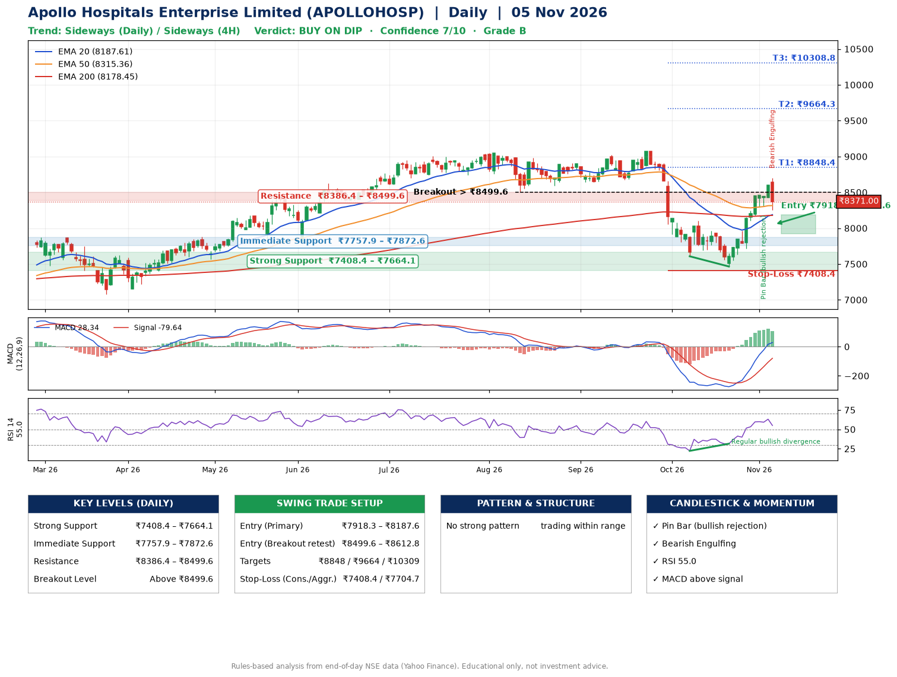

📌 **Apollo Hospitals Enterprise Limited (APOLLOHOSP) – Multi-Timeframe Technical Analysis (Daily + 4H Combined)**
_Data up to 05 Nov 2026 · Close ₹8371.00_

**📍 Daily Timeframe Trend**
- Trend: **Sideways** (mixed swing structure)
- Recent swing highs: ₹9024.0, ₹9070.5, ₹8100.0 · swing lows: ₹8672.5, ₹7607.5, ₹7465.0
- EMAs: EMA20 ₹8187.6, EMA50 ₹8315.4, EMA200 ₹8178.4; mixed / crossing; price above EMA20, EMA50, EMA200
- MACD 28.34 above signal -79.64 (above zero); histogram falling
- RSI(14) 55.0; Regular bullish divergence

**📍 4-Hour Timeframe Trend**
- Structure: **Sideways** (mixed swing structure)
- Pullback/support area: recent 4H swing lows ₹7468.0, ₹7719.0; EMA20 ₹8242.4
- EMA20/50: bullish stack (EMA20 > EMA50); price above EMA20, EMA50
- MACD 146.16 above signal 119.66 (above zero); histogram falling
- RSI(14) 58.2; Hidden bearish divergence

**📍 Pattern Detection (Both Timeframes)**
- 4H: **Descending Triangle** – converging swing highs and lows over the last ~60 sessions

**📍 Candlestick Patterns (last 3 daily candles)**
- **Pin Bar (bullish rejection)** – 03 Nov: long lower wick shows dip-buying near ₹8312.0
- **Bearish Engulfing** – 05 Nov: sellers fully reversed the prior green candle

**📍 Price Action Key Levels (Daily Structure)**

| Zone | Price Level (₹) | Context |
|------|-----------------|---------|
| Strong Support | ₹7408.4 – ₹7664.1 | Cluster of earlier swing lows (demand) |
| Immediate Support | ₹7757.9 – ₹7872.6 | Nearest swing-low / wick area |
| Resistance | ₹8386.4 – ₹8499.6 | Nearest swing-high supply |
| Breakout Level | Above ₹8499.6 | Swing continuation trigger (52-week high ₹9070.5) |

**📍 Swing Trade Setup**

🟢 **Entry Zone**
- Primary: ₹7918.3 – ₹8187.6 (daily support / EMA20 area; enter on a bullish 4H candle)
- Alternate: ₹8499.6 – ₹8612.8 (breakout retest)

🎯 **Profit Targets**
- T1: ₹8848.4
- T2: ₹9664.3
- T3: ₹10308.8

🛑 **Stop-Loss**
- Conservative: below daily swing low (₹7408.4)
- Aggressive: below 4H structure (₹7704.7)
- Risk per share ≈ ₹644.5; reward:risk to T1 ≈ 1.2

**📌 Strategy Notes**
- Higher timeframe: daily trend is sideways; only take longs while price holds above ₹7408.4.
- Entry timing: wait for a bullish 4H candle (engulfing/hammer) inside ₹7918.3 – ₹8187.6 rather than buying mid-range.
- EMA stacking: mixed / crossing; price above EMA20, EMA50, EMA200.
- Breakout rule: a daily close above ₹8499.6 with volume above its 20-day average (≈620,840) opens T2/T3.
- Momentum: RSI 55 – room to run; Regular bullish divergence.
- Exit discipline: move the stop to entry once T1 is hit; book partial profits at each target.

**STEP 2 — Marked Up Chart**

**✅ Trade Validation Checklist**
- Trend + momentum aligned: No · Price at entry zone: No
- Stop defined (₹7408.4) · Reward:risk ≥ 1.5 to T1: No

## 📌 Final Verdict

Recommendation: **🟡 BUY ON DIP**

Confidence: **7/10**

Trade Quality: **B**

Reason:
• No strong edge from trend, momentum or patterns

Next Action:
• Wait for a pullback to ₹7918.3–₹8187.6, or a breakout above ₹8499.6

_Rules-based analysis from end-of-day data. Educational only, not investment advice. Never place orders without your own confirmation._