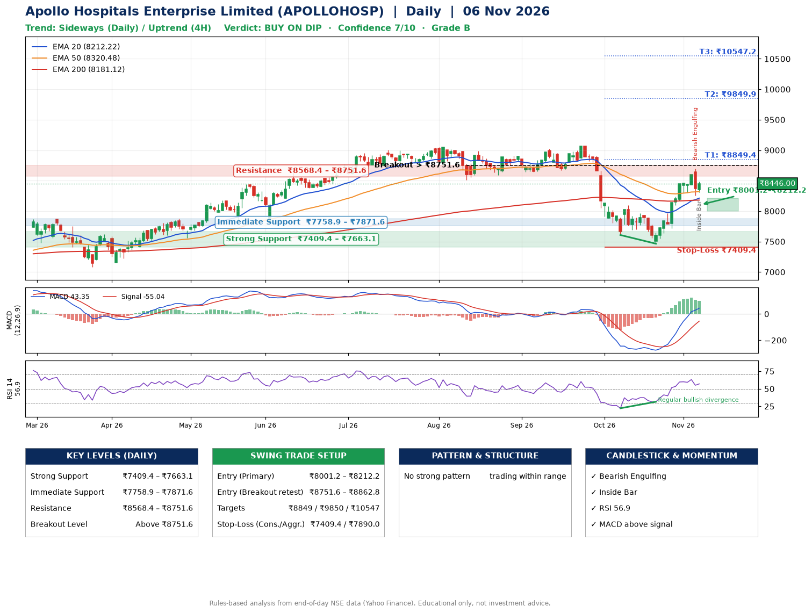

📌 **Apollo Hospitals Enterprise Limited (APOLLOHOSP) – Multi-Timeframe Technical Analysis (Daily + 4H Combined)**
_Data up to 06 Nov 2026 · Close ₹8446.00_

**📍 Daily Timeframe Trend**
- Trend: **Sideways** (mixed swing structure)
- Recent swing highs: ₹9024.0, ₹9070.5, ₹8100.0 · swing lows: ₹8672.5, ₹7607.5, ₹7465.0
- EMAs: EMA20 ₹8212.2, EMA50 ₹8320.5, EMA200 ₹8181.1; mixed / crossing; price above EMA20, EMA50, EMA200
- MACD 43.35 above signal -55.04 (above zero); histogram falling
- RSI(14) 56.9; Regular bullish divergence

**📍 4-Hour Timeframe Trend**
- Structure: **Uptrend** (higher highs and higher lows)
- Pullback/support area: recent 4H swing lows ₹7719.0, ₹8255.5; EMA20 ₹8276.8
- EMA20/50: bullish stack (EMA20 > EMA50); price above EMA20, EMA50
- MACD 137.94 above signal 126.78 (above zero); histogram falling
- RSI(14) 61.0; Hidden bullish divergence

**📍 Pattern Detection (Both Timeframes)**
- No strong pattern detected. Trading within range.

**📍 Candlestick Patterns (last 3 daily candles)**
- **Bearish Engulfing** – 05 Nov: sellers fully reversed the prior green candle
- **Inside Bar** – 06 Nov: compression inside the prior range ₹8252.0–₹8696.0

**📍 Price Action Key Levels (Daily Structure)**

| Zone | Price Level (₹) | Context |
|------|-----------------|---------|
| Strong Support | ₹7409.4 – ₹7663.1 | Cluster of earlier swing lows (demand) |
| Immediate Support | ₹7758.9 – ₹7871.6 | Nearest swing-low / wick area |
| Resistance | ₹8568.4 – ₹8751.6 | Nearest swing-high supply |
| Breakout Level | Above ₹8751.6 | Swing continuation trigger (52-week high ₹9070.5) |

**📍 Swing Trade Setup**

🟢 **Entry Zone**
- Primary: ₹8001.2 – ₹8212.2 (daily support / EMA20 area; enter on a bullish 4H candle)
- Alternate: ₹8751.6 – ₹8862.8 (breakout retest)

🎯 **Profit Targets**
- T1: ₹8849.4
- T2: ₹9849.9
- T3: ₹10547.2

🛑 **Stop-Loss**
- Conservative: below daily swing low (₹7409.4)
- Aggressive: below 4H structure (₹7890.0)
- Risk per share ≈ ₹697.3; reward:risk to T1 ≈ 1.1

**📌 Strategy Notes**
- Higher timeframe: daily trend is sideways; only take longs while price holds above ₹7409.4.
- Entry timing: wait for a bullish 4H candle (engulfing/hammer) inside ₹8001.2 – ₹8212.2 rather than buying mid-range.
- EMA stacking: mixed / crossing; price above EMA20, EMA50, EMA200.
- Breakout rule: a daily close above ₹8751.6 with volume above its 20-day average (≈595,560) opens T2/T3.
- Momentum: RSI 57 – room to run; Regular bullish divergence.
- Exit discipline: move the stop to entry once T1 is hit; book partial profits at each target.

**STEP 2 — Marked Up Chart**

**✅ Trade Validation Checklist**
- Trend + momentum aligned: No · Price at entry zone: No
- Stop defined (₹7409.4) · Reward:risk ≥ 1.5 to T1: No

## 📌 Final Verdict

Recommendation: **🟡 BUY ON DIP**

Confidence: **7/10**

Trade Quality: **B**

Reason:
• No strong edge from trend, momentum or patterns

Next Action:
• Wait for a pullback to ₹8001.2–₹8212.2, or a breakout above ₹8751.6

_Rules-based analysis from end-of-day data. Educational only, not investment advice. Never place orders without your own confirmation._